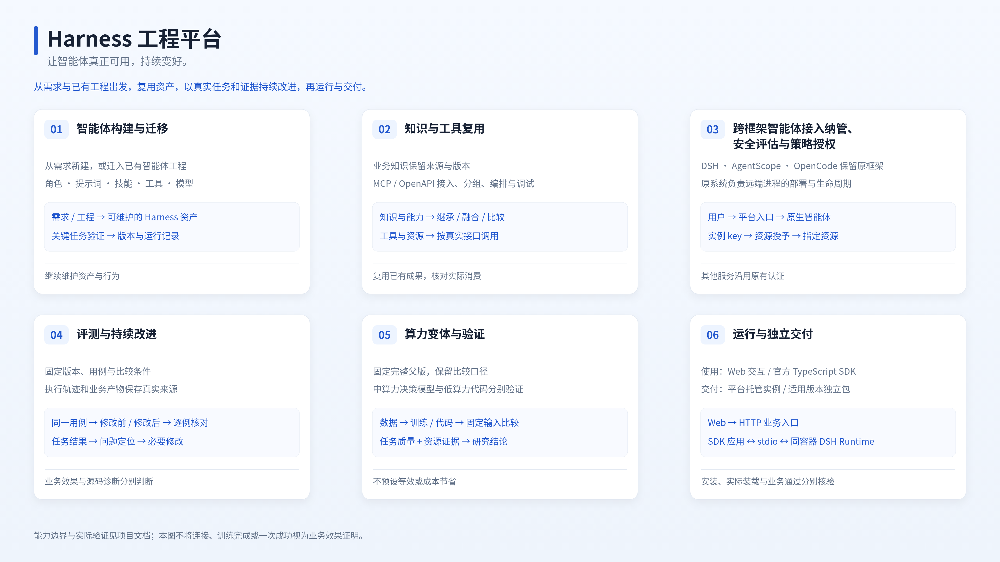

# harness-engineering-platform

让智能体真正可用，持续变好。

Harness 工程平台（Harness Engineering Platform，简称 HEP）面向个人开发者和内部使用：通过管理助手构建或迁入智能体，复用知识和工具，用固定业务用例检验修改，再运行或独立交付适用版本。已有 DSH、AgentScope、OpenCode 实例也可保留原框架，接入平台并按资源授权访问。

项目面向个人开发者，以平台建设和实际使用需求为主线。平台通过系统全局 DSH 装载 Cordis 插件，复用已有 CLI；程序保存在本仓库，用户资产和运行状态保存在独立数据工作区（默认 `~/harness-engineering-platform-data`）；业务智能体由独立的 DSH 容器实例执行。项目定位、开发边界和协作原则以 [`AGENTS.md`](./AGENTS.md) 为准。

程序仓库为 [wr5912/harness-engineering-platform](https://github.com/wr5912/harness-engineering-platform)，配套数据仓库为 [wr5912/harness-engineering-platform-data](https://github.com/wr5912/harness-engineering-platform-data)。已有部署可以继续使用原本地程序目录，数据根、插件包名和标准镜像名不随仓库更名而改变。

[快速开始](#快速启动) · [接入已有智能体](docs/platform-design/27_跨框架接入使用说明.md#登记与访问) · [独立部署智能体](docs/platform-design/23_离线一键打包与安装.md#单智能体独立运行包) · [查看验证结果](./docs/ai-agent-harness项目验收矩阵.md)

## 当前能力

| 能力 | 用途与边界 |
|---|---|
| 智能体构建与迁移 | 从需求新建，或将已有工程迁入为可维护的 Harness 资产，用关键任务验证行为。 |
| 知识与工具复用 | 知识保留来源，能力按版本继承或融合；通过 MCP 与 OpenAPI 接入、组合和调试工具。 |
| 跨框架智能体接入纳管、安全评估与策略授权 | 已有实例保留原 Runtime；平台管理访问入口和指定资源权限，原系统负责远端进程。 |
| 评测与持续改进 | 固定版本和用例逐例比较，区分业务效果与源码诊断，历史运行保留当时口径。 |
| 算力变体与验证 | 中算力可训练决策模型，低算力尝试代码执行；比较任务质量与资源证据，不预设等效或节省成本。 |
| 运行与独立交付 | 通过 Web 或官方 TypeScript SDK 使用；按需运行平台托管实例，或导出符合打包条件的独立运行包。 |



[查看4K全景图](docs/assets/capabilities/overview-4k.png) · [可编辑 SVG](docs/assets/capabilities/overview.svg)。PNG由SVG导出；能力名称与展示规格由[前端设计规范](docs/platform-design/26_前端设计规范与原则.md#56-登录页特性轮播)维护。

当前实现、证据和缺口见[项目验收矩阵](docs/ai-agent-harness项目验收矩阵.md)。Preset 的 Web 创建、回流与选择尚未闭环（PA-09），`release:<id>` 来源解析与装载尚未实现（PA-11）；MCP 的 dry 和工具发现不能替代真实业务验证。

## 快速启动

准备 Node.js 24、pnpm、与[插件兼容声明](platform/plugin/package.json)匹配的系统全局 DSH，以及 Python 3.10 及以上版本和 PyYAML。业务实例另需 Docker 和匹配的标准 Runtime 镜像；目标架构与依赖准备见[源码主机部署](docs/platform-design/23_离线一键打包与安装.md#源码主机部署)。

```bash
git clone https://github.com/wr5912/harness-engineering-platform.git
cd harness-engineering-platform
./platform/dsh-platform start
```

需要从零建立可复现的四仓库工作区时，使用 Bootstrap 入口；它会按数据仓库锁定文件下载平台、数据、DSH Home 和业务智能体仓库：

```bash
./platform/hep-lab bootstrap --destination "$HOME/hep-lab"
# 或直接使用独立入口
./platform/hep-lab-bootstrap.sh --destination "$HOME/hep-lab"
```

打开终端给出的 `/hep/` 地址，按首次引导连接、克隆配套数据仓库或创建空白工作区。默认端口 `18120`；已有部署保留账号和配置。私有仓库使用主机已有 Git 认证；日志只记录初始化入口文件位置，不输出访问凭据。PyYAML 缺失时可先进入初始化页，平台准备阶段会提示补齐。

登录账号保存在数据根 `.local/credentials/admin.json`；修改后重启生效，旧登录会话失效。查询和编辑不需要模型密钥；使用管理对话前，在“设置 → 模型”配置模型。平台 HOME 和 Session 位于数据根 `.local/platform-home/`，启动和准备会保留；`.local/` 不入 Git，新主机须恢复必要状态或重新配置。完整条件见[平台接入合同](docs/platform-design/02_系统架构与部署设计.md#当前最小平台接入合同)。

使用配套数据后，在评测中心查看安全运营专家的 `U-INS-001` 与历史 Run：当前用例和运行时冻结预期分别显示，无需发起模型请求。空白工作区没有历史样例，可先连接配套数据。

```bash
./platform/dsh-platform status
./platform/dsh-platform start --dry-run
./platform/dsh-platform stop
```

Linux 主机可用同一个入口设置用户级自启动，AMD64 与 ARM64 使用相同的 systemd 文本单元：

```bash
HARNESS_ASSET_ROOT=~/harness-engineering-platform-data ./platform/dsh-platform autostart enable
HARNESS_ASSET_ROOT=~/harness-engineering-platform-data ./platform/dsh-platform autostart status
HARNESS_ASSET_ROOT=~/harness-engineering-platform-data ./platform/dsh-platform autostart disable
```

启用会固定当前程序根和 `HARNESS_ASSET_ROOT`，并启用用户驻留；不会重启当前平台。使用离线安装包的一键运行命令 `./install.sh --start` 时，安装器会在平台启动成功后自动执行同一自启动配置。主机仍需具备对应架构的 Node.js、Python、DSH 和其他运行依赖。自启动单元由 `~/.config/systemd/user/harness-engineering-platform.service` 管理。

源码更新使用 `./platform/dsh-deploy update --dry-run` 核对来源、制品与在途任务，再执行 `update`。生命周期、监听地址、打包安装和恢复见[部署说明](docs/platform-design/23_离线一键打包与安装.md)。

## 按任务查找

| 任务 | 入口 |
|---|---|
| 描述需求、构建、评测或改进智能体 | 首页或管理对话；[任务交付](docs/platform-design/17_任务型智能体交付与验收.md) |
| 接入已有框架的运行实例 | 实例管理 → 接入实例；[登记与访问](docs/platform-design/27_跨框架接入使用说明.md#登记与访问) |
| 启动或评测 DSH 业务实例 | [容器适配器说明](runtime/adapters/dsh-container/README.md) |
| 接入 MCP、维护工具分组或组合编排 | MCP 管理；[平台设计入口](docs/platform-design/README.md) |
| 交付单个业务智能体 | 版本 → 更多操作 → 导出独立运行包；[使用说明](docs/platform-design/23_离线一键打包与安装.md#单智能体独立运行包) |
| 配置统一网关 | `/hep/#/gateway`；[首期范围](docs/platform-design/05_实施路线与迭代计划.md#首期定时任务边界与影响)、[验收边界](docs/platform-design/21_统一网关与MCP控制实施验收.md) |
| 检查数据工作区 | [确定性合同检查](runtime/research/validate_repository.py)；管理助手可按指定范围体检、预览整理与恢复 |

## 开发与资料入口

程序、通用工具和研发 Skill 在本仓库；管理助手 Skill、业务资产及运行状态在独立[数据仓库](https://github.com/wr5912/harness-engineering-platform-data)，默认 `~/harness-engineering-platform-data`。平台从自身位置定位程序，从 `HARNESS_ASSET_ROOT` 定位数据，不能靠启动目录切换来源。业务用例只维护在各 Agent 的 `evaluation.md`，历史 Run 保留冻结口径。

- [AGENTS.md](AGENTS.md)：研发协作与双仓边界。
- [平台设计](docs/platform-design/README.md)：当前合同及待实现设计。
- [项目验收矩阵](docs/ai-agent-harness项目验收矩阵.md)：能力验证与缺口。
- [规范来源](docs/standards/SOURCES.md)与[项目解释](docs/standards/PROJECT-INTERPRETATION.md)：采用范围。
- [项目审查原则](docs/项目审查原则.md)：审查方法。

项目与工具链检查、Experiment Evaluation、Research Release 复现分别取证，均不替代生产验收。
