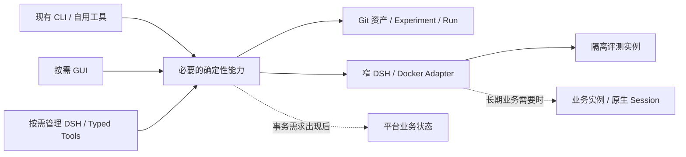
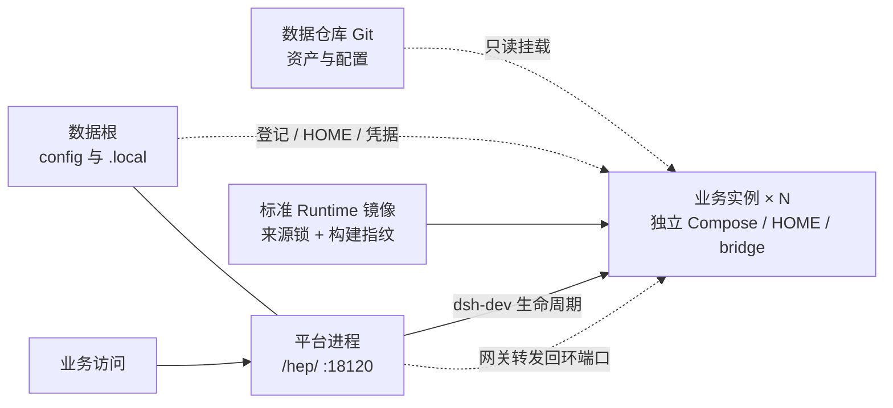
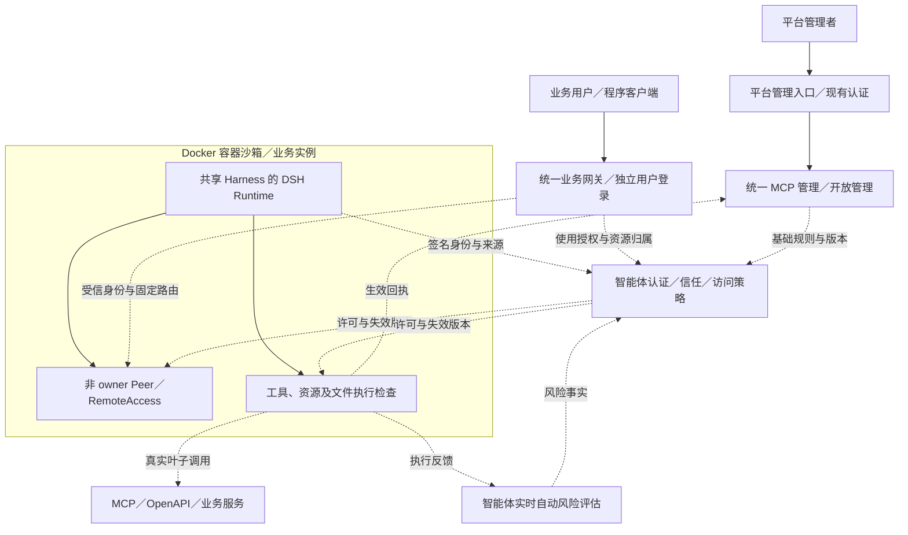

# 02｜系统架构、部署与 DSH 接入设计

## 1. 当前入口与未来形态

当前平台复用 Git 资产、Experiment、Run、`dsh-dev`、`dsh-eval` 和系统全局 DSH 的插件界面，在交付功能的同时支持 Harness 研究。启动与装载合同见[当前最小平台接入合同](#当前最小平台接入合同)。哪些合同已经验证、哪些仍有限制，以[项目验收矩阵](../ai-agent-harness项目验收矩阵.md)为准。除当前接入合同外，本章的后续形态属于设计方向，不表示已经部署。



这些是逻辑责任，允许同一进程和少量函数承载。阶段与进入条件只在 [05](05_实施路线与迭代计划.md)维护，数据写权只在 [03](03_存储架构与数据契约.md)维护。

## 2. 最小责任边界

| 能力 | 责任 | 引入条件 |
|---|---|---|
| Asset/Evaluation | 解析固定来源，定位唯一 Case/Candidate，调用评测并读取冻结 Run | 先复用现有 CLI；第二消费者确实出现才提取公共能力 |
| Instance Adapter | 核对来源、镜像、只读挂载、独立 HOME 和实际观察 | 研究实例先满足当前合同；长期写操作另有真实需求 |
| Operation | 将已确认目标、执行结果和 unknown 对账关联起来 | GUI/Meta 等入口确需共享持久操作状态 |
| Session Binding/Invocation | 将业务请求定位到正确的 Runtime、Session 与 Turn | 真实长期业务会话出现 |
| Meta-Harness | 解释证据、准备计划，通过确定性服务执行 | 自然语言管理实测有益；不是首个工具的前置条件 |
| MCP Composer/Gateway | 执行开发者维护的业务组合定义，暴露实际可发现、可调用的 MCP 工具 | 按 [05 的组合路线](05_实施路线与迭代计划.md#mcp-composition-route)验证执行、发布与只读展示；职责不要求拆成独立服务 |

CLI、GUI、Meta 只适配输入与展示；同一业务写入调用同一实现。业务 Agent loop、SessionPersistence 和模型执行由 DSH 承担，不在仓库再复制 Runtime 内核。

## 3. 实例与镜像

同一业务 Agent 维护一个当前标准 DSH Runtime 镜像，新实例共享它。Prompt、Preset、Plugin 及可挂载依赖作为只读 Harness 资产加载；只有锁定 Runtime 改变或当前镜像与来源不一致时才重建标准镜像。

评测、管理和业务实例使用独立 HOME、Profile、运行配置与持久卷。删除容器不等于删除 HOME；旧实例的冻结来源不能随 dirty Candidate 漂移。容器 running、HTTP 200 和挂载存在分别只证明局部状态，实际装载和任务行为要用新进程或新 Session 核验。独立 HOME 隔离实例，不自动证明共享实例内的用户归属隔离，见 [04](04_核心业务闭环与服务接口.md#多用户数据边界与选型门槛)。

若启用容器管理，Docker Socket 仅由窄执行器接触，Meta 不取得自由 Docker/SQL 客户端或凭据值。凭据文件及 Git 边界遵循[根级规则](../../AGENTS.md)，不得进入模型上下文、普通日志或研究证据。

<a id="packaging-deployment"></a>
### 3.1 制品分层与分发

单机多实例不合并成一个整体制品，按以下四层分别维护，各层的改动和分发互不替代：

| 层 | 内容 | 打包与分发 | 边界 |
|---|---|---|---|
| DSH Runtime 标准镜像 | 锁定 DSH 源码、Node 底座、Chromium、Python 等运行依赖 | 按 [`source.lock.json`](../../runtime/adapters/dsh-container/source.lock.json) 在目标架构构建一次；标签包含提交、架构和构建指纹；所有实例共享 | 不含 Harness 资产、业务数据或凭据；不为 Agent 或 Harness 版本派生镜像 |
| 平台程序 | `platform/`、`runtime/adapters/`、`plugins/` 等源码，以及 `prepare` 生成的插件和 Web 适配器产物 | Git checkout 后在目标机执行 `prepare`；`lib/` 是生成物，不入库 | 不以容器分发；依赖系统全局 DSH，版本须匹配 [`peerDependencies`](../../platform/plugin/package.json) |
| 业务资产与配置 | 数据仓库的 `agents/`、`evolution/`、`extensions/` 和数据根 `config/` | Git 版本化；只读挂载进实例（业务实例挂载数据根，评测实例挂载所选来源资产） | 不复制进程序包或镜像；可编辑来源仍在数据仓库和数据根 |
| 运行状态与凭据 | 平台 HOME、实例登记、Compose、Patch、实例 HOME、制品、凭据 | 数据根 `.local/` 本地状态，按需备份 | 不打包、不进镜像或日志；凭据单独恢复 |

需要作为镜像制品分发的只有 Runtime 镜像；平台程序和数据资产通过 Git 获取。需要离线交付时，可用 [`platform/dsh-deploy`](../../platform/dsh-deploy) 生成安装包：包内包含源码、依赖、Node/pnpm/DSH/Git 离线资源、标准镜像和可选完整数据根快照，安装器运行 `prepare --offline`；包格式、敏感数据和路径映射见 [23](23_离线一键打包与安装.md)。普通开发仍使用源码 checkout 加 `prepare`，离线包不构成生产发布验收。平台的可重复性由程序提交、来源锁和依赖锁保证；实例的可重复性由登记中的来源、镜像 ID、构建指纹和工作区身份保证。镜像身份、构建命令与装载核对只在[容器适配器说明](../../runtime/adapters/dsh-container/README.md#源码与镜像身份)维护，本节不复制。

### 3.2 单机部署拓扑与边界

一台主机承载一套平台及其业务实例：



平台使用系统全局 DSH 和数据根中的平台 HOME，监听 `18120`。业务实例各自使用一个 Compose 项目、独立 bridge 网络和 `127.0.0.1:<port>` 端口映射，由平台统一网关转发。评测实例沿用既有 host 网络和研究访问方式，不并入业务入口。

平台与业务实例必须在同一台主机：实例登记与生命周期操作读取本地 Docker，网关目标是从登记解析出的回环端口。不同主机各自使用独立的平台与实例登记；需要跨主机集中编排时按[部署扩展条件](#deployment-extension-conditions)另行设计。

程序根和数据根的绝对路径会写入实例 Compose（插件目录、资产根、实例 HOME、站点配置和共享密钥）。升级应在原路径更新程序，不能移动运行中实例依赖的目录；迁移后必须按新路径重新渲染并重建实例，旧路径的容器不能继续视为当前实例。

### 3.3 实例编排契约

- 一实例一 Compose 项目，项目名 `dsh-dev-<实例名>`，容器名与实例名一致；配置由 [`dsh-dev`](../../runtime/adapters/dsh-container/dsh-dev) 从 [Compose 模板](../../runtime/adapters/dsh-container/verification.compose.yaml) 渲染，业务实例再由 [`business.ts`](../../runtime/adapters/dsh-container/business.ts) 补齐 bridge 网络、回环端口和只读挂载，不手写每实例 Compose。
- 端口：新实例在 `18500–28999` 内按登记和实际占用分配；同名实例固定使用记录端口；业务实例只绑定回环地址。
- HOME：新实例绑定数据根 `.local/instances/<实例名>/dsh-home`；旧登记可能仍使用命名卷，迁移须显式执行。删除容器或登记不等于删除 HOME。
- 网络与依赖：每实例一个独立 bridge 网络；插件依赖 fallback 卷按镜像构建指纹区分，镜像升级后旧卷不再被使用，可在确认后回收。
- 生命周期：同名实例操作串行，批量操作逐项返回回执；批量启动建议并发 2–4 个（规划值，未实测），避免同时冷启动造成资源峰值。
- 数量约定：每个 Agent 常驻一个业务实例；评测实例短生命周期，完成后停止或删除；旧版本实例停止并保留 HOME，不为每个 Candidate 长期运行实例；实例名不要跨用途或来源复用，删除后同名重建会沿用原 HOME。
- 删除只处理已停止容器与登记，保留 HOME；HOME 回收须人工确认，不得以清理磁盘为由批量删除。

### 3.4 升级、回滚与版本一致性

以下三处版本在升级时必须成组核对：系统全局 DSH 版本（由插件 `peerDependencies` 声明）、[`source.lock.json`](../../runtime/adapters/dsh-container/source.lock.json) 对应的镜像提交与构建指纹、平台程序 Git 提交。

Runtime 升级按“改锁 → 构建新镜像 → 核对镜像 ID、架构与构建指纹 → 平台 `prepare` → 逐实例重建并保留 HOME 与端口 → 新 Session 核对”执行。回滚恢复程序提交和来源锁，确认旧镜像仍在本机或按旧锁重建，再逐实例重建；不跨架构搬运镜像。

业务实例只读挂载平台插件目录，`prepare` 后须重启实例才加载新的运行时插件。平台与实例应成对升级，不长期保留版本不一致的混用状态。来源或 Candidate 变化使用新实例名和新 HOME，不热切换既有实例；旧实例的 Session 和历史继续留在原 HOME。

### 3.5 容量基线与资源清理

以下数字是 2026-10-22 在 64 核、125GB 内存、1TB 磁盘的 AMD64 开发主机上的观测，不是容量承诺：

- Docker 镜像合计 55.67GB（包含其他项目），其中约 50.66GB 可回收，主要是多个约 4.7GB 的 DSH 版本；Docker 构建缓存 41.63GB；Docker 卷合计 10.69GB、136 个（包含其他项目）。
- 观测时两个运行中的 DSH 实例常驻内存约 0.48GB 和 0.49GB，评测驱动容器约 0.12GB；模型调用、长会话和浏览器任务会提高峰值。
- 端口池 `18500–28999` 共 10500 个；按当前宿主的 Docker 地址池配置约可提供 288 个 bridge 子网，并与其他 Docker 项目共享，更换宿主后须重新核对。
- 标准镜像每个版本约 4.7GB；实例 HOME 初始很小，会随 Session、附件和缓存增长。

规划实例数时取内存、端口、网络和磁盘预算的最小值，并为平台、镜像构建、模型调用和突发启动保留余量。批量启动按 3.3 的并发建议执行。清理遵循以下边界：DSH 镜像保留当前与上一版本；其他 Docker 项目的镜像、卷和缓存不纳入本平台清理范围；只清理无容器使用的 DSH 镜像、构建缓存和已确认删除实例的 fallback 卷；不自动清理活跃卷、实例 HOME 或运行中容器。容量探测尚未执行，实际上限须由目标主机实测确定。

### 3.6 备份、恢复与迁移

需要备份的是数据仓库 Git，以及数据根 `.local/` 中的平台 HOME、实例登记、Compose、Patch、实例 HOME、凭据和制品；`.local/build-cache/` 可重新生成，不作为恢复前提。容器、fallback 卷和镜像不属于备份内容。

恢复顺序为：克隆或恢复程序 → `prepare` → 恢复数据根 → 按来源锁构建镜像 → 恢复实例登记 → 逐实例启动并沿用原 HOME 与端口 → 新 Session 核对来源、镜像和挂载。路径或主机变化后须重新渲染实例配置；镜像必须在目标架构重建，不迁移其他架构的本地镜像、构建缓存或依赖目录。完整备份位置和恢复点边界见[独立数据工作区合同](#独立数据工作区)。离线包的完整数据根快照、跨用户路径映射和未验证项见 [23](23_离线一键打包与安装.md)；上述恢复顺序是当前设计路径，完整恢复与迁移演练尚未执行，实际限制以操作结果为准。

### 3.7 明确不做与触发条件

当前不做平台容器化、Kubernetes、调度器、自动扩缩容、跨主机集中管理、镜像内打包 Harness 或凭据、为 Agent 或 Harness 版本派生镜像，以及无确认的自动清理。这些方案各自引入 Docker Socket、宿主路径、回环网关代理、跨主机登记或额外基础设施，当前没有对应需求与故障、容量证据。

出现真实跨主机、离线分发、团队共享或多租户需求时，按[部署扩展条件](#deployment-extension-conditions)和[实施路线](05_实施路线与迭代计划.md)重新设计，并先补容量和故障边界证据；不因本节存在而提前实现。

## 4. Profile、Preset 与开发身份

优先复用 DSH 的 Cordis、Profile、Preset、bundle、插件和适配器机制。显示它们的声明来源、覆盖关系、作用范围及实际装载；保存配置不表示插件已生效。Profile 改动可能影响共用它的其他 Session，应在明确 Candidate 和隔离环境中验证。`dispose` 或重启不能撤销已发生的外部副作用。

开发工具的身份与目标业务 Harness 分开。读取业务 `AGENTS.md` 是为了编辑资产；不能由此切换开发身份或覆盖业务指令。任务内选择已装载工具或知识源属于一次运行；Prompt、Preset、Skill、插件配置或适配器发生语义变化时才按研究合同创建 Experiment。管理或评审 Harness 自身发生变化，也要保留其来源。

## 5. 技术接入与语言迁移

首个工具复用现有 Python/Shell CLI、来源解析和 Run 记录。窄 Client 调用应核对工作目录、参数、结构化 stdout、诊断 stderr、退出码、超时和取消结果；进程启动、HTTP 受理或页面返回不能代替操作完成。`dry-run` 不应执行所预览的副作用。

新增自研功能使用 TypeScript，界面使用 TSX；按 DSH 装载方式生成 JavaScript/ESM，生成物不成为第二份可编辑源码。现有 Python 只在实际变更调用链中按功能切片迁移，保留 CLI、资产与 Run 语义，用受影响 Case、新 Session、构建和装载证据验证后替换。不将全仓语言重写作为工具启动条件。

管理界面可以由特化 DSH Profile/插件承载，调用同一确定性服务。只有现有扩展接口经原型证明不足，才考虑有记录、可回退的最小 Runtime 修改。一元 Remote 调用不能证明流式会话、取消和重连已经可用，这些要按锁定版本分别探测。

## 6. 复用已有 MCP 资产

[EXP-014](https://github.com/wr5912/harness-engineering-platform-data/blob/9afc8fd0047367deb9df5b51595f101835359044/evolution/experiments/EXP-security-operations-expert-014-r8b1bd54e8be7/hypothesis.md)是已有单实例 MCP 管理资产的来源入口，实际结论须回到该实验的 Evaluation/Decision 核查。其接入边界应在新工具中延续：OpenAPI 规范地址用于生成 tools/resources；现成 MCP 服务使用 URL 和请求 Header；Web profile patch 是实例在线工作态，Candidate 种子用于新卷恢复。

未来跨实例管理读取现有 Candidate 与实际 profile，展示差异、实际版本和验证时间，通过已有插件修改；不维护另一套重叠的可编辑 MCP 清单。分组链接是配置的衍生结果。统一 Token 留在实例专用配置，不回流 Candidate 种子或模型上下文。跨实例目录、状态库和操作边界由实际用户故事决定。

<a id="deployment-extension-conditions"></a>
## 7. 部署扩展条件

研究模式继续保留平台管理与实例直连；新增业务 Profile 的统一网关和共享 Runtime 用户隔离按[业务访问架构](#business-access-architecture)演进，不能再把这两项视为尚无需求。统一入口必须验证服务端身份、Agent 与来源路由、流转发、取消、重连和 Session 粘性；浏览器 owner Token 不能代替业务用户身份。平台管理入口的认证保持原职责。

多宿主、队列、专用检索和独立服务均需现实容量或故障边界证据。不存在消费者时不预建接口和目录。

<a id="business-access-architecture"></a>
## 8. 业务访问、容器与 MCP 运行控制

本节定义本轮即时任务的责任边界；业务 Profile 与既有研究实例分别运行，不据代码存在宣称全部路径已验收。原生接入基线为 DSH `v0.2.1-rc.2`；实际升级结果见验收矩阵。当前访问按钮和 iframe 使用实例实际 URL，新业务网关建成并验收前继续标明现状。



### 8.1 业务网关

网关是平台提供的 DSH 插件服务，使用独立业务监听、认证状态与浏览器来源；不接管平台管理认证。复用 Cordis 服务与隔离作用域，采用 `httpxy` 转发 HTTP/WS，真实转发、撤权与恢复分别按证据核验。确需外置 TLS 终止时再接入现成代理，不为首期增加另一套业务权限来源。

业务网关的监听地址、公开来源与共享密钥路径来自数据工作区 `config/business-access.json`。共享密钥路径相对数据根解析，属于本地状态：缺失时由平台在首次启动生成 48 字节、`0600` 的本地文件，已有文件不覆盖；业务容器按同一解析结果只读挂载。监听地址与公开来源是部署环境事实，迁移数据工作区时按本机地址更新，不沿用旧机器的绝对路径或地址。

通过门户反向代理接入时，在同一配置的 `gateway.proxyOrigin` 登记门户的 HTTP(S) origin；代理保留实例路径并传递匹配的 `Host` 与 `X-Forwarded-Proto`，允许 `Host` 省略端口。网关校验浏览器 `Origin` 并按登记值重建上游来源，原 `publicOrigin` 直连入口继续可用；修改来源后重启平台。

网关依次落实两个独立条件：Agent 已获准纳入开放目录；当前可信主体获准使用该 Agent。目录只引用现有 Agent、来源和受管实例，后端地址从实例登记解析，不接受客户端任意上游 URL。撤销开放立即阻止新请求，并按合同处理已有连接。开放资格、HarnessVersion 发布和 Research Release 分别维护。

页面、新标签、iframe、HTTP、WebSocket、事件流、附件、产物与下载使用同一业务入口。业务浏览器来源与管理来源分开，实例的公开前缀为 `/agents/<agent-id>/instances/<instance-id>/`，由共享 Web 适配器负责原生挂载；Agent 与实例都须从服务端登记核对。`/agents/<agent-id>/` 只提供经授权的实例选择，不代用户选取第一台实例，也不把同一 Agent 的不同版本或 HOME 合并。认证 Cookie 不以端口作为隔离边界，Cookie Path 也不能代替权限检查。验证 Host/Origin、流转发、断连和长连接撤销后再开放。

### 8.2 容器与用户数据边界

既有研究容器继续使用原网络方式；新业务 Profile 使用只读 Harness 和独立 bridge 网络，宿主端口只绑定回环地址，直接访问还需有效签名上下文。普通业务用户通过网关接入；需要保留的本机运维或评测入口单独受控。替换 host 网络前核对既有 loopback 模型、MCP 和代理依赖，不能机械改地址。

用户隔离采用新版原生非 owner `Principal/Peer` 与 `RemoteAccess`，共享同一业务 Runtime 和只读 Harness，补齐服务端资源归属。原生方法授权并不自动覆盖任意 HTTP 插件路由、文件读取、Shell 或外部数据库；这些实际执行路径必须使用相同主体与资源检查。没有覆盖的能力明确关闭或保留未开放状态，不能通过 owner 降级放行。具体事实与迁移边界见 [03](03_存储架构与数据契约.md#business-access-data)。

### 8.3 统一 MCP 管理与实际执行

统一 MCP 管理继续维护连接、工具、资源、分组和组合，统一网关管理页在同一平台提供智能体身份、实时风险评估和访问控制入口。平台连接启用后通过明确选择的分组或组合提供调用，不自动装入所有管理会话。受控业务 Runtime 仅装载 Candidate 声明的服务；同 ID 服务的地址和鉴权读取平台 MCP 配置，启用状态与工具范围取两者交集，平台独有服务不会进入业务实例。普通评测仍按固定 Candidate 种子装载。业务入口不成为第二个连接配置中心；执行覆盖与生效证据按验收矩阵核对。GUI 和管理助手使用同一管理接口。

MCP 管理提供基础规则和状态观察；风险插件发布带范围和有效期的事实；访问授权计算当前许可；Runtime 工具管线、MCP 转发和组合执行器在实际调用前落实检查。外层组合已获准不代表内部步骤均获准。工具列表刷新辅助展示，不能取代 `tools/call`、资源读取及组合内部的检查。业务 Runtime 访问平台 v2 分组时，从受信平台入口导出准确 URL，逐请求签名实例、HTTP 方法、公开路径与当前 Session 上下文；平台核对实例登记、签名、时效和重放，再恢复业务身份交由真实叶子操作授权。带业务签名的请求不会降级为 Token 身份，仅有实例签名的启动发现请求不能执行工具和资源；直接使用分组链接的外部客户端仍按独立的统一 Bearer Token 合同访问。数据模型见 [03](03_存储架构与数据契约.md#business-access-data)，过程见 [04](04_核心业务闭环与服务接口.md#dynamic-mcp-control)，三类职责及其既有开发合同见 [20](20_业务访问与运行控制插件开发规范.md)。

### 8.4 平台管理与业务运行

统一网关默认转发业务智能体的全部请求，不在网关路径层维护白名单；业务 Runtime 继续做身份、来源和动作校验。管理平台对应所选数据工作区，业务智能体由受管容器内的 DSH 运行。管理进程与业务实例分别装载自身的 Profile 和 HOME；统一业务入口依据该工作区的 Agent 与实例登记解析路由，并核对开放资格与访问许可。程序、资产和运行状态的维护边界见[独立数据工作区合同](#独立数据工作区)。

## 当前最小平台接入合同

开发环境使用系统全局 `dsh`，离线安装环境使用包内兼容的 DSH；两者共用 `platform/dsh-platform` 命令和原生 Web Profile、Cordis 插件组合。DSH 源码不纳入本仓库，离线制品可携带其构建后的运行树。业务评测容器以 `source.lock.json` 锁定源码与基础镜像，在目标 Linux 主机解析 AMD64 或 ARM64 平台并分别构建标准镜像；具体部署和装载核对见[容器适配器说明](../../runtime/adapters/dsh-container/README.md#源码与镜像身份)。平台全局 DSH 的兼容性由 [`platform/plugin/package.json`](../../platform/plugin/package.json) 的 `peerDependencies` 声明；启动器读取这份声明检查现场版本，不维护另一份平台版本锁。

```text
platform/
  profile/                  # 平台 Profile 与插件组合的可编辑来源
  dsh-platform              # 准备、预览、启停与状态入口
  plugin/                   # TypeScript Host、客户端和构建入口
```

`platform/` 集中维护平台启动约定、Profile 和独立的 DSH 插件包。业务 Harness 仍在各 Experiment 的 `candidate/` 维护。平台查询直接读取独立数据根的 `agents/` 与 `evolution/experiments/`；不另建 `platform/data/`、可编辑索引或研究数据副本。

平台 HOME 为数据根 `.local/platform-home/`。它与用户通常使用的 DSH HOME、业务容器 HOME 分开；数据根默认 `~/harness-engineering-platform-data`，可通过 `HARNESS_ASSET_ROOT` 显式选择。程序位置由启动器自身确定并以 `HARNESS_PROGRAM_ROOT` 传递，不依赖 shell 工作目录。

平台启动器可从本地忽略文件 数据根 `.local/credentials/models.llm-api-key` 读取 JSON 字段映射，支持 `DEEPSEEK_API_KEY`、`LOCAL_LLM_BASE_URL` 和 `LOCAL_LLM_API_KEY`；已有进程环境优先，凭据不进入版本控制。平台模型的初始默认值由 [`platform/plugin/cordis.patch.yml`](../../platform/plugin/cordis.patch.yml) 提供，用户在原生“设置 → 模型”保存的默认值优先。业务容器先装载 [`runtime-model.patch.yml`](../../runtime/adapters/dsh-container/runtime-model.patch.yml) 的基础值，再以当前 Agent 的模型设置投影覆盖，不回写 Candidate。

平台装载组合以仓库 `platform/profile/` 为唯一可编辑来源，`prepare` 将其物化到平台 HOME 的 `profiles/harness-platform/`。其中仓库 `cordis.patch.yml` 渲染为 `harness-platform.patch.yml`，`start` 通过 DSH 原生 `--patch` 装载；这些产物只是运行副本，不在那里修改平台组合。同目录的原生 `cordis.patch.yml` 仅在缺失时初始化为 `[]`，由 DSH 维护欢迎流程、模型设置等原生偏好；再次 `prepare` 和重启保留这些偏好。平台 MCP 服务与分组另从数据工作区装载，原生 Patch 不再承载其当前事实。Session、其他原生设置、缓存、附件与认证状态留在独立 HOME，不回流为平台源码或研究资产。

| 命令 | 行为 |
| --- | --- |
| `./platform/dsh-platform prepare` | 检查全局 DSH，安装平台插件构建依赖，构建 Host 与客户端产物，生成平台 HOME 内的 Profile；首次使用及插件源码修改后执行。 |
| `./platform/dsh-platform start --dry-run` | 只读预览全局 DSH 来源与版本、平台 HOME、Profile、插件路径和监听参数；不生成配置、不启动服务。 |
| `./platform/dsh-platform start` | 检查版本兼容性、构建产物、Profile 与端口，后台启动 DSH 并等待监听就绪；优先采用数据根保存的管理地址，首次缺省时查询本机 IPv4 路由，端口为 `18120`。 |
| `./platform/dsh-platform start --host 192.168.1.10 --port 3091` | 显式选择具体 IPv4 和端口；仅本机使用可设置 `--host 127.0.0.1`。 |

启动器从自身路径定位仓库，可从任意工作目录调用。管理地址的唯一可编辑来源是数据根 `config/business-access.json` 的 `gateway.managementUrl`；显式 `--host`/`--port` 成功启动后保存到该来源。非本机地址明确失败；`start --dry-run` 不写入、不探测端口占用。DSH 要求具体 IPv4，不支持 `0.0.0.0`。

`start` 默认后台运行，`start --foreground` 用于调试，`status [--json]` 查询状态，`stop` 停止，`restart` 重启。已安装的 `bin/hep-start` 只转发 `start`，不维护第二套启停逻辑。状态与日志位于数据根 `.local/platform-service/`；按 PID、进程出生时间、程序根和数据根核对归属，只对受管进程发送 SIGTERM，等待最多 30 秒，不强制杀进程。重复启动复用现有进程；终端退出后后台服务继续运行。前台可用 `Ctrl+C`。未配置 systemd 或开机自启。

DSH 缺失、插件产物缺失、版本不兼容、地址不可绑定或端口冲突时明确失败。平台插件或 Profile 修改后重新 `prepare`，再 `restart` 验证生效；HOME 保留。Python 准备实现仅由统一入口内部调用，浏览器初始化也调用同一 `prepare`。

管理助手的额外插件通过 DSH 原生插件命令安装到平台独立 HOME：`DSH_HOME=<数据根>/.local/platform-home dsh plugin --profile harness-platform add <固定版本或提交>`。安装前核对来源和安装脚本；原生 Profile 的 `package.json` 维护依赖及启用 bundle，依赖锁固定解析结果，用户 `cordis.patch.yml` 保存设置。`prepare` 保留这些原生登记和设置，仅固定平台名称、私有标记、启动时 Patch 装载方式及必需 bundle 的顺序；`start` 按相同边界校验。额外插件的禁用状态不会因重新准备而被开启。平台生成的独立 overlay 仍按仓库模板校验；插件不自动安装到业务实例。

平台整站使用 `/hep/`，浏览器通过 `/hep/login` 输入平台账号；默认值及唯一可编辑配置位于 数据根 `.local/credentials/admin.json`。基址由 数据根 `config/sites.json` 维护，平台 Profile 加载仓库的 WebServer 适配器，页面、资源、API、连接及 MCP 共享原生挂载路径；不修改系统全局 DSH 安装。根页面跳到新基址并保留查询参数，旧根协议入口不再提供服务。业务容器的访问合同见[实例访问规则](../../runtime/adapters/dsh-container/README.md#实例访问规则)。账号修改后重启生效，旧会话失效。认证插件使用原生必需入口 `web-runtime`：先安装密码认证，再委托已核对的全局 WebApp；账号或插件装载失败会终止启动。认证初始化、卸载及失败期间均不退回原生 Token 认证。

平台会话使用随机 Cookie，设置 `HttpOnly`、`SameSite=Strict` 和 30 天有效期；凭据服务仅在平台 HOME 保存会话摘要和账号摘要。重启保留未过期会话；`/hep/logout` 撤销当前会话。迁移保留原 Cookie Path，避免与已有浏览器会话产生同名重复 Cookie。首页、原生 API、平台 RPC 和 MCP Gateway 共用此认证，同时保留原生 Host/Origin 校验。原生 Token 链接与 Cookie 不获得平台权限；启动地址不带 Token，Cookie 与凭据不进入普通日志或项目证据。当前 HTTP 入口适用于受信任局域网；共享使用前修改默认密码。

平台通过现有客户端槽位跳过预览版说明，通过 Profile 关闭模型欢迎流程；业务实例同样在启动参数中跳过预览版说明，该弹窗不依赖网关路径白名单阻断。无需反复点击“继续”或“稍后配置”。手动“设置 → 模型”仍可使用，局域网浏览器按该登录会话管理宿主设置；平台不修改全局 DSH 源码。

管理对话使用所选模型的真实凭据。平台 bundle 初始选择 DeepSeek-V4.1-Flash，其实际路由为 `deepseek-official/deepseek-flash`，推理强度为 `max`，DeepSeek Provider 的 `thinking` 为 `enabled`。“设置 → 模型”的原生目录、模型地址和凭据引用由平台助手与业务智能体共享；平台助手可从目录中选择默认模型，实际调用仍取决于连接配置。数据根 `config/business-model-default.json` 只保存业务智能体统一默认模型；业务可选模型从当前已配置且可用于业务实例的原生目录派生，不含仅供平台登录使用的账号模型。新实例预选统一默认，也可从业务可选目录另选；已登记实例保留自己的默认模型，在实例管理中修改并重启或启动后才应用。旧格式在设置页明确保存新默认值后迁移，现有实例不因统一默认变化自动切换。

业务实例预览与启动核对统一可用范围和所选模型的连接；缺少 API Key 或动态端点时说明缺项。撤销运行实例仍可能使用的模型前，先停止对应实例；设置页不会把撤销保存当作运行容器的热更新。平台将所需公开连接配置和按引用解析的凭据投影到实例，运行时按模型身份检查调用。动态端点及组合式原生授权仍需在实例中实际调用核对。平台进程的账号登录授权不会自动转给业务实例；原生凭据保存在独立平台 HOME 的 `.credentials.yaml`（权限 `0600`），Patch、Compose 和日志不保存密钥。

平台启动器可读取被 Git 忽略的 数据根 `.local/credentials/models.llm-api-key` JSON 映射，仅将 `DEEPSEEK_API_KEY`、`LOCAL_LLM_BASE_URL`、`LOCAL_LLM_API_KEY` 传入平台子进程，调用环境已显式设置的同名变量优先；文件缺失时保留原有启动方式。平台创建的业务实例继承这些变量，并由来源合同按名称透传所需项；直接调用 `dsh-dev` 时仍由调用环境注入。文件值不展开到 Compose、启动预览或日志。平台不复制其他 DSH HOME 的凭据，也不将运行凭据回流至 Git、普通日志或研究证据；业务容器的运行默认模型与设置边界见[容器适配器说明](../../runtime/adapters/dsh-container/README.md#候选资产装载)。

Host 使用受平台登录认证保护的 `/harness-platform` RPC 通道。`inventory` 保留只读资产清单合同，`home` 读取真实 Run 索引和当前实例、MCP 登记；写入操作按 `agents/`、`instances/`、`mcp/` 分流到功能模块。平台通过 DSH 官方 `shell.overlay` 槽位展示参考图的蓝白主题首页、导航和工具页，进入工具页显示平台侧栏。管理对话展示同一原生会话树，设置入口继续使用原生服务与弹窗。客户端由 `esbuild` 生成符合 DSH ModuleLoader 契约的产物，复用 DSH 共享 React，并使用名称正确的 SVG Logo。空数据、读取失败和未知状态分别显示。

| 页面 | 当前动作及唯一事实入口 |
| --- | --- |
| 首页 | 从资产查询与 `run_record.py index` 获取数量和最近 Run；实例/MCP 查询失败时保留明确错误，不显示成零。 |
| 管理对话 | 管理助手使用当前项目工作区的标准模式 DSH Session，每项业务任务独立建会话；隐藏欢迎区工作空间行，原生工作区管理与模式控件保持可用。首页保留主对话入口，其他页面提供助手悬浮按钮；浮窗和管理对话页展示同一原生 Session，共用消息、输入、附件和工具交互，收起后任务继续。原生会话侧栏按进入路径默认收起，保留原生会话分组偏好；移除重复标题、侧栏品牌、DSH 欢迎标题及预览标签。新建、搜索、切换与会话草稿复用原生状态，保留侧栏展开和设置入口。 |
| 智能体管理 | 新建 Agent 向导调用可信创建 CLI，在临时根补齐用户角色并校验后登记首次研究版本，不自动启动。角色正文只维护于工作区指令；既有 Agent 可查看概览、资产、能力和运行状态，比较固定 Baseline/指定同 Agent 版本差异。融合、特性确认、资产编辑与实例启动继续复用现有入口；所选版本与登记版本分开，刷新保留对象和草稿。 |
| 评测中心 | 按测试用例、评测运行和结果比较组织工作区。新增/编辑及 Run 转草稿仍保存回 Agent 的 `evaluation.md`；执行、取消和状态复用 `dsh-eval`，比较展示实际模型、工具、镜像与冻结口径，Decision 写回所选 Experiment。Run 提供结构化轨迹及 AI 决策样本抽取入口；采集、输入截止点和样本写权见 [Trace 合同](03_存储架构与数据契约.md#trace-contract)。 |
| 实例管理 | 对象是智能体 DSH 容器实例。直接调用 `dsh-dev` 获取实际状态、来源、镜像、挂载及 HOME。详情内提供 iframe 嵌入说明和代码复制，使用与访问入口相同的实际实例 URL。生命周期操作立即打开确认窗口，展示预览、取消、错误与执行回执；同名实例操作串行；批量操作返回每项回执。删除仅限已停止实例，删除容器与登记后复查 HOME，保留 Session、研究资产及历史 Run。 |
| MCP 管理 | 复用 EXP-018 的 MCP 配置管理插件源码，提供服务列表、工具与资源分组、工具与资源调试、工具组合编排四个页签。页面维护 OpenAPI/MCP 地址、凭据及分组；管理助手共用配置读取和保存服务，但只提交非敏感修改，保存时核对原始版本并回读。已发布编排派生为服务，可选择工具、资源与资源模板加入分组。保留资产关联告警两步只读组合，并支持[威胁分析阶段组合](#threat-stage-composition)和固定发布版本的子组合调用。界面按所选草稿或发布版展示实际编译图，与 MCP Gateway 共用 `src/mcp/` 执行器。 |

平台插件启动时先在原生工作区注册表中把默认工作区初始化为数据根（`HARNESS_ASSET_ROOT`）；管理对话与原生新建会话都使用该目录。DSH 首次使用按系统文档目录生成的 `deepseek-harness/default-workspace` 不作为平台工作区。

资产树排除 Run、Session、缓存、Git、依赖目录、符号链接与 `*.llm-api-key`；二进制及超过 1 MiB 的文件只显示元信息。草稿 dry 在临时目录中叠加修改，检查 JSON/YAML 格式，再使用可信的 `dsh-eval --dry-run` 检查来源合同和评测计划；不执行 Candidate 代码、模型或业务工具，不启动实例、不创建 Run。缺少运行环境变量作为警告显示，不将其解释为已经可执行。弹窗的预览与直接应用保存都经过服务端 dry，摘要冲突时不覆盖原文件。

实例嵌入沿用实例本身的认证设置；平台登录状态不会自动传递到 iframe。访问地址须能被使用者浏览器访问，HTTPS、同站点登录和网页 CSP 按嵌入说明配置。生成或复制代码只证明地址与访问入口一致，不证明跨站 Cookie 或另一台设备的连通性。

平台 MCP 服务、工具与资源选择、分组及稳定 ID 的唯一公开配置是数据根 `config/mcp-manager.json`；分组 `sharedToken`、服务 API Key、登录凭据和 Header 值单独保存在被 Git 忽略的 `.local/credentials/mcp-manager.json`，权限为 `0600`。页面与管理助手使用同一平台保存入口，携带读取时的 `revision` 修改并回读；版本冲突或保存失败明确返回，不覆盖并行修改。平台启动时直接从这两个文件装载服务和分组；本地凭据缺失时由 `prepare` 初始化空凭据（`0600`），允许先进入平台后在 MCP 管理页补充服务凭据、Header 值和分组 Token，公开配置仍只按数据仓库内容装载，不以空配置替代；凭据与公开配置格式无效或不一致、或装载时配置校验不通过时拒绝装载并保留原文件。`prepare` 对旧用户 `cordis.patch.yml` 中的 MCP 节点逐项核对后迁移，保留原 Patch 的受控本地备份及其他原生设置；已有数据文件与旧节点不一致时停止并保留两侧供核对。由此移走平台 HOME 后，可从数据仓库公开配置加本地凭据恢复 MCP 配置，HOME 内的旧节点不再是维护入口。平台 MCP 配置管理源码集中在 [`plugins/mcp-manager/`](../../plugins/mcp-manager/)；业务 Harness 按固定父版派生独立迁移 Candidate，历史 Candidate 不被覆盖。出站服务凭据、分组访问凭据与平台登录会话各按原有合同使用，不写入回执或普通日志；实例内部 MCP 配置继续按其 Candidate/Profile 合同维护。

编排通过平台登录认证下的 `/hep/api/harness-platform/mcp` 发布，支持 `initialize → notifications/initialized → tools/list → tools/call`。出站 MCP 调用使用协商版本和服务端颁发的 Session Header，接收 JSON 或有限 SSE 响应；总体超时和响应大小受限。Gateway 接收单条 JSON-RPC 消息，通知返回 `202`，仅提供已发布工具，不提供持续服务端事件订阅。协议依据是 [MCP 2025-06-18 Streamable HTTP](https://modelcontextprotocol.io/specification/2025-06-18/basic/transports)。OpenAPI 支持范围由解析器和测试明确约束；不支持递归引用、组合 Schema 等完整 JSON Schema 能力，解析限制以错误与测试为准。

组合执行回执记录定义摘要、当前实现来源、规范与操作 Schema 摘要、步骤和错误。第一步失败或缺少真实资产 ID 时不执行第二步；保存声明或成功发现工具不表示外部业务已验收。实例挂载观察不表示所有声明能力已经生效；Run 页面只显示现有材料，不承诺实时 trace。

工具目录的唯一维护位置是 数据根 `config/mcp-compositions.json`，保留工具名称、标题、说明、流程类型、连接、可编辑草稿和不可变发布版本，当前发布指针决定 Gateway 对外工具。编辑和测试显式选择编排及版本；保存、测试和发布核对目录摘要，拒绝并发变化，失败保留草稿和原发布版。旧资产告警组合继续使用原两步 SDK 流程：已装载的业务扩展提供 SOC 流程，分别选择资产和告警服务，`get_soc_asset_by_asset_id` 校验 `data.assetId` 后传给 `list_detect_alert`，查询近 30 天首页告警分组。OpenAPI 对象查询参数按 `form/explode` 展开，业务响应同时检查 HTTP、业务码及结果映射。发布必须通过服务端 dry 校验，不请求上游；调用方在发布后重新发现工具。目录变更直接回读，无需重启；SDK 代码变更仍需重新构建及装载，发布版本不冻结整个平台实现。

已发布工具从目录派生为服务列表中的“工具组合编排”服务，保留服务 ID `platform-compositions` 和直连显示名 `compositions`；没有发布工具时不显示。该服务不能在服务列表另行编辑或保存为 MCP 服务配置，草稿不进入服务工具清单。发布结果立即更新服务与分组候选工具，保留页面未保存的输入。分组在数据根公开配置中保存服务 ID 与所选工具名、资源 URI、资源模板；新链接 `/hep/mcp/groups/<group-id>/v2` 用分组 ID 标识连接，返回 `服务ID__原始工具名` 形式的稳定工具名（服务 ID 中的下划线先转义），资源与模板使用包含分组和来源 ID 的代理 URI，服务显示名变化不改变 v2 名称或目标摘要。DSH 再用连接名为工具加公开前缀，因此业务 Harness 在调用时通过当前发现结果和来源 ID 解析实际工具名。原 `/hep/mcp/groups/<group-id>` 保持 v1 名称及工具范围兼容；两版仍使用统一 Bearer Token，业务 Runtime 另走逐请求签名和 Session 校验。已发布编排的 v2 工具名以 `platform-compositions__` 开头，固定绑定由同进程分组接口执行并核对 v2 目标摘要。工具名称或分组选取变化后须重新发现并核对；工具发现成功不代表依赖接口已经可用。

组合执行代码集中在 [`src/mcp/`](../../platform/plugin/src/mcp/)，使用 LangGraph.js `StateGraph` 编译及执行，不配置 checkpointer。资产查询使用 `compositionGraph()`，阶段和子组合分别由 `executor.ts` 与 `nested.ts` 调度；界面展示所选版本的实际节点、服务、条件和映射，未提供任意代码节点编辑器。页面 dry 只检查输入、图编译和依赖连接登记，零上游请求、零节点执行；上游规格、参数映射和工具结果由实际执行另行验证。流程展示参考 [Langflow 的节点与流](https://docs.langflow.org/concepts-flows)，SDK 用法依据 [LangGraph.js Graph API](https://docs.langchain.com/oss/javascript/langgraph/graph-api)。

<a id="threat-stage-composition"></a>
### 威胁分析阶段组合

平台管理助手可通过已装载业务扩展的 `seedThreatCompositions` 创建四个子组合草稿及一个总组合，页面统一管理已有编排。阶段算法的固定 Git 来源由数据工作区[网络安全运营扩展](https://github.com/wr5912/harness-engineering-platform-data/blob/main/extensions/security-operations/README.md)维护。平台 TypeScript 适配器从该来源生成只读运行缓存，每阶段核对实际源码摘要；篡改、缺失及符号链接均拒绝，不修改原 Harness，也不维护第二份可编辑算法。它提供单事件流程，未将原智能体的 Schedule 自动研判迁入组合。

| 默认工具 | 输入 | 实际阶段边界 |
| --- | --- | --- |
| `threat_collect` | `incident_id` | 只认领一次事件，读取告警与名单；快判命中时产出结果，否则完成五源富化并冻结模型输入。 |
| `threat_infer` | `run_id` | 只对五源分支调用一次模型，保留原始响应和独立机械校验结果；名单快判不调用模型。 |
| `threat_writeback` | `run_id` | 完成结果先生成本地 HTML，再回写 SOC；已认领但分析失败时写失败状态。沿用同一 judgementId/runId 和原回写重试 payload。 |
| `threat_report` | `run_id` | 保存已有 HTML，取得真实存储 ID、下载 URL，再生成带保存状态的固定摘要。 |

总组合 `analyze_threat_incident` 接收 `INC-YYYYMMDD-NNNNNN` 格式的 `incident_id`。先发布四个子组合，再为父组合每步选择具体发布版本，保留 `always → five_source → claimed → completed` 条件及 `$input.incident_id`、`$steps.collect.run_id` 映射。父组合固定引用子版本；子组合再次发布后，已有父组合继续使用原引用。子组合也可独立作为 MCP 工具调用，但仅运行该阶段，不自动补跑其他阶段。

SOC 和报告连接通过 MCP 管理服务表单保存：SOC 选择覆盖原研判操作的 OpenAPI 规范，Mock 对应 `/api/v1/security-operations/openapi.json`；报告选择原生 MCP，Mock 对应 `/mcp/report/`，须发现 `save_persistence_result`。只有资产与告警两条 GET 的只读规范不能替代 SOC 阶段依赖。所有外部调用复用已保存连接的鉴权与调用入口，Python 仅访问本次局部协议桥；公开服务配置、受控本地凭据及编排目录各有唯一维护位置。四阶段对同一 Run 使用取证时固定的 SOC、报告连接。

完整研判阶段可选择平台默认模型或显式模型。默认路由从平台当前 DSH 原生设置解析，与管理助手共用同一默认来源；修改平台默认值会影响后续选择默认路由的新研判。只在首次 infer 时冻结实际 provider、model 和 reasoningEffort，后续默认值变化不改写既有 Run。模型凭据由原生服务管理，不进入阶段输入、产物或日志。该样例每 Run 至多一次模型调用，平台直接返回程序摘要，不另作模型改写。

阶段回执、业务研判、输出校验、SOC 保存和报告保存分别表达状态。保留原算法行为：模型 JSON 可解析但机械校验失败时仍可能返回 `status=completed、validation.status=failed`，交付时明确要求人工复核；无法解析或模型请求失败不生成正式结论。SOC 保存失败仍可独立尝试报告保存；没有真实有效下载 URL 时不得补造链接。

本地上下文、冻结输入和产物保存在数据根 `.local/artifacts/security-operations/`，后续阶段按 `run_id` 读取同一身份。页面可刷新上下文及查看、下载产物；完成阶段重放原结果，不能通过重复 infer 重新采样。运行环境要求 Python 3.10 及以上。正常阶段间衔接不需要常驻 Python worker、数据库或调度器；宿主进程硬崩溃遗留的 `.phase-lock` 需先人工核验进程和运行状态后清理，不能直接重启研判。实际装载、取消与业务验证边界以 [`PA-12`](../ai-agent-harness项目验收矩阵.md#pa-12-全局-dsh-平台启动认证与研究工具) 的本轮记录为准。

[`mcp-composition` Skill](https://github.com/wr5912/harness-engineering-platform-data/blob/main/.agents/skills/mcp-composition/SKILL.md) 给出组合修改、映射和验证方法。平台 Profile 使用 DSH 原生 `skill-filesystem`，显式扫描当前数据根 `.agents/skills/` 和已声明扩展的技能目录；保持 `includeDefaultRoots: false`，不从旧会话 cwd 或用户全局目录引入同名技能。程序 `.agents/skills/` 只供平台研发使用，业务 Candidate 的技能不作为管理助手的全局技能。插件或装载组合修改后仍需 `prepare`、重启和新 Session 验证。

完整平台验收从准备、只读预览到真实全局 DSH 启动，经平台密码登录完成各管理页面操作，停止和重启后来源一致。构建、HTTP `200`、受控 Cordis 载体上的浏览器操作和外部接口测试桩分别证明对应局部合同；实际证据、环境阻断和业务评测缺口集中写入 `PA-12` 及受影响路径。

## 独立数据工作区

程序仓库 `harness-engineering-platform` 和私有数据仓库 `harness-engineering-platform-data` 分别版本化。固定数据根是部署默认值，代码不写死本机用户名；克隆后的工作区身份由 `workspace.json` 的 `id` 固定，`legacyRoots` 用于已确认迁移的原生管理会话、实例登记与评测任务的归属核对。评测任务同时核对工作区 ID 与当前或已登记的历史数据根，保留原始来源目录；运行进程按当前实际数据根确认归属。新会话使用当前数据根并保存工作区 ID。旧会话保留原始 cwd，不据此写回旧程序目录。

```text
~/harness-engineering-platform-data/
  AGENTS.md                      # 管理身份、业务原则与约束
  .agents/skills/                # 13 项管理、研究、审查及表达 Skill，各有 SKILL.md
    user-facing-output/          # 面向用户的通用表达技能，唯一规则正文
  docs/harness-research/         # 研究方法、有效经验及固定来源索引
  workspace.json                 # 身份、历史根映射、明确启用的原生扩展
  config/
    sources.json                 # 用户来源登记
    mcp-manager.json             # 平台 MCP 服务、工具与资源选择及分组
    mcp-compositions.json        # 用户编排目录与固定发布版本
    sites.json                   # 实际 /hep/、/assistant/ 站点配置
  agents/<agent-id>/              # manifest、evaluation、业务文档/测试/部署资料
  evolution/                     # Experiment、Candidate、Run、数据集与历史输入
  extensions/security-operations/ # 业务 MCP 映射、阶段执行桥与业务 Skill
  .local/                        # 全部忽略 Git；包含需要备份的持久数据
    platform-home/               # 原生管理 Session、模型等设置
    instances/<id>/              # dsh-dev 唯一维护的 instance.json、Compose 和 dsh-home
    artifacts/                   # 业务组合结果与报告等制品
    credentials/                 # 平台账号、MCP 凭据和 *.llm-api-key
    build-cache/                 # 扩展构建产物，可重新生成
```

只有有实际内容时才创建目录。`releases/` 仍遵循已有 Research Release 合同，本次目录拆分不表示 PA-11 已实现；不预建 SQLite、索引库或调度系统。实例实际状态从 Docker 核对，登记仍由 `dsh-dev` 维护；平台 MCP 配置从上述数据文件装载，业务实例内部的原生 MCP 连接和分组仍由对应 DSH HOME 的 Settings 管理。

共享状态目录不会使其他工作区的实例成为当前工作区的管理对象。列表、详情和变更入口共同核对登记的工作区身份及资产根；旧登记需由当前根或明确历史根下的 Candidate 挂载确认。当前工作区没有对应登记但 Docker 已有同名容器或 Compose 项目时，新建动作明确拒绝并提示换名，不能接管已有实例。

管理助手的 13 项 Skill 均在数据 `.agents/skills/` 维护，包含六项管理技能、五项研究技能、一项 Skill 审查技能（`reviewing-agent-skills`）和 `user-facing-output`。程序不保存业务 Skill 或表达规则副本；旧研究链接不再生成或扫描。研究校验、继承检查和旧资产检查的实现位于程序 `runtime/research/`。工作区声明的业务扩展仍使用 DSH 原生 Plugin，构建到按源码及工具链摘要区分的 `.local/build-cache/`；生成物不是源码。编排协议和兼容编辑器由程序维护，实际 SOC API 映射与威胁运行器由业务扩展提供。没有装载扩展时，目录仍可查看，工具发现隐藏没有实现的业务项。

平台管理助手由受信任上下文取得程序根、资产根、状态根和工作区身份。通用任务先使用 `workspace-management` Skill，通过已有平台工具定位对象、读取、预览、执行和回读；决策样本任务保持专用 Skill 与工具范围。助手工具在平台管理会话内执行，调用平台管理接口时按平台管理身份办理；外部客户端仍按连接主体与业务上下文判定。平台管理助手不额外设置工具权限约束，普通管理会话直接使用原生 DSH 工具（如 `bash`、`read`、`write`）与 DSH 原生安全策略；专用任务 Scope（抽取、算力变体、特性整理）仍按各自任务合同限制工具；普通管理与任务执行不额外限制。实例创建区分业务受控实例与评测实例：业务实例由 `business_control`、访问方式和身份阶段确定，业务 Runtime 在开放连接前登记固定工作区并通过统一网关访问；评测实例保持直连和手动工作区。助手在确认前冻结业务来源摘要，创建成功后回读统一网关入口。平台程序更新不能覆盖业务资产或原生设置，读取业务角色资料不改变管理身份。业务 Skill、工具实现、实际装载与任务回执分别核验。管理会话的系统提示从当前数据根读取 `AGENTS.md`，并通过 DSH 原生 Skill 注册表装载 `user-facing-output` 正文；两者分别维护业务原则与表达要求。旧会话中的原生工作区指令保留为历史材料，不改变当前管理身份。普通原生会话不注入管理规则。

数据仓库迁移保留原 Git 历史，在新 HEAD 中删除程序文件；旧引用仍从原提交和原路径恢复。历史 Run 原样保留，新 Run 分别记录程序与资产来源。历史来源目录读取支持旧 `runtime/adapters/dsh-container/sources.json`；当前已初始化工作区只使用 `config/sources.json`，缺失时明确失败。

完整备份放在数据根之外，例如 `~/harness-engineering-platform-backups/<backup-id>/`，包括 Git 对象与 refs、未提交资产、原生平台/实例 HOME、实例登记、凭据和制品。Git clone 只恢复已版本化资产，不能恢复 `.local/`；不能把整个 `.local/` 当缓存删除。迁移前旧 HOME 和 Docker 卷作为恢复点保留。其他 checkout 的实例和未确认归属的遗留卷不自动迁移或清理。Mock Service、OpenAPI MCP 服务和 DSH Runtime 源码仍属于各自独立项目。


### 首次启动与工作区恢复

`start` 先只读核对数据根是否为独立 Git 仓库、工作区身份、来源与组合目录、站点配置、本地平台账号及所需命令。缺少时，在所选地址和端口的 `/hep/` 提供初始化引导；`start --dry-run` 只报告检查结果，不建立目录或服务。初始化页面先展示缺口，再提供连接已有工作区、克隆 Git 仓库、新建空白工作区三种路径。Node.js 24 是该轻量入口的前提；它不依赖 DSH 已经成功启动。

初始化先预览路径、缺失配置和将加载的扩展，再明确执行。新建或克隆只接受不存在或空的目录；连接已有目录仅补缺失文件，已有无效文件保留并报告。克隆使用同级临时目录，失败不替换目标；只使用本机已有 Git 认证，不在页面收集 PAT。克隆后出现原预览未包含的业务扩展时，先展示实际扩展并要求重新预览，明确执行后才准备装载。

首次账号写入数据根 `.local/credentials/admin.json`，权限为 `0600`；已有有效账号复用，密码不进入接口回执。初始化写入入口使用启动器提供的一次性访问链接，浏览器换取本次会话 Cookie 后移除 URL 凭据；非交互启动只将链接写到当前用户可读的临时文件，普通日志仅记录文件位置。

准备成功后释放引导端口，由同一父启动器使用选定数据根重新计算 HOME、Profile 和实际命令，浏览器接续正式登录页。准备失败保持引导和错误原因，已建目录保留，可作为已有工作区重试；刷新页面不重复初始化。配置一个自定义数据根时，部署定位文件 `~/.config/harness-engineering-platform/workspace.json` 只保存 `assetRoot`，不保存业务数据或凭据。启动器、平台与 CLI 的定位顺序一致：`HARNESS_ASSET_ROOT` → 该定位文件 → `~/harness-engineering-platform-data`；默认部署无需额外定位文件。正常启动不自动 fetch 或更新 Git 内容。

管理助手业务资产的就绪状态由 `assistant/configuration` 单独报告。新建空白工作区仍只初始化基础文件，不自动安装或复制管理技能；基础页面可用，缺失核心管理资产时助手入口说明缺口并引导连接或克隆已维护的数据仓库。已有数据集、Run 和历史会话仍可查看。连接现有工作区不覆盖其规则与技能。
