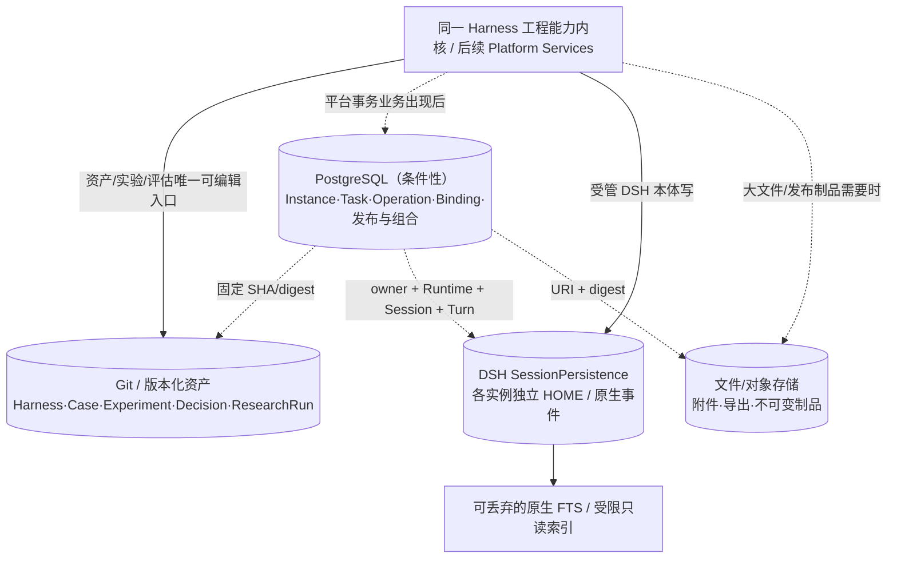

# 03｜数据分类、存储演进与关键数据契约

## 0. 当前事实与未来写权

当前 Git 仓库保存源码和研究证据。未来工具或平台可受控写入同一个 Git 事实源，也可在需求明确时迁移写权与存储；不得保留两个可编辑版本。本章定义数据合同，阶段条件统一引用 [05](05_实施路线与迭代计划.md)。

### 业务文档归属与校验

特定业务智能体的说明性文档及其导出件必须归入数据根的 `agents/<agent-id>/docs/`，覆盖需求、方案、计划、问题记录、使用说明和 HTML、PDF 等格式；根级 `docs/` 只保存共用的管理与研究方法。此限制对页面、管理助手、CLI、导入、复制、移动与导出一致适用，不以文件扩展名、操作方式或临时保存为例外。数据侧业务原则由数据工作区 `AGENTS.md` 维护，本节维护程序校验合同。

文档按实际服务的对象归属。某个智能体的具体方案涉及其他智能体时，在主责智能体下保留唯一正文，其他位置只引用；共用方法包含具体业务示例时仍可属于共用文档。归属不能单凭标题关键词判断，也不能只因没有传入 `agent_id` 就认定为共用资料。已有 `evaluation.md`、测试源码、Candidate、Run、Decision、原始输入、知识资产及运行制品保持各自合同，不移动或复制成文档副本。HTML、PDF 作为导出件与正文一起归属，不成为第二份可编辑来源。

**实现边界**：目录规则是当前硬性原则。以下保存前拦截、统一校验入口和全仓巡检为待实现设计；已有 `research/validate` 校验 Experiment，不能作为本节的目录校验通过依据。规则装载、助手理解、程序拒绝和真实任务验证须分别取得证据，当前状态只在[项目验收矩阵](../ai-agent-harness项目验收矩阵.md)记录。

#### 保存前共用校验

在现有 Agent 业务工具中增加文档保存与归属核验能力；页面、管理助手和 CLI 调用同一 TypeScript 实现，不分别维护规则，也不另建文档登记库。文档路径和现有 Agent 清单共同提供归属事实，调用参数只表达本次操作意图。

| 核对项 | 输入与行为 | 不满足时 |
| --- | --- | --- |
| 工作区与归属 | 使用受信任工作区及固定任务上下文；Agent 资料必须有实际存在且清单身份一致的 `agent_id`，版本或实例任务同时核对其所属 Agent | 拒绝本次写入，显示对象和缺失或冲突的归属，不猜测、不换工作区 |
| 业务与共用资料 | 保存请求明确选择 Agent 文档或共用方法；业务上下文的资料默认归入该 Agent，共用方法需说明跨智能体用途，不能用切换类别绕过固定任务对象 | 无法确定归属时返回需澄清，不按共用资料放行；内容是否确为共用方法保留语义复核 |
| 目标路径 | Agent 请求只接受 `docs/` 内相对路径，由服务端拼出 `agents/<agent-id>/docs/<relative-path>`；共用请求只在根级 `docs/` 内办理 | 拒绝绝对路径、目录穿越、符号链接逃逸、跨 Agent 路径，以及清单和专用事实源的覆盖；返回正确目录建议 |
| 覆盖与并发 | 新建时拒绝覆盖；编辑或移动核对来源摘要，按现有排他写入方式协调，并在落盘前复核实际路径；多文件导入先核对全部目标 | 保留原文件和待保存内容，返回冲突及可回读位置，不自动覆盖或部分迁移 |
| 结果回读 | 返回实际 Agent、相对路径与内容摘要；移动同步当前引用，导出件继承正文归属，导入逐项检查归档内路径 | 无法确认结果时标为未知，先回读再恢复，不自动重放写操作 |

页面从当前 Agent 固定文档归属并展示保存目录；保存失败保留草稿，提供修改路径、回读冲突或退出的明确入口。用户从全局入口操作时先选归属，再选择相对目录，不要求自行输入完整文件系统路径。当前引用随迁移修正，固定历史 Run、原始材料与 Git 来源不随当前目录改写；历史失效引用单独报告。

管理助手写入前先确定归属，写入后核对实际路径；平台工具执行相同校验。对原生 `write`、编辑工具及 `bash` 的直接文件写入，先核对锁定版 DSH 可复用的文件访问与工具扩展点，再补齐相同边界。**不能只检查平台专用工具或用 shell 命令正则过滤就宣称已全面强制限制**。若原生 shell 仍能直接写受约束目录，必须保留为未完成项；需要原生文件系统隔离时，仅限制文档目录的直接写入，由共用写入入口办理，不扩大为普通管理会话的工具白名单或审批流，不修改 DSH 源码。

#### 存量与交付核验

复用现有仓库校验入口调用上述 TypeScript 校验器，另由平台工具暴露同一只读检查；限定 Agent 的检查只读取相关范围，全仓检查显式执行，不成为启动智能体、普通对话或无关业务操作的门槛。

- 检查根级 `docs/` 与各 Agent 的 `docs/`，核对目录、清单归属、链接逃逸、当前本地引用及导出件位置，输出问题路径、所属对象、原因和建议目标；所有文档格式都纳入清点。
- 根级共用文档逐项结合用途与内容核验。能确定为 Agent 文档的误放项判为错误；自动检查不能确定归属时标为“待核对”，不把没有命中关键词当成通过。不以可编辑白名单、第二份文档索引或文件名前缀代替归属事实。
- 检查只读，不自动迁移、删除或修复历史记录。用户确认归属后再预览迁移；在已有迁移授权内连续执行，校验摘要、目标冲突和引用，再回读。误放文档不能阻断其他 Agent、MCP、会话或业务请求。
- 迁移核对文件数与内容摘要；只改目录和必要的相对链接，导出件保持字节不变。分别报告原有失效链接和本次新增问题，保留 Git 恢复定位。

验收必须覆盖：正确 Agent 保存成功；Agent 文档保存到根级或另一 Agent 被拒绝；未知归属、无效清单、绝对路径、`..`、符号链接及归档路径逃逸被拒绝；并发编辑不覆盖；批量导入失败不留下部分迁移；PDF、HTML 与 Markdown 同样受约束；共用方法中的业务示例允许保留；已有专用事实源和历史 Run 不回退。最后通过实际页面与新管理会话分别核对提示、失败后草稿恢复、助手纠正错误落点及原生文件写入路径。只完成目录巡检或提示词修改时，不认定保存前强制校验已完成。

### 版本身份与装载声明

新业务版本使用 `EXP-<agent-id>-NNN-<m|f>-r<12位随机十六进制>`。编号表达代际，`m` 表达主干，`f` 表达分支特性；完整 ID 才是身份。**同一智能体、同一版本号最多一个 m，允许多个 f；不同随机后缀不能用于创建第二个 m。** 纳入分代治理的当前代必须存在唯一 m。最新代的 m 和 f 均可编辑，历史代只读，仍可从固定来源派生和复现；`security-operations-expert` 的 026 及以前版本只读。验收结论由 Run 与 Decision 表达，不增加草稿状态。

共享版本治理按 `(agent_id, 版本号)` 检查全部已有版本身份，包括历史代；发现重复 m 时返回冲突的完整 ID，停止该智能体的版本创建、编辑与融合，不自动选择、改名或覆盖。首次创建、版本派生、迁移和合并在 `.local/version-governance/<agent-id>.lock` 下排他写入，并在落盘前重新核对当前身份和来源摘要；页面、管理助手、版本 CLI 与 `dsh-dev init` 遵循相同约束。迁移也检查同号不同后缀的已有 m。直接修改仓库产生的冲突在后续工具读取与写入时报告，不以文档约定替代运行校验；锁文件只协调写入，不是另一份版本登记。

已采用 m/f 的智能体通过 `agents/create` 从固定父版复制时，默认创建当前同号 f；历史父版也只派生到当前代 f。只有显式传入 `create_next_generation: true`，从当前 m 继承，并逐项提供未合并 f 的 `feature_dispositions`（`defer` 或 `reject` 及原因），才创建下一代 m。已合并特性由同号 m 自身验证后的来源与 Candidate 摘要识别，调用方不能自报已合并。`expected_governance_sha256` 可锁定用户核对过的当前版本与资产；创建及确认期间也重新检查来源。可选 `version_number` 接受 1–999 的整数，必须等于本次动作允许的代际，不能用于跳代、回写历史代或额外创建 m。随机后缀由平台生成并检查占用。

未迁移的其他既有智能体保留原 ID 的读取和创建合同，不批量回溯；其旧创建入口省略编号时仍递增，显式编号时仍可创建同号副本。新智能体从 001-m 开始。VAR 保持独立编号、既有格式与继承限制，不因本轮治理重命名或改变创建行为。

最新主版本从当前代唯一 m 读取，已启用版本从 Agent 清单读取，实例实际加载版本从实例观察读取。三个事实分别展示；源码更新、身份迁移及融合完成都不代表实例已重载。

#### 027 身份迁移

迁移工具盘点以下 `security-operations-expert` 身份，不改变随机后缀：

| 原 ID 尾段 | 当前 ID 尾段 |
| --- | --- |
| `027-reab20c48f610` | `027-m-reab20c48f610` |
| `027-r0318e00a959b` | `027-f-r0318e00a959b` |
| `027-r058697202fb8` | `027-f-r058697202fb8` |

`agents/versions/migration-plan` 为只读 dry/plan，返回 `inventory` 中的可迁移、已迁移、缺失、残片和阻塞状态，以及实际迁移映射、固定 Git 来源、Candidate 移动与摘要、将更新的文件及字段、实例依赖和 `plan_sha256`。缺失或不完整版本保留历史读取，不补造目录，也不阻塞完整版本；主版本必须可迁移或已迁移。可迁移版本的身份、研究说明和完整 Candidate 必须可从当前 Git 提交读取，目标不得已存在。身份与研究说明的未提交修改会阻止迁移；Candidate 的工作稿连同未跟踪源码原样移动，预览分别列出当前摘要、历史固定摘要及两者是否不同，既不提交并行工作稿，也不将它视为已验收。历史读取仍使用迁移前的固定 Git 来源。目标冲突或预览后工作稿变化会阻止执行。`agents/versions/migration-apply` 接受 `confirmed: true` 与相同 `expected_plan_sha256`；已有用户整体授权时可直接执行，无需重复询问。当前引用、来源或依赖变化后须重新预览；已完成的迁移重复执行不写入。实例及其实际加载登记保持原样，不执行重载或部署；未固定来源的实例在下次启动或重载时读取迁移后的当前资产，固定 Git 来源保持原身份。资产状态比较当前装载闭包与实际回执，身份迁移不能冒充已加载。

迁移只移动盘点中可迁移的 Candidate，旧目录保留原 Run、归档、Decision 等研究原文，并在旧 `change.yaml` 增加 `current_version_id` 与 `archived_ref: git:<提交>`。旧 ID 的历史详情和固定来源继续可读，不留下第二份可编辑 Candidate。新身份不继承旧验收结论或验证回执。当前可变引用仅检查该 Agent 清单及既有 `business-runtime`、`business-access`、`sources`、`sites`、`mcp-manager` 配置中的完整 ID、完整 `experiment:<ID>` 及精确 Candidate 路径；摘要列出实际字段，缺失和残片身份的引用不变。历史 Run、归档文本、固定 Git 引用及嵌在说明中的旧 ID 不替换。

页面、助手与本地 CLI 共用同一智能体及版本处理入口。CLI 为 `node --experimental-transform-types platform/plugin/src/agents/cli.ts <action> --asset-root <数据根> --input <JSON文件或->`，action 使用领域内名称，如 `new`、`versions/migration-plan`、`versions/migration-apply`、`create`、`fusion/preview` 与 `fusion/confirm`。`new` 使用与页面、助手相同的角色、标准来源和业务用例创建逻辑；`create` 派生已有版本。CLI 的两次融合调用可用原预览请求、`confirmed: true` 与 `expected_plan_sha256` 跨进程确认；摘要同时锁定请求、来源快照和归一后的方案（包含评测口径摘要），不一致时拒绝写入。

每个 Experiment 的 `change.yaml` 唯一维护 `agent_id`、`experiment_id` 和固定继承关系；`candidate/harness.yaml` 唯一维护 `loadable_assets` 与 `credential_environment_keys`。平台按目录发现版本，不维护当前来源登记表。装载声明指定 Candidate 内的工作区、Preset、Managed 根、Patch，以及按需声明的 Preset 文件、Guard 和 Profile 清单；Runtime 身份统一来自程序仓库的 `source.lock.json`。 `loadable_assets.profile` 选择 `web` 或 `sdk`，旧版本未声明时按 `web` 读取；实例、继承与独立运行包从该版本声明派生，不另设可编辑模式副本。

版本的补充备注保存在同一 `candidate/harness.yaml` 的可选字符串 `agent.notes`，未填写时按空备注展示。“描述与技能”中的资料编辑、已启用版本描述接口及资料 JSON 导出读取该字段；表单直接保存，沿用资产格式与摘要冲突校验，不另建备注文件。备注随版本复制与导出保留，不作为角色提示词装载。

检查以本次操作实际消费的对象为限：

| 操作 | 检查范围 |
| --- | --- |
| 读取与编辑 | 目标归属、路径、正文摘要；保存时检查本次文件格式与语法，并发变化时拒绝覆盖。不执行源码或评测。 |
| 从固定父版派生 | 同一 Git 提交中的父版身份、Candidate 与装载入口。只创建新版本，失败清理本次目录，不借用当前工作树补齐父版。 |
| 启动实例 | 选定版本的装载资产、锁定 Runtime 和当前模型设置。外部 MCP 凭据或连接不可用只影响相应工具调用。 |
| 执行评测 | 所选版本、Case、模型及对应执行条件；回执保存实际输入、来源和结果。 |
| 显式全仓检查 | 汇总所有版本的资产和研究合同问题；不作为普通编辑或派生的隐式前置步骤。 |

清单中单个版本不可读时，展示该版本的具体错误，其他版本继续可用。恢复历史固定提交时，优先读取该提交的 `candidate/harness.yaml`；仅对没有装载声明的历史版本，兼容同一提交中的旧来源表，不恢复当前登记写入机制，也不改写历史 Run。

源码可编辑读取返回原始正文及其 `sha256`，变量式凭据引用保持原文。含凭据常量的文件只返回脱敏预览并标明只读；`sha256` 对应原文件，`content_sha256` 对应显示正文。脱敏或截断内容不能直接保存为源码。LLM API Key 仍只保存在本地忽略的 `*.llm-api-key` 文件中。

### 当前助手与版本数据

Experiment 的 `change.yaml` 是当前特性、固定继承来源和融合验证引用的可编辑来源。`features` 保存特性说明、来源及证据引用；`parent_experiment_id` 与 `parent_ref` 标识主父版，`fusion_sources` 标识确认采用的并行来源。`creation` 保存已确认的融合方案与后端验证回执，融合中的来源声明不作为已完成继承。验证针对完整 Candidate 摘要及真实封存 Run，资产变化后须重新验证。历史缺少结构化关系时显示待核对，文字提及不自动生成已完成继承边。

特性融合指定 `target_experiment_id` 为同号现有 m，`parent_experiment_id` 与固定 `parent_ref` 指向本次 f。方案须说明来源取舍、特性、语义冲突，以及 m 自身的 build、load、capability 检查；只声明采纳、空修改或省略构建都不构成融合。

CLI 与管理助手使用 `agents/fusion/preview → prepare → resolve → confirm`。无方案的 preview 只读盘点；prepare 不要求 `plan.edits`，在数据根 `.local/fusion/operations/<operation_id>/` 固定来源、实际目标工作树、可核验共同派生来源、方案与评测摘要，生成操作清单和差异文件。共同祖先只沿明确派生引用和既有迁移身份映射查找；无法核验时不同文件全部要求明确取舍，不把当前 HEAD 当作祖先。来源独有变化直接采用，目标独有变化保留，双方文本变化使用 Git `merge-file --diff3`；无法自动解决的文本、二进制、删除／修改、文件／目录及检测到的重命名冲突交 resolve。重命名检测限内容与执行位一致且唯一匹配的删除／新增对；其他情况按文件差异处理。

融合复用平台已有 Git 与 TypeScript 工具，不新增比较软件或合并算法依赖。离线包收集目标架构的 Git；收集测试实际执行 `merge-file -p --diff3` 的无冲突合并、冲突返回和目标文件不变检查。机械比较只固定一次来源并处理差异清单，助手只读取需要业务取舍的冲突；恢复时沿用原操作，不重复传输整树或重新制作同一草稿。[Git merge-file](https://git-scm.com/docs/git-merge-file) 提供三方文本合并；新版 [merge-tree --write-tree](https://git-scm.com/docs/git-merge-tree) 面向提交树，不能假定现有 Git 2.34.1 环境支持；[rerere](https://git-scm.com/docs/git-rerere) 依赖 Git 冲突与索引流程，当前 Candidate 目录融合沿用持久草稿，不另建冲突缓存。Beyond Compare 保持可选；[官方 Linux 安装入口](https://www.scootersoftware.com/kb/linux_install) 未提供原生 ARM64 包，因此不作为双架构离线依赖。

prepare 返回 `operation_id`、`plan_sha256`、冲突和本地 `bundle_path`。`base/source/target` 保存差异的固定快照，`result` 是唯一可编辑输出，可供本地 Beyond Compare 等工具比较；不调用或安装外部比较软件。resolve 只接受清单内路径，通过 source、target、delete、content 或同操作 result 的预期摘要提交取舍及理由，并更新方案摘要；不允许任意路径导入。快照和结果保持二进制及执行位，排除运行状态、环境凭据和 LLM API Key；普通自动合并不经模型传输整份文件。草稿属于本地操作状态，不是第二份可维护 Harness。

confirm 核对最新方案、来源、完整目标、版本与评测口径，复用 Agent 排他锁与草稿静态校验，先保存逐文件写前记录及原内容，再原子替换内容和执行位，最后更新 `change.yaml` 中的 integrating 元数据并清空本次验证回执。返回原 m ID，不生成下一代或另一个 m。普通写入失败只恢复仍等于本次写入的文件；进程中断后，status 按写前／预期摘要报告 untouched、applied 或 mixed。recover 仅在全部预期资产和元数据一致时补记 complete，否则选择 rollback；并行修改拒绝自动恢复。重复确认 applied 操作返回原回执，连接中断不得自动重放。来源、目标、版本或评测变化须重新 prepare，保留旧草稿供核对。

原有页面与调用方的 `preview + plan.edits → confirm` 继续兼容，仍核对真实编辑及原摘要；未分代来源仍可建立独立融合目标。本次不新增页面入口。装配失败返回 `assembly_validation_failed` 或 `assembly_apply_failed`，携带阶段、路径、文件系统错误码及可提供的预期／实际摘要，避免把全部失败压成泛化错误；不返回配置解析正文中的凭据。

`agents/fusion/verify` 生成当前 m 的构建回执，装载与能力检查只接收该 m 自己的封存 Run，并核对完整 Candidate、来源、评测和证据摘要；f 的 Run 不能代替。`agents/fusion/finalize` 全部通过后才写入来源的 `merged_at` 与 `verified_mainline_sha256`，不改变版本号。未完成或失效的融合不能只通过 Decision 登记 m 采纳，f 也不能在尚未实际合入并验收时登记采纳。融合后的 m 仍可继续编辑；修改后旧回执不能证明当前资产已通过。

验收后通过同一 `fusion/finalize` 入口显式传入 `cleanup_features: true`、`confirmed: true` 清理对应已合并 f。先解除 f 的实例绑定及 Agent 启用依赖，当前 f 的完整摘要须与方案固定 Git 来源一致；未满足时保留资产并说明失败。清理只删除当前 Candidate，在 f 的清单记录 `assets_retired`、`retired_into` 和 `archived_ref`，使该身份只读并可从固定来源派生或复现；Run、工件、归档及研究原文保留原路径。清理失败时恢复本次移动的资产，不改写实例登记。页面从当前 m 的融合完成提示进入助手继续清理，CLI 和助手使用相同入口。

管理助手的任务上下文、确认提案和操作回执保存在原生 DSH Session 的插件记录中，由原生 `sessionProjections` 按会话增量投影并恢复。每个 Session 独立持有页面上下文和任务固定目标；分支会话可继承上下文，但不继承父会话提案的执行权。内部策略与当前会话的上下文通过原生 `systemPrompt.section` 装配，默认不展示为聊天消息；用户消息保持实际输入。确认期间原工具调用等待回执，确认完成后返回真实工具结果并继续原生执行循环。冷重启保留提案和回执，原进程等待中的工具调用不会凭记录自动重发；普通提案在确认后需要下一条消息继续。

界面发起任务时，通过原生客户端 `sessions.create` 创建或接续会话并即时登记身份，再由 `sessions.using` 等待绑定就绪，随后向同一会话附加任务与上下文。绑定失败时保留原生会话和当前选择，尚未开始投递任务；会话选择失败仍释放选择状态，后续恢复可以继续。

会话状态按会话身份隔离、内部上下文与用户消息分离的取舍，参考 [LangGraph 的会话状态范围](https://docs.langchain.com/oss/javascript/langgraph/persistence)和 [Anthropic 的上下文工程建议](https://www.anthropic.com/engineering/effective-context-engineering-for-ai-agents)，具体实现使用 DSH 现有扩展接口。

普通页面数据与实例观察继续从原有来源读取。平台 MCP 服务、工具与资源选择、分组及稳定 ID 唯一维护于数据根 `config/mcp-manager.json`；分组 Token 和出站凭据唯一维护于被 Git 忽略的 `.local/credentials/mcp-manager.json`。管理助手与页面共用同一配置读取和带 `revision` 的保存入口，重连后重新读取并核对版本，不维护原生 Settings 中的第二份平台连接配置。领域失效事件只携带域、对象 ID 和递增序号，不保存事件数据库；业务实例自己的 MCP 设置仍按其实例合同维护。

<a id="task-delivery-contract"></a>
### 当前原生会话与业务操作合同

管理助手通过 DSH 原生会话和权限机制，直接调用智能体、评测、实例与 MCP 领域工具。平台保留固定目标上下文、普通操作回执和必要确认，不额外维护交付任务执行器、总调用额度、任务总时限或修复轮次。

历史 Session 的交付任务状态、额度计数和已停用动作的待确认提案不进入当前助手投影，也不阻塞后续消息；原始事件和历史 Run 保留。刷新或重启不会重放旧任务或未知写操作，仍须回读实际 Job、文件和实例后决定下一步。

评测 Job 在运行状态根保存执行关联，逐 Case 事实和轨迹仍以 Run 为准；独立评测继续支持状态查询、取消和单 Case 原生超时。业务报告经显式导出保存到 Run 的 `artifacts/`，关联真实回复或业务工具回执及内容摘要。封存后不改写原失败。业务结果须结合实际 Case、当前资产、实例及产物核对，HTTP 200 或容器运行不构成业务通过。

接口与用户流程见 [04 的任务交付入口](04_核心业务闭环与服务接口.md#task-delivery-interfaces)，具体业务步骤由数据工作区的 `task-builder` Skill 维护。

### 当前代码变体与固定外部输入

变体的独立名称只维护在 `change.yaml.variant_name`，与 `research_question`、`compute_variant.strategy` 和稳定 Experiment ID 分开。创建预览与创建接口显式传递名称；既有变体没有该字段时显示“未命名变体”，不会从其他正文推导或自动回填。`agents/list` 与 `agents/detail` 返回实际 `change.yaml` 的 `change_sha256`，它是只读摘要；`agents/compute-variants/rename` 接收 `experiment_id`、`variant_name` 与 `expected_change_sha256`，摘要不符时拒绝覆盖。改名只保存名称，保持研究计划、Candidate、Decision 和封存 Run 的原始内容及身份。

代码变体的计划仍只维护在 `change.yaml.compute_variant`。可选 `generation` 固定 `mode: langgraph-aot`、Candidate 内的 TypeScript 入口、父版诊断 Run 与服务端核对的来源证据；实际代码由管理助手写入该入口。`execution_mode: code-only` 约束业务全链零 LLM，要求代码生成计划且不能同时声明模型变更；缺省保留原编排方式。比较时每个变体 Case 都须有当前构建的纯代码图回执、完整计量和零实际模型请求，未知不按零通过。ESM 由平台固定编译器生成，不作为另一份可编辑源码。`compute_variant_build` 保存源码、共享执行器、依赖、ESM 和构建摘要；读取构建状态时重新核对实际文件，修改源码、产物或依赖后不能继续沿用原构建通过状态。业务流程随 Candidate 只读装载，标准 Runtime 镜像不因本轮 Harness 改动派生。

代码变体直接沿用已派生目标、固定父版和比较计划，通过领域工具完成编辑、构建、冻结及两侧评测。本地冻结展示确切差异并按原生权限执行，只物化目标 Candidate、研究计划及计划 Case 的 Git 投影，保留无关工作树和暂存修改，不推送。比较依据实际构建、冻结、装载和所选两侧 Run，不自动确认 `end`；交互步骤见 [06 的算力变体流程](06_界面与前后端渐进建设.md#36-不同算力需求的近似等效变体)。

比较回执按内容摘要保存在 `evolution/experiments/<experiment-id>/evaluation/compute-comparison-<sha256>.json`，只新建或复用完全相同的原件，不覆盖。刷新时核对回执摘要、当前 Candidate、计划、固定父版和构建身份，并重新从所选原始 Run 计算比较；任一来源或证据不一致时不恢复“已比较”状态。实现以 [compute-variants.ts](../../platform/plugin/src/agents/compute-variants.ts) 的 `saveComparison/restoredComparison` 为准。

固定外部输入只维护在 `candidate/dsh/managed/compute-workflow/fixtures.json`，必须明确 `mode: mock-replay` 或 `replay`。Run 初始化逐字节复制到 `evidence/external-inputs.json`，并在 `inputs.lock.json.external_inputs` 保存模式和完整 SHA-256；这份复制是不可编辑的本轮输入证据，后续 Candidate 编辑不回写它。没有该文件时不生成外部输入冻结声明；缺少或无效模式则拒绝初始化并清理部分 Run。相同用户输入不代表相同外部返回，比较还须核对外部输入模式及摘要。

模型资源记录区分历史已记录响应次数与包含重试的实际请求次数。工作流经受信执行器保留原生工具回执、图执行身份、实际构建摘要及内部模型尝试；主/子 Session、图内模型、失败和重试按实际身份归并，未知记录不按零计。生成阶段的投入与变体运行消耗分开解释；固定样本重放的研究结论不提升为本轮在线业务事实。

## 1. 四类存储域与第五类派生视图



| 分类 | 写入权威 | 典型物理格式 | 放什么 | 不能放什么 |
|---|---|---|---|---|
| 版本化源码和研究口径 | 当前宿主研究工作流；将来可交给平台 Asset/Evaluation Service | Git 文件、Markdown/YAML（按现有合同）、冻结 Run、Manifest/Digest | Harness/Plugin/Skill、Experiment、Candidate、Case、Decision、研究 Run、Variant 研究依据、业务组合定义源码 | 运行中的 HOME、无界 Session token 流；同内容第二份可编辑 PG 记录 |
| 平台操作/业务对象 | 真实平台服务（引入前可先用单一本地操作记录） | 结构化 PG 表、唯一键、短事务 | 实例绑定、管理任务、Operation、Session Binding/Invocation、发布状态、MCP 登记与组合来源引用 | Git Candidate 或组合定义正文、所有 DSH 原生事件的可写镜像 |
| DSH 原生会话 | 各自的 DSH SessionPersistence 写者 | 独立实例 HOME、JSONL/压缩及单写互斥（以锁定版本为准） | Meta Session、业务 Session、模型/工具事件与可读取的执行历史 | 平台审批、研究 `Decision` 的第二份权威 |
| 文件制品 | 生成制品的唯一流程 | 本地路径/对象 URI、digest | 图片、报告、大附件、备份、不可变依赖包 | 无版本约束的“当前可编辑 Harness”影子副本 |
| 派生索引/衍生采集 | 唯一构建者；默认索引可重建，Trace B 按第 6 节持久合同 | 原生 Query/FTS、受限只读索引；B 可用 PG 等持久存储 | 检索、步骤树与已选择 B 的 ACK/重放副本 | 反写原会话、第二可编辑事件权威、未核验就声称完整 |

## 2. 数据对象身份与关联模型

| 对象 | 主键/引用草案 | 唯一事实含义 | 关联注意事项 |
|---|---|---|---|
| `agent_id` | `kebab-case` 当前研究对象 | 一类业务 Agent 研究身份 | 不等于某容器或 Profile |
| `experiment_id` | 业务版本 `EXP-<agent-id>-NNN-<m\|f>-r<12位随机十六进制>`；变体 `VAR-<agent-id>-NNN-r<12位随机十六进制>`（旧 ID 保留） | 一项 Harness 变更假设，前缀区分版本与变体 | m/f 规则见本章版本身份合同；变体不能作为继承来源；Baseline/Case/Decision 来源唯一 |
| `research_run_id` | `run-<UUIDv4>` | 一次冻结评测事实 | 保存案例快照、模型、镜像、输出/误差；不重复编辑原证据 |
| `asset_ref` + `source_digest` | `experiment:<id>` / 固定 Git ref / 可恢复 Release | 本次实际声明装载的资产 | 是否支持 `release:<id>` 以当前项目验收矩阵为准，设计不能直接证明能装载 |
| `instance_id` | 稳定平台或自用工具 ID | 某次可查回的运行实例逻辑身份 | Docker ID 会变；HOME/装载摘要须绑定 |
| `runtime_owner_key` | 不透明、稳定、不可重复使用的拥有者键 | 给 Runtime ID/Session ID 限定命名空间 | 防重建/跨实例 Session ID 撞号；按实测契约定最终字段 |
| `dsh_runtime_id` + `dsh_session_id` | 原生 DSH 标识 | 一次原生会话 | 不假定全局唯一；Meta HOME 与业务 HOME 互相隔离 |
| `invocation_id` + `turn_locator` | 平台创建/来自原生的定位引用 | 一次业务用户请求如何落到某原生 Turn | 一次 Invocation 不等于一个 LangSmith Span |
| `operation_id` + `request_key` | 平台内稳定去重键 | 某次平台修改动作/回执 | `unknown` 不可按失败盲重试 |
| `harness_version_id` | 仅发布产品发生时产生 | 真正的 published/withdrawn 平台事实 | 不是 Git commit、`Research Release` 或 `Decision adopt` |
| `deployment_id` | 仅新会话路由发生时产生 | 对新会话选版的业务启用事实 | 旧 Session 不能静默漂移 |
| `composition_version_id` | 仅真实组合 Tool 发布时产生 | 固定的组合定义、依赖与工具 Schema | 不等于 Agent HarnessVersion |

## 3. 数据实现对阶段路线的支撑（阶段条件见 05）

### R0：先保全现有唯一事实源（**不建数据库**）

- 保留 `agents/<agent>/evaluation.md` 的唯一 Case/预期，Git Experiment 的 `candidate/`、`decision.md` 和 Run 的冻结结构。
- `dsh-dev` 现有实例状态放仓库外；DSH HOME 保持实例独立；原生 Session 不回流进 Harness Git。
- 每次实验能够由固定来源、镜像摘要、输入快照、资源配置、Run 和原生 Session 引用**核查**；缺少必要字段时完善 Run 合同。
- 仅保留必要版本化文件，无消费者不创建“索引/资产登记总表”的多格式可编辑副本。

### R1：为了使用便利而建只读索引（可选）

例如 `assets.list`/`runs.find` 跨目录查找的消费者真实出现，可先从 Git/Run 目录动态扫描；真的慢了才建立一次性**可重建**索引，明确索引 schema、来源 sha、更新时间。文件目录可直接用于个人工具；是否使用 SQLite FTS 由检索需求决定。

### R2：先稳定身份、关系与恢复，再选技术

按实际用户故事记录：`AgentRef ↔ Instance ↔ LoadSnapshot ↔ DshRuntime/Session ↔ ResearchRun`。如仅 CLI 同一进程，仓库外少量状态文件就能恢复，先保留；当出现**多入口并发写、持久异步任务、需要跨浏览器重启查 Operation、关系查询繁琐**，再做数据库选型小实验。

| 选择 | 合适条件 | 当前限制 |
|---|---|---|
| Git/文件 | 当前唯一编辑者、实验/Run 是主体、短写，消费者少 | 跨对象事务/并发更新弱；不可假装多用户协调 |
| SQLite 本地（可选） | 单机单写主路径、有限并发、读索引与小型状态库 | WAL 仍单写事务，跨主机共享不可当 PG 用 |
| PostgreSQL | 多写入口、异步 Operation/Session/Deployment 真实存在，需要事务与关系查询 | 引入数据库实例、迁移/备份和运维成本；不等于每个模块必须建表 |

Git/文件满足所选恢复与查询需求时，R2 继续使用该实现，以真实恢复和查询证据验收。

### R3：把改进证据链组成统一业务关联

首条工具闭环有且只有明确写者：原始 Trace 来自 DSH，反馈来自原生反馈接口（若真实核实支持，未核实可用独立待确认问题），`Case` 在唯一 `evaluation.md`，Experiment/Run/Decision 在 Git；统一工具只是调用相应写入口与冻结引用，不能自己复制一套可编辑 Case。

### R4：真实业务消费倒推 PG（条件性）

第一次需要平台化时可增量建表，而非一次铺开全部数据域：

| 触发故事 | 候选表 | 必须说明的唯一写入事实 |
|---|---|---|
| 持久管理 Agent/实例 | `agents`, `instances` | 平台对象身份、期望状态、装载来源、最后观察 |
| GUI 与 Meta 共用副作用动作 | `operations` | operation/request_key/执行确认/unknown |
| 业务 Session 与逐轮对话 | `session_bindings`, `invocations` | 稳定关联与本次请求状态，不保存原生聊天正文 |
| 管理委托任务 | `tasks`（使用时） | 用户目标、已确认对象、计划 revision |
| 产品发布/启用 | `harness_versions`, `deployments` | published 与 enabled 的不同状态 |
| MCP Server 注册/组合发布 | `mcp_servers`, `mcp_compositions`, `mcp_composition_versions` | 注册配置、组合源码引用/摘要与发布状态；不另存可编辑定义或图 |
| 待处理问题收件箱 | `issues`（可选） | 问题处理状态与来源引用，非 Case 正文 |

每张表必须绑定实际需求消费者、写者、状态迁移及一条有效查询。研究 Run、平台操作和业务 Invocation 按各自语义建模，是否建立平台 `runs` 表由实际查询需求决定。

## 4. 数据契约示意（不是已实现接口）

### 4.1 资产装载快照

```json
{
  "agent_id": "example-agent",
  "source_ref": "experiment:EXP-example-agent-001-r0123456789ab",
  "source_digest": "sha256:<actual-content-hash>",
  "runtime_image_id": "<verified-image-id>",
  "runtime_version": "<locked-dsh-version>",
  "profile_preset_ref": "<actual-manifest-ref>",
  "dependency_manifest_ref": "<immutable-reference>",
  "home_owner_key": "<stable-instance-owner>",
  "verification": {"mount": "verified", "session_probe": "not-run"}
}
```

例子中尖括号字段都是**占位值**，其名字、API 格式和摘要算法需按实机锁定版 DSH 与仓库现有工具调整。`verified` 仅代表对应局部探针，不能推断业务成功。

### 4.2 管理操作回执

```json
{
  "operation_id": "<uuid>",
  "request_key": "<stable-client-idempotency-key>",
  "target_ref": {"type": "instance", "id": "<instance-id>", "source_digest": "<digest>"},
  "action": "restart",
  "state": "unknown",
  "observed_at": null,
  "evidence_refs": [],
  "next_action": "reconcile-before-retry"
}
```

平台自己保证 `request_key` 不重复生成管理命令记录，但不能凭此保证远端 Docker/DSH/MCP 恰好执行一次。只有状态证据充足才能从 `unknown` 变为 `succeeded/failed`。

<a id="comparison-environment"></a>
### 4.3 比较运行的外部状态合同

HOME/Session 隔离只隔离 DSH 自身。业务任务、告警、知识库、文件、缓存、时间窗口、外部服务和工具副作用仍可能污染比较。以 Case 为单位选择并核验一种方式：

| 方式 | 执行前实际核验 | 必须记录的依据 |
|---|---|---|
| 只读冻结数据集或响应样本 | 两端读取同一不可变版本，工具没有修改共享数据 | 数据版本/摘要、读取范围、工具模式、核验时间 |
| 可复位后端 | 每次执行前恢复同一初始状态，并查询确认复位成功 | 初始状态、复位步骤、核验结果、失败及残余副作用 |
| 独立 namespace/隔离后端 | 两端具有等价初始数据和各自读写范围，调用不越界 | namespace、数据版本、实际端点/范围和隔离验证；不记录凭据值 |

Run 或其实际环境证据记录所选方式、状态引用/摘要、时点与窗口、复位/隔离范围、执行顺序和未控因素；不要求为此预建新台账或数据库。仅声明“相同环境”不算已核验。拟作因果结论时，按假设需要交换 A/B 顺序、每次恢复初始状态，检查顺序效应，并结合重复样本与反例限制结论。

后端不可复位或隔离、动态输入无法冻结、执行次序会改变状态时，保留原观察并标明限制；可以进行观察比较，不能宣称差异由 Harness 引起。`run-comparison.ts` 的 `comparable` / `causal_comparable` 只检查已记录条件，不能证明未记录的外部状态受控或自动成立因果关系。变体、反馈转 Case、AI 评审或工具化入口使用同一合同。

<a id="mcp-composition-contract"></a>
### 4.4 业务组合定义与发布合同

开发者在 Git 维护一份组合定义源码，平台装载其引用并生成只读流程图。定义覆盖业务输入/输出、步骤及依赖、参数传递、成功判定和失败处理；采用的格式与执行器由 [T12](07_关键POC验收与架构决策.md#mcp-composition-poc)验证后确定。图和目录是派生视图，不能成为第二份可编辑定义；平台发布记录只保存来源与状态，不要求为首个组合引入数据库。

发布固定源码提交/摘要、输入与输出 Schema、执行器版本以及下游 OpenAPI 来源或 MCP Server/工具的身份与依赖版本。无法固定的上游行为标明限制，不把固定定义称为冻结了外部服务。发布制品可包含从该来源生成的不可变定义，但不成为另一份编辑入口；凭据值不进入定义、发布摘要或执行证据，调用复用现有凭据引用。

页面测试和 MCP 调用的回执均关联实际定义摘要或 `composition_version_id`，记录步骤身份、实际下游调用、参数传递、结果引用、耗时及失败/未执行/未知状态，展示内容排除凭据。步骤记录来自执行器的真实执行，Trace 写权遵循[第 6 节](#trace-contract)。业务行为见 [W6](04_核心业务闭环与服务接口.md#mcp-business-composition)。

<a id="business-access-data"></a>
### 4.5 业务访问与动态权限事实

本节定义业务模式的数据归属与写权，插件方法语义见 [20](20_业务访问与运行控制插件开发规范.md)，可导出字段以其链接的 TypeScript 合同为准。智能体身份内部保留凭据验证与可信来源两项事实，风险评估输出业务风险，访问控制输出当前许可；不能用一列“安全正常”合并。

| 事实 | 唯一写者与保存边界 | 必须关联的对象 |
|---|---|---|
| 对外服务的智能体认证证据 | 协调器在发布模式真实验签成功后生成，只读投影到 Runtime 和页面；开发调试实例不产生发布身份认证证据 | 工作区、Agent、实例、代次、来源、认证方式、验证及失效时间，不保存密钥值 |
| 智能体来源与身份状态 | `config/business-access.json` 中实例的 `identityMode`、固定来源 ID 和摘要，以及对外服务 Agent 的身份启用开关；状态从当前模式、认证和登记计算 | Agent、实例、固定来源、当前代次及可信、撤销、过期、不匹配或未知原因 |
| 接入用户稳定身份 | 外部用户认证与信任提供方；平台仅保存会话归属需要的已核验引用 | 受信来源、外部用户、稳定用户主体、有效状态和时点；凭据轮换不重建主体 |
| Agent 开放资格及提供方接入 | 当前数据工作区 `config/business-access.json`，GUI 和管理助手共用写入口 | 工作区、Agent、实例、固定来源、风险及访问提供方地址与超时；第三方策略由第三方维护，同文件仅保存手动兜底的工具基础范围与条件规则。执行语义见[插件合同](20_业务访问与运行控制插件开发规范.md#风险事实与访问控制策略)，实例后端地址从登记解析，不存副本 |
| 人到 Agent 使用授权 | 同一业务访问配置中的使用范围，与智能体访问 MCP 的策略分别解释 | 主体、Agent、动作、规则版本；不将登录成功当作业务许可 |
| 业务资源归属 | 业务 Runtime 维护归属，协调器仅接收受信观察索引供查询；原生 Session、消息和附件正文留在原处 | 工作区、Runtime 代次、Agent、Session、稳定主体；任务和产物继承已核对的归属 |
| 风险事实 | 风险评估插件保存第三方返回的事实及必要历史引用 | 作用范围、风险观察、原因、来源、观察时间、到期时间和事实版本；条件证据绑定工具、目标摘要及输入摘要，不复制私有目标地址与参数正文 |
| 运行限制 | 授权插件维护当前限制及递增版本；与固定 Harness 分开 | 用户／Session／实例／Agent／服务的明确范围、受限动作或目标、原因及来源风险事实 |
| 单次访问决定 | 对应执行点保存在既有控制事件中的只读回执，协调器接收受信观察 | 本次请求和作用范围、第三方或手动兜底来源、决定、策略版本、原因及有效期；不保存凭据，不把历史允许作为当前长期授权 |
| 生效观察 | 对应运行执行点返回的只读回执 | 目标实例与代次、已应用版本、时间、能力覆盖、失败或未确认原因 |

不因为这些逻辑对象新增数据库。首期使用现有单写文件和 DSH 存储扩展，引用与摘要即可恢复；出现真实并发事务问题后再按本章选型。主体映射、开放配置、资源归属和风险状态不是同一事实，不能把它们合并为一份含糊 ACL，也不能让多个插件分别编辑同一事实。

**身份与命名空间。** 人类主体、业务 Agent、实例／Runtime、DSH Session、MCP 协议 Session 分别标识。MCP Session ID 只是协议关联，不是用户身份。原生工具执行中的 `exec.agent.id` 是 DSH SessionId，不是平台 `agent_id`；消息 `source.principal` 表示该消息的作者，不是会话所有权。业务调用上下文的主体、Agent、实例和 Session 由受信服务建立并绑定；普通 Header、模型参数、工具参数或相同显示名不能赋予归属。跨进程断言必须绑定接收实例、有效期和调用范围，接收方验证来源，拒绝任意透传客户端身份字段或复用不属于下游的 Token。

**共享 Runtime 的归属。** 每个新业务 Session 默认只属于一个稳定主体，创建时先持久保存归属，再交付引用。任务、产物、导出及附件访问继承其真实业务归属；内容摘要相同不构成共享授权。历史无用户归属的 Session 和任务保留原样，标为未分配，仅在明确迁移后开放，不能由第一个访问者自动认领。fork 或复制不能自动取得他人资源。管理者的运维权限与业务用户的可见范围分别检查。

**原生保存边界。** 在当前 JSON 后端及默认配置下，Session／消息／工具轨迹位于 `$DSH_HOME/sessions/`，附件位于 `attachments/v1/`，Workspace 与 Schedule 分别在 `storages/workspace.json`、`storages/schedule.json`；实际启用后仍按锁定版及配置核对。新实例 HOME 由数据根 `.local/instances/<name>/dsh-home` 挂载为 `/var/lib/dsh`，旧登记可能仍指向命名卷。Docker stdout/stderr 由实际日志驱动按容器收集，不假定在 HOME 内。研究 Run 在 Experiment 的 `runs/`，不因业务用户隔离自动改变历史写权；外部 MCP、数据库及共享业务目录必须另外验证归属。

**有效许可。** 当前 MCP 可执行范围为 Harness 能力上限、基础授权范围、有效风险约束及上游服务许可的交集。服务、工具、资源和操作使用受信登记的规范标识，聚合工具不能只按显示名匹配；规范标识与实际上游目标和 Schema 绑定，重连发现不得重新授予已撤销权限。目录发现不是授权，风险只能在上限内收紧；解除一条风险限制后，重新计算当前所有约束，不能恢复旧许可快照。约束过期、评估不可用或来源缺失分别记录，必需风险事实未知时拒绝或暂停其保护的动作，不能把未知解释为安全。

**实时与恢复。** 每次派发读取执行点已经确认的最新许可，限制变更携带单调版本；迟到旧消息不能覆盖新限制。发布模式跨进程的运行许可采用短期有效快照，失联不能无限沿用旧许可；租期与传播目标由 [04](04_核心业务闭环与服务接口.md#dynamic-mcp-control)维护。快照用于重连与重启恢复，通知仅加速传播。规则保存和生效是两个状态；未确认实例不得显示为已收紧。受保护操作在必要版本未同步或许可租期到期时暂停；刷新恢复后仍逐次检查。撤权不是配置保存瞬间的跨进程原子动作。开发模式只异步同步记录，不依赖许可租约；同步周期与失败语义见 [20](20_业务访问与运行控制插件开发规范.md#当前访问语义)。

## 5. 写权迁移协议：未来平台**内生** Git 资产

```text
当前唯一写入口（宿主研究工作流）
  → 固定来源与内容摘要
  → 选择未来唯一写者（优先 AssetService 写原 Git）
  → 受控暂停旧写入口
  → 内容/历史兼容验证
  → 切换新唯一入口（CLI/GUI/Meta 都调用它）
  → 旧入口只读或委托新入口
  → 删除一次性同步适配器
```

迁移是**一次性的写权交接**，不强制迁移物理 Git 数据到 PG；产品里出现“编辑 Candidate”的页面仍可以最终修改 Git 文件，但通过唯一受控 Service 检查路径、基线 digest、冲突和 diff。

<a id="trace-contract"></a>
## 6. Trace：原生读取与持久衍生的合同

[原任务清单](sources/DSH智能体运行平台开发任务清单_2026-10-09.md)的 TR02/TR03 要求平台持久 ACK、补取、去重和采集健康。原生历史可读不等于这些要求已满足。本节是 Trace A/B 路线、写权与存储例外的唯一维护位置。

- **路径 A：原生持久读取，默认先研究。** 平台保存关联引用，按需读 DSH 已持久化 Session，显示覆盖和缺失。原生读取或可重建索引不满足独立平台持久 ACK，TR02/TR03 原始完整任务仍未完成。分阶段交付记录选定范围和未覆盖要求。
- **路径 B：按选定范围持久采集。** 真实需求必须独立持久 ACK 且原生能力不足时，先验证游标、重放、flush 与缺口，再建立单向、持久、去重、补取的只读衍生副本。PG 或其他合适存储可保存该副本；ACK、覆盖率、恢复和保留以已验证采集合同为准。没有完成全量覆盖时，不能宣称原始完整任务完成。

B 保存选定范围内的只读衍生事件，原生日志仍是源事件权威，副本不反写 DSH。存储选型与采集覆盖以实际需求和验证结果为依据。原生从未持久化的瞬态 delta 不保证可补，除非锁定协议与实测证据支持。

B 需要按已选范围验证事件身份、ACK 后游标推进、补取/去重、缺页、schema 兼容、保留清理和崩溃恢复；未出现消费者或未获得证据时不引入采集实现。对应 POC/ADR 在 [07](07_关键POC验收与架构决策.md)记录验证方向，不能在那里另立写权规则。

### 当前 Run 的冻结与导出

当前用例的场景编号从权威解析器的 `catalog` 中的合规编号推导，不维护独立缩写配置；编号格式遵循数据侧[用例编号与授权改号](https://github.com/wr5912/harness-engineering-platform-data/blob/main/.agents/skills/evaluation-review/references/platform-adapter.md#用例编号与授权改号)。`cases/create-context` 和 `cases/from-run` 返回各场景的 `case_id_suggestions`；数值建议取同前缀当前最大编号之后并避开全文件重复。无法推导或序号用尽时返回空建议；从 Run 整理时，原 Case 仍存在才沿用其当前场景。新建智能体、迁移追加用例及当前用例的新增、改号、移动场景，在创建参数、用例操作和整份评测文件的预览与保存中共用编号格式校验，拒绝不合规编号和已知场景的不匹配前缀。旧编号仍可读取和原位修改正文，授权改号不回写历史 Run 或历史出处。用户明确授权批量改号时，管理助手使用 `cases/renumber-preview` 与 `cases/renumber`，提交旧新编号映射及原摘要；平台只替换当前标题编号，复用既有解析、校验与原子保存，不让模型重传整份正文。当前正文引用需另行核对，历史出处不改。

Run 初始化从同一次评测定义解析生成 `evaluation_cases`、`case_catalog` 和用例摘要，写入 `inputs.lock.json`；执行和评审只消费该快照。当前 `evaluation.md` 的保存用于后续 Run，活动 Run 校验快照自身的一致性，封存事实不随当前定义变化。融合方案等需要检查当前口径的业务消费者仍核对当前摘要。

Run 保存被测及子 Session、逐 Case 评审的实际导出事件；场景归因及 repair 各次尝试分别保存到 `evidence/analysis/scene-XX/attempt-NN/`。超时或校验失败保存最后取得的归档，未取得时明确记录缺失；被测、评审和归因的轨迹分别归属各自 Session。这是评测范围的证据采集，不代表整个平台的实时 Trace 或持久 ACK 已实现。

平台下载读取所选 Run 目录中的已保存普通文件。报告为 `report.md`，完整 ZIP 保留 Run 相对目录及全部可导出证据，文本脱敏只作用于下载副本；`export-manifest.json` 记录源摘要、导出摘要、遗漏及采集覆盖。文件预览上限为 64 KiB，下载不受该预览上限影响。运行中不提供完整 ZIP；已封存的完成、失败和取消 Run 均可下载。历史缺失不补造，未执行阶段标为不适用；会话附件、工作区工件和整个 Runtime HOME 不在本次导出范围。

TR04 步骤树可按需转换原生事件并保留原位置和缺口；选用 MCP 组合时，子调用记录来自组合执行器自身的新增执行事实。未选组合不需要伪造其步骤，也不能把转换视图称为完整原生 Trace。

### 当前决策样本与结构化阅读

结构化阅读直接读取已保存的 Run JSONL，按文件和 Session 隔离，保留原行号、事件 ID、源文件与原行摘要；分页不经过旧的 64 KiB 文本预览。超过 32 MiB 的文件明确拒绝，超过 128 KiB 的原始行显示省略与上下文缺口，未知事件继续保留。业务角色依据冻结 Case 及采集记录识别；评审、归因、子会话或未知身份不自动继承目标角色。没有开始/结束或耗时字段时不补造。

决策样本保存在 `evolution/datasets/decision-dataset-<UUID>.json`，它是该批次唯一可编辑来源；JSONL 按下载请求生成。源 Run 不修改。新批次使用 `schema_version=2`，每条记录共享一份服务器生成的决策前 `state`，包含业务 `workflow`、`task.id` 与 `task.semantics`。`recommended_decision` 表示基于可见状态的推荐判断；`observed_action` 仅监督实际选择，不声称实际动作正确或最优，标签必须对应真实动作名。服务器保留稳定 ID、内容摘要、Run 与行引用、固定来源组。并行工具共用模型决策前缀；真实请求缺失时明确标为 `reconstructed`，超过 96 KiB 的提取上下文明确拒绝，不静默截短。

`questions` 为非空的命名问题映射，每题只保存 `type`、`instructions` 与候选或有序等级 `criteria`，不能混入标签、审核和来源字段。`targets` 与问题名称精确对应，分别保存标签、可选概率、来源、标注依据、复核状态和 `decision_time_reviewed`。`choice` 标签匹配候选键，`noul` 使用布尔值，`score` 使用从零开始的等级下标。概率需覆盖全部候选或等级，值有限且在 0–1 之间，总和与 1 的偏差不超过 `1e-5`，标签属于最大概率集合；不自动归一化或为硬标签生成 one-hot。监督字段采用本平台的 `targets`，并不声称原样兼容参考集的所有列或教师标注流程。模型输入只有 `state` 与 `questions`，当前动作、后果、标签和审核依据留在监督或审核侧。没有出现在输入中的回复不能成为当前题目的评分对象；结构校验与人员声明不能替代自然语言语义和行业真值核对。

平台管理助手读取数据工作区的 `decision-sample-extraction` Skill，通过 `datasets/source.extraction_contract` 获取当前程序合同，再分页取数和提交 `datasets/preview`。预览的来源凭据和样本均限定为同一 Run 的同一 path，跳过原因按当前合同提交为文字数组；不支持的形状和超量项明确拒绝，不静默丢弃。推荐判断目标由服务器固定为 `model_suggestion`，观察动作目标固定为可核对的 `observed_action`，所有 AI 预览目标均为 `suggested`；合法的软标签仍是未经校准的模型建议，不能自报人工复核、教师多次采样或聚合来源。本版本不提供教师聚合来源的写入流程。实际模型来自原生 Session 请求事件；预览固定管理规则、抽取 Skill 及直接方法资料的来源摘要和缺失状态，确认保存前重新核对，保存后保留为历史来源而不要求未来方法永远不变。prompt、冷恢复、工具清单与动作范围仍由 DSH 原生作用域约束，只有指定 Skill 和固定 Run 的平台取数、预览可用。通过同一原生提案确认后保存，来源变更或预览过期时拒绝写入。

影响 Run 身份、Case 归属、角色与采集状态的清单、输入锁、checks/judge 及 trace 组成固定来源集合。保存、逐题复核和合格导出共用来源验证，重建决策切片并核对 state、时点、实际动作和来源组；来源缺失、改变、输入被编辑或目标来源不符时不进入合格导出。候选仍可阅读和下载，并显示逐条资格与阻塞原因。没有格式版本的历史批次按旧格式只读保留，不因旧 `reviewed` 或时点声明自动升级；使用重新抽取入口建立新批次，不能静默改写旧文件。

编辑和复核使用批次摘要乐观锁。保存和复核在文件提交前完成来源、资格和取消检查，提交后直接返回实际保存回执；提交后发生的取消不撤回已保存事实。题目、规则、任务、标签、概率或依据改变时，受影响题目撤销复核，服务器记录人工修改及原始标签来源；先保存修改，再逐题声明输入可答、时点一致并标为 `reviewed`，排除为 `rejected`。仅复核不把模型原始来源改写成人工原始标注。`source_group_id` 由来源任务固定；人工 `group_id` 及其历史补充已知关联，不能通过改名擦除同源关系。跨批次按传递关联共同检查训练、开发、校准和测试隔离，未分配记录不自动归入训练。

`datasets/read/list` 返回服务端计算的 `eligibility`，页面和下载共用这一事实。读取目录同时返回 `batch_errors` 与 `catalog_complete`：损坏批次单独说明文件和原因，仍可阅读健康批次；当前批次读取失败时保留上次内容和草稿，并明确标为上次读取。目录不完整时不推断全局无样本，写入、复核及各类导出仍要求完整目录和原有来源校验；批量回放采集也明确停止并保留已采材料。候选下载与合格下载分开；`training` 只选显式 `train`，`development`、`calibration`、`test` 分别选择对应用途，`unassigned` 不进入这些导出。合格记录只包含其中已复核、完成输入时点核对且来源有效的题目子集，返回实际样本数、题目数与省略原因；导出投影重算 `content_sha256`，另以 `source_record_content_sha256` 保留原记录摘要。来源异步核对结束后重新核对批次摘要和最新分组，拒绝核对期间已经撤销复核或改变用途的过期导出。候选 JSONL 保留格式和审核状态，不能直接当作已标注训练或评测集。研究依据、已确认反例与验证边界见[本轮审查与整改](19_决策模型数据集整改.md)；业务方法仍由[数据侧研究入口](14_决策样本构建研究.md)维护。

## 7. 备份与恢复不是跨源瞬时原子事务

- Git：commit/tag/Research Release；确保指向的不可变资源及依赖真实可恢复。
- 平台业务状态：使用 PG 后按其官方工具备份事务一致快照（例如 `pg_dump`），不能宣称与所有 Session 同时原子冻结。
- DSH：按实际版本支持的 flush/read、锁约束和每个实例 HOME，生成可读取的 Session/附件副本；不要跨多个 Host 共写一个 Session 路径。
- 文件：内容摘要与路径/URI，制品不可被静默改写。
- 恢复核验：从已知 Agent/Instance/Run 找到正确 Session，重新打开历史、检查来源 digest/镜像/当前状态；在途未知保留未知；先验收，再宣布恢复成功。
- 删除/保留：删索引不删原生 Session；移除容器不删 HOME；发布版本撤回不抹研究历史；当前研究 Run 原始输入不可为了美观静默覆盖。

## 8. 迁移验收最小清单

1. 同一 Candidate 在任何时刻只有一个可编辑入口；另一个入口不能绕开冲突检查。
2. 同一原始 Case 能从历史 Run 找到当时冻结输入，不被当前 `evaluation.md` 修改。
3. 来源与实例/HOME 固定，容器重建后不误认别的 Session。
4. 平台重启后可查原 Operation/Invocation；网络失联显示 `unknown` 而非伪失败。
5. DSH Session/Trace 的每个视图有真实原生定位与覆盖标记；TR02 全量模式未验收就不宣称完成。
6. Git/PG/DSH/制品分别在隔离环境恢复过一次；跨源恢复前逐项核对引用。


## 9. 本章在现有项目中的约束级别

本章的 PostgreSQL 方案、关系对象与迁移模型均属于**有实际消费者后按需求选择的设计候选**。资产写权、比较环境和 Trace A/B 合同由本章维护；实际选择方法引用 [12](12_阶段决策与实际执行协议.md)，适用关系引用 [10](10_项目核心声明与执行边界.md)。

## 跨框架接入事实源

| 事实 | 唯一维护位置与写者 |
|---|---|
| 逻辑智能体、实例、责任、目标、适配器、登记修订 | 数据根 config/external-instances.json，由接入管理接口写入；无 Harness 的对象不创建 Agent manifest 或 Experiment |
| 实例入口授权 | config/business-access.json 的 externalInstances；登记目标不得在此复制为第二份可编辑地址 |
| 签名资源及实例授予 | 同文件 agentAccess；资源绑定固定受众、工具、scope、对象范围和可信目标 |
| 凭据校验材料、签发身份及撤销 | 数据根 .local/agent-access/；原子持久化，秘密不进入登记、普通日志或 Git |
| 连通、验证、会话和日常访问记录 | 本地运行区，由相应服务单一事件入口写入；不是研究 Run |

平台维护稳定登记 ID；名称及上游自报 ID 不作为唯一身份。一个逻辑智能体可有多个实例，关联已有 Harness 时公共名称和用途读取原来源。管理模式与框架分开，既有实例兼容解析，不批量改写历史 manifest。

登记、策略采用 revision、既有操作锁和原子写。启用同时绑定登记、有效策略及验证修订；不一致或部分提交不得形成有效路由。地址、凭据、适配器、目标选择器及开放能力变化使对应验证失效；撤权和范围收缩立即作用于当前访问。

声明、认证、配置与观测分别记录；配置摘要不是源码完整性证明。重启恢复持久授权和撤销，实时在线状态重新观察。访问记录默认保留 30 天，不默认保存完整内容。恢复清单必须覆盖签发身份、凭据状态及撤销；普通离线包排除 .local，不能代替完整运行备份。
