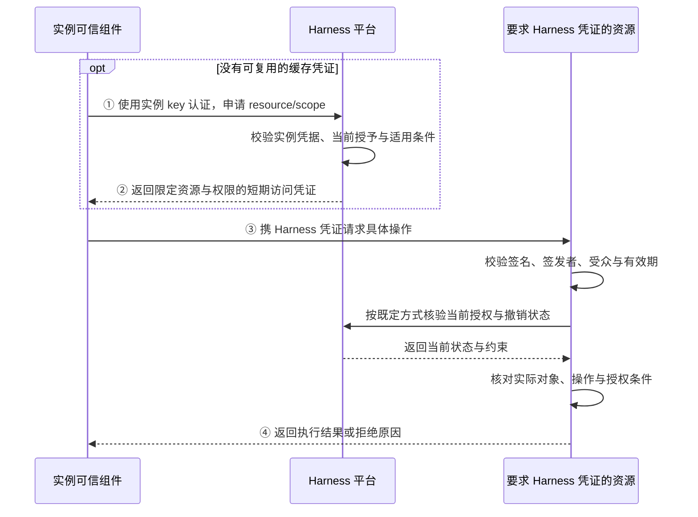
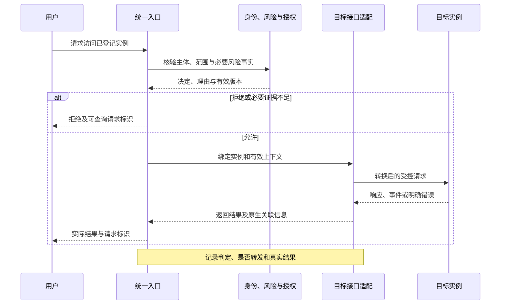
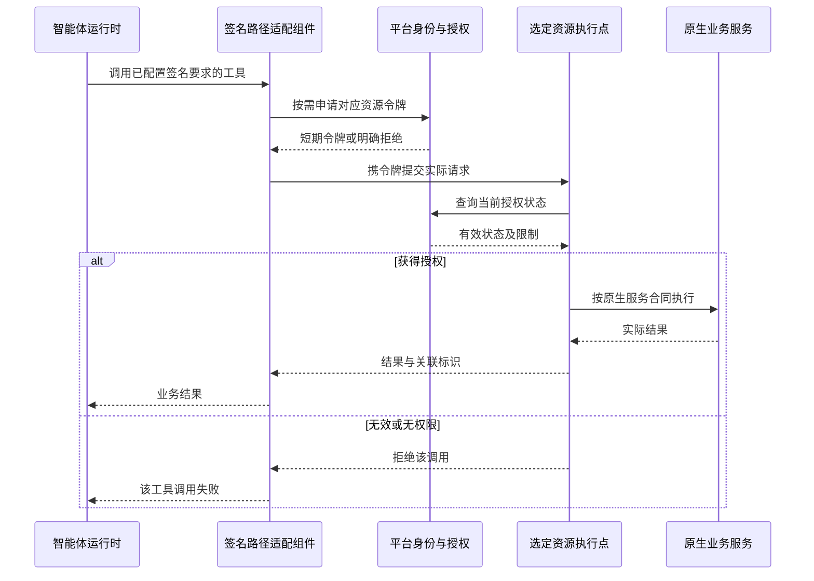
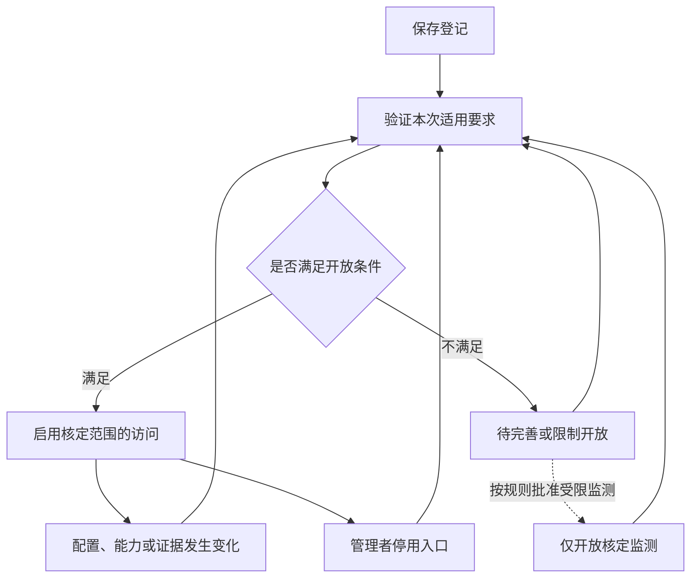

# Harness 工程平台：跨框架智能体统一纳管与安全访问策划设计方案

| 项目 | 内容 |
| --- | --- |
| 文档版本 | V0.6 |
| 作者 | luopeng |
| 日期 | 2026-11-02（北京时间） |
| 文档状态 | 策划设计建议，供需求评审和分阶段实施 |
| 适用阶段 | 内部工具阶段的增量建设，兼顾价值验证后的产品化 |
| 本期实施安排 | S0—S2；S3 按真实业务需要单项启动；S4 在价值验证后按交付需要推进 |
| 程序基线 | wr5912/harness-engineering-platform，bab392996476e8c988b335dcbfe72998605a71ad |
| 数据基线 | wr5912/harness-engineering-platform-data，17d103098f80f46ab6de3ebb7f9f6ed029719a80 |
| 核验说明 | 已复核上述基线、实例与工具执行路径、官方身份规范及首批框架接入资料；未启动平台、连接业务实例或执行运行验收 |
| 本文效力 | 用户确认的功能定义优先；其余为建议设计，不表示代码已实现、协议已支持或标准符合性已通过 |

## 阅读导航

- 第 1—3 章：功能定义、范围、设计决定与典型场景；第 3.5 节集中说明哪些能管、哪些只能观测、哪些仍由原系统负责。
- 第 4—6 章：页面组织、信息模型、接入架构、Compose 部署与首批适配。
- 第 7—10 章：实例凭据、认证状态接口、按资源启用的签名访问、撤销范围与接入验证。
- 第 11—13 章：十项总体要求的阶段映射、开源成果研究与当前实现落点。
- 第 14—17 章：工作包、验收、产品化演进和待验证事项。
- 附录 A—E：术语、记录示例、核心决定、原始来源、接口与令牌示例。

---

## 1 功能定义与需求依据

### 1.1 已确认的功能定义

> **跨框架智能体统一纳管与安全访问**：支持将已有智能体及其实例登记到 Harness 工程平台，记录所属系统、责任主体、接入方式和管理范围；通过统一访问入口实施身份认证、风险评估、访问授权和记录查询。根据不同接入方式已经验证的能力，逐步提供权限撤销、任务取消、工具访问控制等功能，并明确未覆盖的管理范围。

本定义是本方案的需求基准。

用户之前提出的“添加到平台的智能体实例列表中”等表述，不再作为必须直接混入现有列表的界面约束。页面位置、标签页、列表结构和操作方式应依据对象语义与使用体验选择。

用户提供的 a—j 总体要求作为安全设计方向。它们允许结合当前阶段增减、简化和分阶段实施；本方案不将全部长期要求直接转化为首期上线门槛，也不把未实现的要求标为已经满足。

### 1.2 要解决的实际问题

首批需要接入的是 DSH、AgentScope、OpenCode；后续可能扩展 Codex 或其他智能体。它们的部署位置、调用接口、维护责任和安全能力不同。

平台需要提供：

1. 一个能找到这些智能体及其实例的管理入口。
2. 一种不要求迁移原框架的登记和接入方式。
3. 一条能够真实执行认证、风险判断和访问授权的访问路径。
4. 一份可以查询的访问决定、返回结果和控制回执。
5. 清楚的能力边界：平台目前能够控制哪些路径，还有哪些由原系统负责。

平台价值首先由上述使用闭环验证。接入数量、支持协议名称、界面中的绿色状态都不能单独证明价值或控制效果。

### 1.3 当前项目原则对本方案的约束

当前仓库强调内部工具阶段、精要主义、最小完整能力、单一事实源、优先原生扩展与插件、新增自有实现使用 TypeScript/TSX，以及业务 Harness 语义变化与普通平台开发分别验证。当前 DSH-only 边界需要因本次明确的跨框架需求作有范围的扩展。[^P01]

本方案据此采用以下原则：

- DSH 继续承担平台现有的管理助手和默认 Harness 工作流；已有智能体可保留原运行时接入。
- 复用现有实例管理、身份提供方、业务控制和网关，优先增加小范围适配。
- 新增能力使用现有前端风格和布局规则；首页 LUI、顶部菜单、原生管理对话及右侧助手的既有交互继续作为设计基础。[^P02]
- 已呈现的功能应有完整的加载、空态、错误、长文本和窄屏体验，工具阶段不降低交互质量。
- 当前采用 Docker Compose 和既有基础设施。只有取得明确需求、实测缺口与替代方案对比，证明该组合不能满足要求后，才评估 Kubernetes；产品化、多框架和多台远端主机都不是自动升级理由。
- 实现本功能不要求预先引入多租户、服务网格、独立 IAM、调度平台、策略 DSL、统一记忆或复杂工作流。
- 平台工程变更使用针对性的工程验证；只有涉及业务 Harness 语义变化时，才进入既有 Experiment/Evaluation/Run 研究链。

### 1.4 文中结论的三种性质

| 性质 | 含义 |
| --- | --- |
| 已核验现状 | 来源于固定版本源码或官方原始资料；源码存在不代表本轮已运行验证 |
| 推荐设计 | 本方案为当前需求提出的取舍，尚需实施 |
| 条件能力 | 仅在特定接口、适配器、权限和场景验证后开放；不按框架名称默认具备 |

---

### 1.5 V0.2 新增的明确约束

| 用户本轮要求 | 本版落实方式 |
| --- | --- |
| 首批为 DSH、AgentScope、OpenCode | 三者进入首批交付与验收矩阵；Codex 移至后续候选，不能替代首批任一项 |
| Kubernetes 太重 | 默认 Compose；在第 6.7 节设置有证据的重新评估门槛 |
| 提供实例认证状态访问接口 | 提供实例自助查询与管理查询两个权限视图，标明事实来源、时间、范围和未知项 |
| 运行中可取得签名以访问其他服务 | 仅对明确要求 Harness 凭证的接口，采用“实例独立凭据 → 限定资源的短期令牌 → 服务端或选定代理校验” |
| 当前简单有效，兼顾长期 | 首期使用实例服务账户、可信连接器和一个真实受保护资源；用户委托、发送者约束及跨组织身份按需求演进 |

用户对 key 和签名的表述是待完善的设计设想。本版保留“实例可以证明身份并受控访问其他服务”的目标，将身份凭据、状态查询、签名令牌和执行授权分开。**平台不提供任意内容签名接口，也不把一张认证状态证明当作所有业务服务的通行证。**

### 1.6 V0.3 确认的签名适用边界

> **平台签发的凭证仅用于明确要求 Harness 签名认证的服务或接口。已运行的跨框架智能体实例访问其他不要求该凭证的服务时，继续采用原有调用路径、认证方式和权限规则。实例登记、未配置 Harness key、平台凭据过期或撤销、签发或校验服务故障，不应因此阻断这些原有调用。**

这里的“无需签名”专指无需 **Harness 签名凭证**，不表示无须该服务原有的 API key、OAuth、Cookie、证书、请求签名或业务权限。新增机制不覆盖或替换原有认证配置。

签名要求可以精确到同一服务的某个接口或操作，由服务责任方确认，并在服务端或其明确接入的前置校验组件执行。Agent 或模型不能自行把“要求签名”改为“不要求”。

本版按此边界修正 V0.2 的“默认代理”表述：只为明确接入签名认证的资源配置校验与必要适配；不把所有工具或全部网络出口统一改道。原有非签名服务不需要先登记到平台白名单才能继续使用。

如果一项任务确实依赖签名受保护接口，该接口被拒绝可能使该任务失败或等待；这是该任务的直接依赖结果。平台不应因此自动停掉实例、关闭其他服务连接或撤销其他服务的原生凭据。

## 2 策划结论与阶段范围

### 2.1 主要设计决定

| 编号 | 推荐决定 | 目的 |
| --- | --- | --- |
| D01 | 在现有“实例管理”内采用“平台托管 / 接入实例”两个标签页 | 保留既有操作路径，使接入对象使用恰当的列与操作 |
| D02 | 以生命周期管理责任区分两个标签页 | 避免把“外部”误解为非 DSH、远程主机或外网 |
| D03 | 逻辑上区分智能体登记与实例登记，允许一对多 | 支持同一智能体多部署，同时避免建设复杂资产图谱 |
| D04 | 外部登记不强制关联 Harness、Experiment、Variant 或 DSH 目录 | 支持已有系统原样接入 |
| D05 | 当前交付统一入口访问，并增加一个明确要求 Harness 凭证的资源访问闭环 | 分别验证入口权限与所选签名资源权限 |
| D06 | 先覆盖明确要求签名的资源；其他工具、任务或网络控制仅按独立需求与明确范围评估 | 签名接入不扩大为全部运行或网络控制 |
| D07 | 登记事实、策略配置、运行观测分别确定唯一写者 | 避免两份可编辑 endpoint 或相互覆盖的状态 |
| D08 | 接入验证按具体实例、适配器、接口和版本记录 | 协议连通与能力有效分别判断 |
| D09 | 停用入口、断开连接、取消任务、停止进程使用不同操作及回执 | 避免用户误认为“不能访问”就是“后台已停止” |
| D10 | 产品化能力由真实使用和交付需求触发 | 当前保留清晰边界，后续再补规模与交付设施 |
| D11 | 首批适配固定为 DSH、AgentScope、OpenCode | 每个真实版本单独验收，不以名称勾选代替支持 |
| D12 | Compose 为当前默认，Kubernetes 须通过证据门槛 | 把部署复杂度控制在已证明的需要内 |
| D13 | 认证状态只读查询与资源令牌签发分离 | 避免历史认证结果被当成当前授权 |
| D14 | 每实例独立机器凭据；平台签发私钥不出签发边界 | 支持逐实例撤销，避免扩散 DSH 共享秘密 |
| D15 | 要求签名的资源选择服务端校验或前置代理；其他调用沿用原方式 | 只为选定接口增加必要适配，保留既有使用 |
| D16 | 要求 Harness 签名的资源执行前检查当前状态与实际操作 | 明确撤权效果，避免仅验签就放行 |
| D17 | 签名故障、过期与撤销只影响依赖该凭证的范围 | 原有非签名服务不增加平台在线依赖 |

本轮已确认的阶段投入安排见 2.3；其他设计细节仍作为方案建议，不据此推定已经批准全部实现内容。

### 2.2 本期最小完整范围

本期实施范围为 **S0—S2**，包含两条相互关联、分别验证的路径：

1. **访问实例**：登记已有实例 → 验证接入 → 核定访问范围 → 用户经统一入口使用 → 查询风险、授权与结果 → 验证入口撤权。
2. **实例访问签名受保护资源**：在资源明确要求 Harness 凭证后，按需配置实例凭据 → 可信组件取得该资源令牌 → 服务或其前置代理检查当前状态和操作 → 执行与记录 → 验证撤销。

原有不要求 Harness 凭证的服务继续原路径；上述第二条链路不作为实例所有工具调用或继续运行的前置条件。本文后续“签名受保护资源”及本签名机制中的“受保护资源”均指明确要求 Harness 凭证的范围，不能据此泛指所有需要其他认证的服务。

首期至少实现：

- 接入实例登记、编辑、查询、停用和移除，保留所属系统、责任主体和管理范围。
- 已选择接口的连通、目标识别、认证和真实交互验证。
- 调用者认证、实例入口与已开放操作授权，必要会话归属控制。
- 接入风险、访问风险及选定资源操作的风险判断。
- 实例凭据发放、状态查询、有限签发、轮换与撤销；秘密不进入普通前端、日志和模型上下文。
- 一种明确要求 Harness 签名的真实业务资源，以及至少一个沿用原认证的非签名服务；验证两者可以并存。
- 对签名路径验证拒绝、过期、续期、撤销和故障；同时验证其他原有调用不因此改变或被阻断。
- 明确未知、未覆盖和不能取消的部分，并对既有 DSH 路径作相关回归。

这里的“一个资源”用于先证明共同安全链路；首批框架完成标准仍是 DSH、AgentScope、OpenCode 各有真实样本通过。首期不承诺全量出站隔离、任意用户委托、任意服务自动接受令牌、全框架后台任务治理。

### 2.3 分阶段交付、本期范围与首批完成标准

**已确认的实施安排：当前集中完成 S0—S2，形成三框架接入与安全访问闭环，随后进入内部使用、反馈和价值验证。S3、S4 不作为本期必须完成的开发任务，也不作为 S2 的统一验收前置条件。**

| 阶段 | 当前投入安排 | 交付重点 | 完成或启动依据 |
| --- | --- | --- | --- |
| S0：合同与样本固定 | 本期执行，以首个真实闭环所需准备为限 | 固定三框架实际版本、责任与范围、一个资源、身份与授权合同、Compose 基线 | 对象与两条路径可解释；必需的凭据保管和执行点可落实 |
| S1：最小纵向闭环 | 本期核心，尽早形成可用样本 | DSH 基准与一个真实 AgentScope 接入；完成实例入口、状态接口、机器凭据及一个工具代理资源 | 正常访问、拒绝、续期、记录、撤销和故障可核验 |
| S2：首批收齐 | 本期完成目标 | 加入真实 OpenCode 样本，完成三框架的入口及同一受保护资源访问验证 | 三者都有版本能力矩阵与证据；不依赖假 DSH manifest 或人工粘贴短期 token |
| S3：按独立需求加深 | 默认暂不全面展开；内部使用阶段也可按需单项启动 | 明确授权范围的高影响工具或任务控制；需要时增加用户委托或发送者约束，网络限制另行核定 | 有具体业务需要、可靠执行点及可验证收益；无需等待产品化 |
| S4：产品化 | 使用价值验证后，按实际交付需要逐项推进 | 安装升级、身份系统集成、稳定性、维护支持和审计增强 | 有重复价值、明确交付对象及可承担维护成本；不要求先完成全部 S3；Compose 门槛持续有效 |

**S2 的交付结果：** DSH、AgentScope、OpenCode 各有真实样本能够登记并经平台入口按授权使用；对一个明确要求 Harness 凭证的真实资源完成领取、使用、拒绝、撤销和故障验证；原有非签名调用保持原行为；管理界面清楚显示已验证能力、未覆盖范围和责任主体。达成这些结果即可形成首期交付，不为补齐所有后续能力持续扩大本期范围。

**基础安全随 S0—S2 完成。** 身份认证、当前开放范围内的最小权限、凭据保护、必要记录、撤权和故障处理均属于本期要求。S3 延后的是更深或更广的控制范围，不是上述基础机制。如果某项业务必须具备审批、任务取消、真实用户委托或更强令牌保护才能安全开放，应先落实相应控制并验证，或收窄、暂缓该业务；不能仅因相关能力列在 S3 就带着不满足的必要条件开放。

**S3 与 S4 不强制串行。** 例如内部试用确认某类后台巡检必须可取消时，可只启动 S3 中的任务取消；有实际交付需求时，也可以推进所需的 S4 工作，不必先建设全部任务、进程或网络控制。阶段表示投入范围和触发条件，不表示所有能力必须按编号依次做完。

S1 内可以先完成 DSH 的资源路径，再完成 AgentScope；OpenCode 若已有更容易验证的真实样本，也可提前并行。**调整施工顺序不改变首批清单。Codex 是后续候选，不进入本版首批完成条件。** 阶段不等于未经评估的工期承诺。

尚未取得样本或不能保护凭据的签名适配组合保持待验证，不能发布为已支持签名访问；这不妨碍该实例原有非签名服务调用，也不否定独立通过的登记或入口能力。首批样本的签名验证要求不等于强制每个被登记实例启用该功能。

### 2.4 两类建议验收范围

本方案使用“入口访问范围”和“执行控制范围”组织需求。它们是本项目建议的实现与验收集合，不是外部标准定义的安全等级。

- **入口访问范围**：调用者、目标、接入通道、访问决定、转发与记录。
- **执行控制范围**：实际工具、业务资源、任务、进程或网络出口等已纳入的执行点。

实例可在核定的入口范围验证通过后提供相应业务访问，同时明确内部控制未覆盖项。若某项业务必须依赖内部执行控制，而该控制尚未具备，则不能仅凭入口通过开放该业务。

---

## 3 对象、责任与典型场景

### 3.1 四个维度分别记录

| 维度 | 回答的问题 | 示例 |
| --- | --- | --- |
| 运行框架 | 用什么运行时实现？ | 首批 DSH、AgentScope、OpenCode；后续可扩展 |
| 生命周期责任 | 谁负责主要部署、升级、启停和恢复？ | Harness 平台、原业务系统、责任团队 |
| 运行位置 | 实际部署或运行在哪里？ | 本机、内网主机、集群、云环境 |
| 接入方式 | 平台通过什么接口连接？ | Web 代理、API/协议端点、本地执行桥 |

标签页以生命周期责任为主要依据：

- 其他团队部署并维护的 DSH 服务，属于“接入实例”。
- Harness 平台负责生命周期的远端实例，属于“平台托管”。
- 本机已安装的 OpenCode 经接入桥使用、仍由原使用方维护，可以属于“接入实例”。
- 平台维护接入桥，并不自动意味着平台接管了目标软件的部署与升级。

后续若管理责任转移，应显式更新并重新核验受影响能力，不能仅修改框架名称来移动分类。

实例应保存明确的生命周期管理模式，并单独记录具体责任主体。标签页由管理模式生成，不依据框架、物理位置、是否关联 Harness 或登记文件来源推断。既有平台实例通过兼容解析按原生命周期合同映射；新增接入实例明确记录相应模式。

### 3.2 智能体、实例、连接与会话

- **智能体登记**描述逻辑对象：名称、用途、所属系统和责任主体。
- **实例登记**描述一个明确的部署、运行配置或服务入口，以及接入与控制范围。
- **连接**表示平台与接入端之间的一次通信通道。
- **会话/任务**是业务交互对象，可能由目标系统创建，也可能不存在。

一个服务 endpoint 可能包含多个智能体，因此实例绑定可以需要目标选择器。一个智能体也可能有测试、生产或不同地域的多个实例。

CLI 场景须写清登记的是“已有运行进程”还是“允许接入桥按配置创建会话的执行入口”。只有真实协议支持接管已有进程或恢复既有会话时，才提供对应功能。

### 3.3 最小责任分工

| 活动 | Harness 平台 | 被纳管系统/责任方 |
| --- | --- | --- |
| 登记与范围 | 维护记录、核验、访问入口与变更记录 | 提供真实信息并确认责任 |
| 用户访问 | 在平台路径上认证、授权、风险判断、记录 | 配合身份或凭据映射，说明原生会话规则 |
| 原服务运行 | 观察已提供的状态 | 对其负责的部署、升级、故障恢复作处置 |
| 执行控制 | 对已纳入的执行点下发或实施控制 | 按约定执行并反馈，不伪造生效结果 |
| 异常协同 | 限制受影响入口，说明影响和证据 | 确认后台任务、内部状态和修复结果 |

当前可以通过负责人、联系方式或组织标识、管理范围和处置说明实现，无需建立复杂责任管理子系统。

### 3.4 典型使用场景

| 场景 | 用户动作 | 平台行为 | 必须讲清的边界 |
| --- | --- | --- | --- |
| 接入已有 AgentScope 业务服务 | 登记服务、负责人、入口和凭据 | 验证实际接口，配置访问范围，提供统一入口 | 不要求重写为 DSH；服务内部工具不因接入自动受控 |
| 接入其他团队维护的 DSH 服务 | 选择 DSH 与实际接入方式 | 按真实支持能力接入 | 使用 DSH 不等于已完成本平台专用 HMAC/控制协议 |
| 接入本机 OpenCode 执行入口 | 选择已配置接入桥和运行配置 | 转换请求与事件，控制经过桥的访问 | 不默认接管任意现存终端会话，不自动安装未知脚本 |
| 为同一智能体新增第二实例 | 选择已登记智能体并登记新实例 | 继承适当元数据，单独验证实例 | 原实例的认证与能力结论不自动复制给新实例 |
| 授权使用与查询 | 用户访问实例、读取自己的结果 | 核验主体、实例、会话及产物归属 | 共享使用模式必须明确，不能伪称用户隔离 |
| 发现风险后限制入口 | 管理员停用或撤销权限 | 拒绝新访问，处理受影响长连接，记录结果 | 远端任务是否停止另行确认 |
| 只允许受限监测 | 核定监测范围后登记 | 只开放明确的监测动作 | 业务问答、巡检不因看起来只读而自动获得许可 |

### 3.5 管理范围总表：平台能管到哪里

**管理范围按具体实例、具体路径和具体操作核定，不能仅按框架名称或“已纳管”标签判定。** 平台需要同时具备相应管理授权、能够执行限制的可信位置，以及证明其有效的接入验证结果。登记、连通、收到日志、成功领取 token 分别证明不同事实，不能相互替代。

#### 3.5.1 先分清当前代码与本方案设计

| 范围 | 固定基线能支持的结论 | 当前不能宣称的能力 |
| --- | --- | --- |
| 现有 DSH 实例与业务控制 | 有实例操作、统一网关、调用者身份、风险和访问授权的代码基础 | 不能据此推定所有外部 DSH 已接入同一控制合同 |
| 已有 AgentScope、OpenCode 等原框架实例 | 本方案确定首批适配路线；现有网关和控制逻辑可作为扩展基础 | 外部登记、原框架原地接入及相应控制尚不能标为已实施验收 |
| 实例 key、短期 Harness 凭证与应用接口访问 | 本方案明确凭据、签发、校验、撤销和原生调用并存的合同 | 既有 DSH 内部签名不等于通用资源凭证闭环已经实现 |

上述判断基于封面的固定代码版本；本轮未连接实际业务环境、逐实例执行运行验收。因此下面的“可管”是**按方案完成接入并验证后可承诺的范围**，不是当前部署环境的已验证能力清单。每个实例的真实状态应由其能力和验证记录产生。已有代码与增量落点详见第 13 章。[^P04][^P05][^P06][^P07][^P13]

#### 3.5.2 对外部智能体实例的管理边界

| 管理事项 | 平台可管理或观测的范围 | 必要条件与执行位置 | 未覆盖范围及原责任方职责 |
| --- | --- | --- | --- |
| 登记与责任 | 维护实例标识、框架、所属系统、责任主体、端点、接入方式和开放范围；停用或移除平台登记 | 登记接口、管理权限和版本记录 | 移除登记不删除远端软件、数据或进程；声明内容仍须核验 |
| 经平台访问实例 | 对经过统一入口的调用者认证、入口与已识别操作授权、必要风险判断、访问拒绝及记录 | 已验证网关路径、目标绑定和适配；在转发前执行检查 | 只代理不透明流量时不宣称逐消息、逐工具控制 |
| 实例原有其他入口 | 已明确接入控制的原生入口可按其实际接口管理；未接入的仅记录已知情况 | 原服务自行校验，或责任方明确授权配置其他执行点 | 原生 URL、CLI、计划任务和其他客户端不会因平台入口停用而自动失效；入口旁路须单独核验 |
| 运行状态与风险 | 查询实际提供的健康、会话、任务、版本及风险证据，标注来源、时间和未知项 | 目标查询接口或受授权采集；风险判断限于实际可获取的数据 | 心跳成功不证明内部任务正常；登记或认证成功不证明全部行为安全 |
| 会话与任务 | 发起已开放任务、关联原生任务 ID；有能力时查询、请求取消并核验结果 | 对应接口真实存在、平台有权调用且已验证语义 | 关闭页面或连接不等于后台任务取消；未获结果的子任务保持未知 |
| 部署、升级、启停与恢复 | 只在额外取得相应生命周期权限、接入控制接口并验证后开放相应动作 | 原系统运维接口、受控执行桥或平台实际负责的运行环境 | 外部实例默认由原责任方维护；同为 DSH、本机运行或可见容器均不自动赋予控制权 |
| 内部工具、Shell、文件、网络及其他智能体调用 | 仅管理明确接入的工具执行点、资源接口或其他已授权控制点 | 限制必须在实际调用经过的位置执行；覆盖范围和绕过检查可验证 | 其他内部工具、原生凭据、任意命令、全部网络出口及下游智能体不会因登记自动受控 |

“只能观测”与“可以阻断”分别记录。能够收到任务日志、看到 shell 输出、读取风险事件，并不代表平台能够阻止下一次执行。反过来，只有入口拒绝记录，也不能证明远端全部运行已经停止。

本期优先完成登记、入口访问和选定资源访问。更深任务、进程或网络管理按真实需求逐项增加；不将整台主机或全部运行环境默认并入跨框架接入范围。

#### 3.5.3 对实例访问的应用服务的管理边界

**应用接口的访问权限与应用系统自身的运行管理分别核定。** 某服务要求 Harness 凭证，意味着选定接口接受平台参与访问授权；不自动意味着应用整体交由 Harness 托管。

| 应用服务或调用路径 | 平台可管理的范围 | 实际生效条件与证据 | 本功能不自动覆盖的部分 |
| --- | --- | --- | --- |
| 服务本身要求 Harness 凭证 | 管理该实例对已登记资源的授予、有限签发、轮换、撤销；服务按真实操作和对象执行授权 | 服务校验签名、受众、时效及当前状态；对象和动作必须与服务自身权限语义对应 | 平台签发成功不证明请求已到达、执行成功或服务全部接口均受控 |
| 由选定前置组件要求 Harness 凭证 | 对经过该组件的已核定接口实施验证、授权、记录，并按合同使用下游原生认证 | 代理目标固定，操作映射和凭据边界清楚；同一受保护接口的绕过路径已核验 | 代理不能因此成为实例全局网络出口；其他服务和接口不自动改道 |
| 仅对接日志、事件或状态 | 查询已授权的数据，形成风险事实、告警或处置建议 | 有真实采集接口、来源和时间；必要时由原系统确认结果 | 日志接入本身不具备阻断、撤权、取消或修改业务数据的能力 |
| 不要求 Harness 凭证、沿用原路径的服务 | 本签名机制不增加控制；可另按明确授权进行状态观测 | 原调用路径、原凭据、原认证与权限继续生效 | Harness key 缺失、过期、撤销或签发故障不新增阻断；不把这些路径标为已受本签名机制控制 |
| 已有其他平台控制接口的服务或工具 | 继续按原有管理合同实施已经具备的控制 | 依赖原有受授权接口和真实执行点，单独记录能力 | “不要求 Harness 凭证”不等于取消该服务原有权限检查，也不否定其已有其他管理能力 |
| 应用系统自身的生命周期与内部管理 | 只有另行纳入且具备真实管理接口时，才管理相应部署、启停、账户或配置 | 应用责任方授权、独立管理凭据、明确操作和结果验证 | 本方案不自动接管应用安装升级、全局账户、数据库内容、服务可用性或备份恢复 |
| 应用继续调用其他服务或智能体 | 仅对进一步明确接入的路径，按其主体与授权单独判断 | 每一级实际访问均有适用合同；委派不扩大原授权 | 上游 token 被接受不表示下游已纳管；不能将 token 任意透传或自动获得下游权限 |

服务原生校验时，完整访问记录依赖服务返回的事件、日志或结果接口。只有平台签发日志时，最多能证明“发过什么凭证”；有状态查询时能证明该次查询的判断；要显示业务成功、实际数据变更或任务完成，还需相应执行结果证据。平台无需为了获得记录而强制代理全部业务流量。

资源列表记录的是**明确要求 Harness 凭证并接入的资源范围**，不要求枚举实例能访问的所有普通服务，也不要求先建“免签白名单”。同一应用可以只有某些接口要求 Harness 凭证，其他接口继续原规则。

#### 3.5.4 控制动作不能跨范围推定

| 动作 | 可以承诺的直接效果 | 不能直接推定 |
| --- | --- | --- |
| 停用平台实例入口 | 新的平台入口访问被拒绝，相应连接按核定方式处理 | 实例停止运行、所有资源授予被撤销、其他原生入口关闭 |
| 撤销实例 key | 禁止该凭据继续认证和签发；按本方案在线状态联动使关联旧 token 的后续检查拒绝 | 纯离线校验自动知道撤销、任务已停、原生 API key 被撤销 |
| 撤销某资源授予 | 拒绝该范围的新签发及不再满足当前授权的后续受保护操作 | 所有资源一起停用、已完成操作回滚、在途请求立即消失 |
| 请求取消任务或停止进程 | 按该原生任务或受控进程的实际能力执行，并回读状态 | 所有远端异步任务、子任务和已产生副作用同时消失 |

不同动作如果确需联动，应有明确选择、范围和逐项反馈；本签名功能不默认加入“禁用整个智能体”的联动。撤销与在途操作的具体语义见 7.14，任务、连接和进程的区分见第 9 章。

#### 3.5.5 一个便于理解的范围示例

以下为设计示例，不是当前环境验收结果：某个原系统维护的 AgentScope 巡检实例通过平台接入，同时访问三个应用接口。

| 项目 | 已核定条件 | 平台管理范围 |
| --- | --- | --- |
| 用户通过平台使用该实例 | 入口适配与授权已验证 | 可管理谁经该入口使用；停用入口只产生相应入口效果 |
| 读取 SOC 中资产组 A 的状态 | 该接口明确要求 Harness 凭证；资产组 A 只读授权与执行点已验证 | 可管理凭证和该范围访问；不能据此管理 SOC 系统启停或修改其他资产组 |
| 使用原 SSH 凭据查询网络设备 | 未接入 Harness 凭证验证或其他平台执行控制点 | 保持原 SSH 与权限规则；撤销 Harness key 不影响这条调用 |
| 使用原 API key 调用模型服务 | 不要求 Harness 凭证 | 保持原调用；不能由登记推定已能限制全部模型调用或费用 |
| 取消已发出的远端巡检任务 | 目标尚未提供或验证取消接口 | 平台只能展示已取得的状态、提示需原系统处置，不能显示“已停止” |

同样的规则适用于 DSH、OpenCode。框架名称不会改变控制范围，也不会替代具体版本和路径的验证。

#### 3.5.6 在界面上怎样说明

复用 4.5 的实例详情，不新增独立管理中心。每个实例应有简短的“管理范围”摘要，至少说明：

- 已验证可控的入口、资源或动作，以及其准确适用范围。
- 只能观测的事实及其来源、最近时间。
- 未覆盖或待验证的控制能力，以及由谁负责处置。
- 对应验证记录和变化后的重新验证状态。

例如展示“平台入口：已验证；SOC 资产组 A 只读接口：已验证；任务取消：待验证；远端进程与原 SSH：未纳入本功能；运行维护：原系统团队”。实际字段与状态复用既有能力和验证记录，不另建一套可编辑清单。

未知不自动当作不支持，也不自动当作安全或可控。原有普通服务只需说明当前已知边界；未发现、未声明的其他调用不得虚构为完整资产清单。若确需仅开放受限监测，再按第 8 章及经核定的 limited 规则办理，不把普通能力缺项一律改成 limited。

---

## 4 产品信息架构与交互设计

### 4.1 页面组织方案比较

| 方案 | 优点 | 当前主要代价 | 判断 |
| --- | --- | --- | --- |
| 混合列表加筛选 | 全部实例一处检索 | Harness 来源、生命周期与外部接入列差异大；容易出现空字段和大量禁用操作 | 未来可用于总览，首期不强制混合 |
| 实例管理内双标签页 | 复用现有菜单，责任和操作明确，增量较小 | 需要保证共享底层合同，避免两套权限系统 | **当前推荐** |
| 独立“外部智能体”顶层菜单 | 容纳独立运营流程容易 | 用户需要判断同一对象去哪管理，过早增加管理入口 | 需求明显独立后再评估 |

### 4.2 推荐页面结构

在现有“实例管理”中增加：

| 标签页 | 对象 | 主要操作 |
| --- | --- | --- |
| **平台托管** | 平台承担主要生命周期管理责任的实例 | 沿用已有创建、运行、停止、重启等实际支持操作 |
| **接入实例** | 已有智能体或服务的登记实例，主要生命周期由原责任方承担 | 登记、验证、访问、授权、停用入口、查看记录、移除登记 |

推荐使用“接入实例”而非仅“外部实例”，减少部署位置和框架类型的误解。如产品术语最终采用“外部接入”，应在空态和帮助中保留相同定义。

首页 LUI、顶部菜单结构和 DSH 原生管理对话继续按现有规范组织。当前无需增加“全部实例”第三个标签页；确有跨类型搜索需求时，再提供统一查询投影。

### 4.3 登记操作：两步表单

主按钮建议命名为 **“登记已有智能体”**。已有逻辑智能体的详情中可以提供“新增接入实例”。

**第一步：对象与责任**

- 登记新智能体及首个实例，或关联已登记智能体。
- 智能体名称、所属系统、责任主体。
- 实例名称或用途环境。
- 登记人由登录上下文记录，与责任主体分开；相关责任信息由用户核对。
- 关联已登记智能体时，所属系统和逻辑智能体责任信息默认只读。当前实例需要不同运维责任时，记录实例级责任说明，不静默修改父对象；修改公共信息使用独立动作，提示受影响实例并检查相应权限。

**第二步：连接与开放范围**

- 框架类型与接入方式。
- 服务地址、目标选择器，或接入桥及既有执行配置。
- 凭据引用。
- 允许访问的主体和操作。
- 当前管理范围与共享/隔离使用方式。

描述、标签、声明版本、补充来源等放入可展开区域。不要把十条安全要求变成十组必填大表单。

两种提交动作分别为：

- **保存登记**：允许保留不完整或待验证信息，不开放业务访问。
- **验证并启用访问**：通过适用验证与授权后开放入口；是否额外审批由实际策略决定。

验证连接展示连通、目标核验、认证、接口能力、风险发现和未验证项。探测仅执行已约定的安全检查，不默认触发有业务副作用的任务。

### 4.4 接入实例列表

首屏建议展示以下信息，按屏幕宽度组合列：

| 信息 | 展示方式 |
| --- | --- |
| 实例/智能体 | 主名称加逻辑智能体名称；完整名称可查看，不用 ID 替代用户名称 |
| 所属与责任 | 所属系统、责任主体，可合并在一列 |
| 框架/方式 | 框架、API/Web/桥类型 |
| 连接 | 最近检测结果及时间，避免过期绿色状态 |
| 入口 | 已启用、已停用、待验证或受限制 |
| 风险 | 简短发现、范围和评估时间；未知独立显示 |
| 操作 | 访问；更多菜单包含验证、编辑、授权、记录、停用、移除 |

初期筛选包括所属系统、责任主体、框架、连接状态和入口状态。管理范围等高级条件放入更多筛选。

用户只能看见授权范围内的对象；列表计数、搜索建议和错误信息同样遵守可见性要求。是否允许“可见但不可调用”可按已有规则配置。

### 4.5 详情页

推荐四个标签页：

| 标签页 | 内容 |
| --- | --- |
| 概览 | 身份与责任、接入位置、风险摘要、验证范围、主要入口、异常待处理 |
| 接入与能力 | 接入配置、凭据引用、声明与验证结果、接口版本、覆盖和未覆盖范围 |
| 访问授权 | 分为“谁能访问实例”和“要求 Harness 凭证的服务”；分别显示范围、凭据、当前授权及生效结果 |
| 访问记录 | 请求、拒绝、风险判定、撤权和控制回执；按请求关联证据 |

在“接入与能力”内增加“实例身份”小节，展示 client ID、凭据编号、状态、到期时间、最近认证及证据范围；提供有权限的创建、轮换和撤销操作。秘密仅在明确创建流程中交付一次，普通详情只显示引用。自助状态查询成功也只表明本次凭据认证成立。

在“访问授权”内增加“要求 Harness 凭证的服务”列表：目标资源、适用接口/操作、对象范围、实际执行点、凭据模式、撤销方式和验证状态。该列表不表示实例全部可访问服务；未在此启用签名的既有调用沿用原规则，无需完整登记。原有“访问”按钮继续用于使用实例；不新增面向普通使用者的“复制签名”按钮。接入说明提供接口和配置示例，真实凭证由可信组件管理。

“停用入口”与“禁用 Harness 签名资源访问”使用不同名称。后者仅限制相应签名授予，不停实例、不撤销其他服务凭据。原有任务/进程控制保留独立动作与明确作用对象，不能由签名故障自动触发，也不能显示笼统的“全部已停止”。

风险详情可从摘要展开，不必另建风险中心。未覆盖范围由能力记录生成，不能成为所有实例完全相同的免责声明。 管理范围摘要按 3.5.6 展示已验证可控、仅可观测、未覆盖或待验证的具体事项，并关联责任与证据；不以一个总开关表示全部行为已受控。

### 4.6 “访问”怎样使用

- **API/消息接口**：通过轻量实例访问页提供输入、输出、错误、必要流式与产物入口；恢复和取消按能力开放。
- **原生 Web**：经经过验证的代理或目标侧集成保留原界面，核验资源、跳转、登录、会话和长连接路径。
- **脚本调用**：提供使用平台实例标识与平台调用身份的 API 示例；初期无需另开发完整 CLI。
- **原界面链接**：可作为登记信息或补充导航，但应明确“打开原界面”的控制边界，不能因此标记统一安全访问已验证。

原界面导航地址与受控路由目标分别命名和保存。点击参考链接可以记录导航事件，不能记成“业务调用已授权并执行”。

实例访问页用于调用业务智能体；管理助手用于登记、解释状态、查询记录和管理操作。管理助手与 GUI 使用同一受控接口，其模型输出不直接形成授权。

### 4.7 交互质量要求

- 切换标签页保留各自查询条件和合理的返回位置。
- 提交期间防止重复登记；超时后先查询提交结果，避免盲目再次创建。
- 验证结果标明来源和时间，失败时允许修正，保留用户已填写的非秘密字段。
- 危险操作使用准确名称：“停用入口”“移除登记”“取消任务”“停止进程”分别表述。
- 批量操作在单项闭环稳定且有真实需求后增加，逐项返回结果，不能用整体成功掩盖部分失败。
- 错误提示说明影响、已完成事项和可采取的下一步，不以笼统“操作失败”替代已知事实。
- 遵循现有浅色、白色、浅蓝主题、组件、间距和文字规则；状态不能只依赖颜色。[^P02]

---

## 5 信息模型、事实来源与存储

### 5.1 最小逻辑对象

| 对象 | 必需语义 | 当前落地方式 |
| --- | --- | --- |
| 智能体登记 | 稳定 ID、名称、所属系统、责任主体、用途 | 轻量登记；可选关联现有 Harness 资产 |
| 实例登记 | 所属智能体、实例 ID、管理责任、运行位置、接入绑定、范围 | 与逻辑智能体同文件维护即可 |
| 接入绑定 | 适配器、接口版本、目标、凭据引用、配置修订 | 由登记的唯一管理入口修改 |
| 实例机器凭据 | 独立 client ID、credential ID、校验材料引用、状态、有效期、轮换记录 | 专用凭据存储；登记文件只引用，不保存明文秘密 |
| 签名受保护资源与授予 | 资源标识、可信入口、明确要求签名的接口/操作、对象范围、实例授权版本 | 复用现有资源配置和访问策略；只登记签名适用范围，不要求枚举所有非签名服务 |
| 验证与能力记录 | 检查对象、版本、时间、证据、结论和失效范围 | 结构化记录，不另建复杂证据图谱 |
| 访问/控制记录 | 主体、实例、请求、风险与授权决定、转发/回执 | 日常记录，与研究 Run 分开 |

这是逻辑职责划分，不要求每个对象各建数据库表、菜单或独立服务。

名称不作为唯一身份。一个服务的自报 ID 作为来源标识保存，平台仍维护稳定登记 ID；同名或同框架不自动合并对象。

同一逻辑智能体的平台托管实例与接入实例通过稳定 ID 或明确的既有对象关联进入共同查询。将来若支持管理责任转移，应保留逻辑和实例身份、授权与历史引用，验证后明确移交字段写者，不复制第二份实例记录；首期不必预建责任迁移操作。

### 5.2 四类事实分别保存

| 事实类别 | 示例 | 不可自动推定 |
| --- | --- | --- |
| 声明 | 提供方版本、技能、身份、支持接口 | 声明内容已实现或已验证 |
| 通信与主体认证 | 调用者认证、端点证书或凭据校验 | 已获业务授权、代码可信、内部行为安全 |
| 平台配置与授权 | 开放主体、操作、入口、策略版本 | 所有执行点已经应用并生效 |
| 观测与验证 | 接口调用、真实状态、拒绝证据、取消回执 | 持续有效、未观测路径受控 |

必要记录包含来源、观测或生效时间、适用对象和引用。多个记录不一致时保留差异并显示，不能以最新声明静默覆盖已经观测的事实。

### 5.3 推荐的事实源安排

本版推荐：

- 拟新增一个版本化登记文件，例如 **config/external-instances.json**，维护接入智能体、实例和接入绑定。
- 现有 **config/business-access.json** 继续作为访问策略的事实源，引用稳定实例或智能体 ID。
- 网关路由从登记和策略生成只读投影；不再在其他位置保存第二份可编辑 endpoint。
- 平台托管 DSH 的既有实例 manifest 继续作为对应运行事实来源。
- 实时连接、会话和调用状态放入明确的本地运行状态区域；秘密通过独立凭据机制引用。
- 访问记录由唯一事件写入口产生，列表和详情读取其投影。
- 每实例机器凭据的校验材料、签发私钥和资源原生秘密进入专用凭据区；不能进入可提交的登记 JSON。
- 资源端点与工具操作优先引用现有 MCP/OpenAPI 配置；新增授权引用稳定 resource ID，不另存第二份可编辑目标 URL。
- 资源授予版本、凭据状态和撤销状态必须持久化；内存缓存不能在重启后恢复已经撤掉的权限。

文件名属于实施建议，尚未创建。存储格式实施时可按现有配置习惯细化，但唯一写者和禁止双写事实是必须保留的决定。

具体字段归属应进一步固定：纯接入智能体的名称、所属系统和业务责任由登记源维护；关联平台已有逻辑智能体时引用其事实源，不复制一份可编辑公共信息。实例接入绑定、管理模式和实例级运维责任由对应实例管理源维护；运行 manifest 或探测结果提供各自运行事实。共同视图仅作只读投影。

### 5.4 摘要和版本的语义

至少区分：

- **登记修订/配置摘要**：指本次决定绑定哪份接入配置。
- **声明版本**：提供方或用户声明的版本。
- **观测版本**：接口或运行端实际返回的版本，并保留证据。
- **已核验来源摘要**：实际核验代码、构建产物或明确来源后才存在。

不能把 endpoint 或登记 JSON 的哈希填入现有 DSH sourceDigest，再据此显示“源码已验证”。外部绑定应有明确的独立合同。当前 DSH 合同存在来源摘要与运行代次假设，需要在扩展时拆清。[^P06][^P08]

### 5.5 配置变更、并发与恢复

- 编辑采用 revision 检查、既有操作锁和原子写，避免两个管理员静默覆盖。
- 目标地址、认证方式、适配器或开放能力改变时，使受影响验证失效。
- 新配置未验证前保持待启用；如继续使用旧有效配置，界面应同时显示“已生效版本”和“待验证变更”。
- 旧配置继续服务仅适用于旧身份、凭据、权限和必要验证仍然有效的情况。撤权、入口停用、范围收缩及已确认风险阻断应作用于当前访问，不能滞留在待验证配置中继续沿用旧允许结果。
- 业务转发前确认决策仍绑定当前有效实例、配置和权限；关键条件改变时重新判断。
- schema 迁移使用同一解析入口，保留可恢复备份；不支持的版本应明确报错，不能悄悄丢字段。
- 程序回退必须匹配相应配置；不能依赖旧程序误读新结构。
- 平台重启后重新观测实时状态，不将历史在线直接恢复为当前在线。
- 运行目录中的会话、凭据和记录按各自保留规则处理，不统称为可随意删除的缓存。

“验证并启用访问”跨登记和策略两个事实源，不能仅依赖单文件原子写。由同一应用操作协调已验证登记修订、有效策略修订与启用状态；任一条件不满足，不生成可用路由、不显示启用成功。部分写入、超时或恢复后先查询实际生效状态；引用不存在对象或不匹配修订的授权不成立。这是一致性要求，不要求为此引入数据库或分布式事务平台。

---

## 6 接入架构与适配合同

### 6.1 逻辑架构

逻辑架构区分两组授权关系：**调用者访问智能体实例**，以及**实例访问资源和服务**。前者由平台统一访问入口、身份与协议适配承担；后者在目标明确要求 Harness 凭证时，由平台签发凭证，再由目标服务或其指定验证组件实施校验与访问控制。

**已接入实例需要访问要求 Harness 凭证的目标时，先使用平台为该实例登记并交付的 key 向平台申请目标凭证，再携带该凭证访问目标。** 平台是凭证签发与授权状态提供方，业务请求可以直接到达目标服务；只有选定的资源路径才按需要设置前置代理。

| 调用路径 | 使用的身份材料 | 职责与边界 |
| --- | --- | --- |
| 调用者 → 平台统一入口 → 接入适配 → 智能体实例 | 调用者身份及相应调用授权 | 决定谁可以访问哪个实例、执行哪些实例操作 |
| 实例可信组件 → 平台凭证接口 | 该实例独立的 client ID/key，以及请求的 resource/scope | 平台核验实例凭据、当前授予与适用条件，决定是否签发、签给谁及范围 |
| 实例可信组件 → 要求 Harness 凭证的资源服务或其指定验证组件 | 平台返回的短期访问凭证 | 目标校验凭证，并按真实资源、操作和当前授权决定是否执行 |
| 实例 → 不要求 Harness 凭证的服务 | 该服务原有的凭据和认证方式 | 保持原路径与原权限，不依赖本签名机制，不由此宣称已纳入 Harness 资源授权控制 |

下面以已有适用资源授予、需要成功领取凭证后访问目标为例。缓存命中时可省去领取步骤，目标侧的校验与当前授权检查仍然执行。



图中“实例可信组件”可以是框架原生插件、受信任的工具执行代码或接入连接器。模型可以提出工具调用意图；实例 key、令牌申请和凭证注入由可信代码管理，不进入模型上下文。组件选型及其能否保护秘密，应分别在 DSH、AgentScope、OpenCode 的实际运行边界上验证。

需要严格区分三种材料：

| 材料 | 持有方 | 用途 |
| --- | --- | --- |
| 实例 key，例如 client secret | 实例可信组件；平台保留必要的验证材料 | 向平台证明客户端身份；不发送给目标资源，不因拥有 key 自动取得资源权限 |
| Harness 访问凭证，例如短期 access token | 平台签发，实例按需缓存，并向适用目标提交 | 在限定资源、权限及有效期内申请访问；目标仍需校验并授权 |
| 平台签发私钥 | 平台受信任的签发组件 | 签署访问凭证，不下发给被纳管实例或资源服务 |

这个交互顺序采用客户端向授权服务认证、取得 access token 后访问资源的标准角色划分。当前阶段按第 7 章选择机器客户端流程与 JWT 凭证配置，不因此宣称已实现完整 OAuth/OIDC 平台。签发前必须检查当前资源授予；调用者请求的 resource/scope 不能自行扩大授权。[^I01][^I02][^I04]

**缓存与当前授权分别处理。** 可信组件可以在凭证适用且未过期时复用，缓存按实例、凭据、目标和授权范围隔离；无需每次资源请求都重新领取。目标的当前授权与撤销检查按 7.12—7.14 执行，不能仅凭 token 尚未到期放行。图中状态交互是逻辑关系：同进程执行点可调用统一函数；独立验证组件使用经过认证和授权的状态/内省接口，不要求为此新拆服务。实例自查认证状态接口不替代凭证签发，也不替代资源侧授权。[^I05]

**故障影响限定在相应受保护路径。** 凭证申请被拒绝、凭证无效或当前状态检查失败时，不得把已要求 Harness 凭证的资源改成不带凭证调用。不要求 Harness 凭证的服务继续沿原路径、原凭据和原权限访问，不因本机制的 key 撤销、签发故障或令牌状态新增阻断；这也不代表原服务允许匿名访问。

实例登记、凭据与资源授予、风险事实、签发记录、资源访问记录和控制回执仍由平台按统一对象引用关联。当前优先在既有后端、进程和插件结构内实现；Compose 部署与是否拆进程、拆服务继续按 6.7 的实际证据决定。

### 6.2 三类接入形态

| 形态 | 实现重点 | 当前能承诺的边界 |
| --- | --- | --- |
| 已有 Web 服务 | 受控代理、路径与跳转、资源、身份/会话、HTTP/WS/SSE | 只对实际经过受控路径的访问作承诺；未解析业务消息时不声明逐消息检查 |
| API/协议端点 | 请求、结果、流、错误、会话/任务 ID 的语义映射 | 对已映射操作进行认证、授权、风险判断和记录 |
| 本地执行桥 | 使用已安装运行时的结构化接口或已验证协议，管理请求与事件 | 控制经过桥的访问；恢复、取消、审批、进程控制分别验证 |

适配器不应接受客户端任意指定转发地址或可执行命令。登记和探测的目标范围由管理者配置；内网是合法场景，不能简单禁止全部私网，也不能使平台成为任意内网探测或转发工具。

### 6.3 最小适配合同

首期公共合同只包含已有真实使用需要的职责：

| 职责 | 含义 |
| --- | --- |
| 校验配置 | 接入形式、目标绑定、凭据引用和接口参数有效 |
| 探测与识别 | 提供近期连通结果、认证证据、目标标识及能力发现结果 |
| 执行已开放访问 | 使用平台认可上下文，映射真实请求与返回 |
| 关联会话/任务 | 取得真实原生 ID 时建立对应关系；没有则保留未知 |
| 报告错误和证据 | 区分未转发、已转发、返回错误和执行结果未知 |
| 可选控制 | 取消、恢复、进程生命周期、工具控制等按已验证能力实现 |

一个接口名存在或函数返回成功不足以证明能力有效。适配器需说明执行点、控制对象、返回语义和验证证据。

### 6.4 原生接口与开放协议的使用策略

| 接口 | 适合的用途 | 实施选择 |
| --- | --- | --- |
| 原生 SDK/API/结构化 CLI | 当前最直接的运行时接入 | 优先选可验证、能保持语义的接口 |
| ACP | 编码智能体客户端与运行时交互 | 作为适配方式之一，不把权限请求视为强制沙箱；远程能力按具体版本核验 |
| A2A | 远程智能体发现、任务、事件和产物 | 保留原生任务状态；取消请求不等于进程停止 |
| MCP | 工具、资源及其访问授权 | 用于相应工具路径，不代替通用实例生命周期协议 |
| OpenTelemetry | 关联运行、模型、工具观测 | 后续按需要引入；GenAI agent 语义仍在演进，映射应固定版本 |

上述边界来源于官方协议和语义规范；具体实现仍需验证。[^S01][^S02][^S03][^S04]

### 6.5 原生 Web 的额外验证

原生 Web 接入至少检查：

- 实际业务 API、静态资源、上传下载和重定向是否仍经过正确路径。
- Cookie、登录、CSRF/Origin 语义及上游会话是否能按预期工作。
- WebSocket、SSE、流式输出和重连是否经过当前权限判断。
- 管理接口与普通业务接口是否需要不同授权。
- 原生页面内容与平台管理界面的来源和权限边界是否明确。

不可信原生页面不应因挂在平台同源路径就取得管理界面的权限。可根据场景使用独立来源、受限嵌入或经验证的应用集成；若无法保证必要边界，优先采用 API 访问页或保持未开放状态。

不能通过转发平台管理密钥、放宽鉴权或关闭目标安全机制来获得“首页可以打开”的演示效果。

### 6.6 业务访问顺序

本节描述**调用者通过平台访问实例**，与 6.1 中“实例申请凭证后访问资源”的方向分开。图中“身份、风险与授权”及“目标接口适配”是两个逻辑职责，不是名为“身份与策略适配器”的新独立服务。

前者复用现有 business-control 的公共合同、提供方和控制核心；后者以现有 DSH 网关和实例解析为基础，补充 AgentScope、OpenCode 等实际接口的接入。已有代码基础、待实现适配及运行验收分别说明，不能从图中出现某角色推定已经支持该框架。当前沿用既有后端和插件结构实现。[^P04][^P05][^P06][^P07][^P08]



图中身份、风险与授权职责属于复用并扩展；目标接口适配已有 DSH 基础，其他框架按真实样本补充并验证。访问决定和真正转发之间发生关键配置变化时，应重新判断。对持续连接的后续访问和权限撤销，按第 9 章处理；该流程的控制范围按 3.5 核定。

---

### 6.7 部署原则：Compose 优先，复杂编排须有证据

Docker 官方文档明确给出 Compose 单服务器生产部署方式。当前没有证据说明本功能需要 Kubernetes。[^D01]

**推荐部署边界：**

- 平台继续使用现有部署，以 Docker Compose 表达平台、必要工具代理及依赖。身份、风险、签发与记录先是同一后端的逻辑模块。
- 对外提供必要 HTTPS 入口；复用已有 TLS/反向代理。内部网络不默认等于可信，新增身份接口仍实施认证和权限检查。
- 已有 DSH、AgentScope、OpenCode 可以原地运行；接入实例不因登记而被迁移进 Compose，也不自动归平台创建和销毁。签名接入只配置对应工具/资源，不改全局代理、默认路由或现有网络连通范围。
- 需要保护长期实例 key 的场景，将其挂载给独立 connector 或受控工具组件。运行模型及可执行 shell 的容器不共享该秘密目录、宿主目录或 Docker socket。
- 原有数据仍为单写文件且含内存控制状态时，保持单写部署；没有证明多副本一致性前不简单增加平台写副本。
- 持久数据、凭据、审计记录各按自己的备份与恢复规则保存。镜像重建不应丢失实例 ID、撤销状态或无意更换签发身份。

Compose secrets 是按服务提供的文件挂载机制；宿主秘密文件、读取权限、备份及轮换仍需管理，不能把它等同于自动加密的凭据保险库。显式网络能限制连通关系，但平台所在网络不能替远端主机约束出站行为。[^D02][^D03]

**评估 Kubernetes 前，必须形成一份短的证据记录：**

| 实际需求 | 先验证的 Compose 与既有设施方案 | 需要记录的证据 |
| --- | --- | --- |
| 主机故障恢复 | 镜像重建、备份恢复、备用主机和已有负载均衡 | 业务要求的恢复目标、实测恢复时间、数据损失范围及剩余缺口 |
| 发布中断 | 单服务更新；必要时用已有负载均衡切流与蓝绿部署 | 允许的中断、会话/状态限制、演练结果 |
| 容量增长 | 瓶颈定位、纵向扩容、无状态部分扩展、代理流量拆分 | 实际吞吐、延迟、资源占用和维护成本 |
| 多台远端 Agent 主机 | 原地运行与 remote connector，使用已有运维方式 | 是否真的需要平台自动创建、迁移、回收工作负载 |
| 运维负担 | 配置标准化、诊断和恢复脚本、已有自动化 | 故障次数、人工投入、可减少的工作与新增复杂度 |

记录应说明：当前需求为什么必要、已尝试哪些较小方案、哪个缺口仍存在、编排系统如何解决以及维护成本。出现缺口后才比较 Kubernetes 与其他适合方案；不能以“未来产品化”“多智能体”“超过某个未经测量的实例数”作充分理由。

即使以后使用 Kubernetes，也仍需处理凭据、授权一致性和真实执行点。编排系统不会自动修复本方案的身份与权限问题。

### 6.8 首批适配清单与实际接入方式

| 框架 | 实例入口 | 仅对要求 Harness 凭证的接口适配 | 本轮资料能支持的判断与限制 |
| --- | --- | --- | --- |
| DSH | 保留已有 DSH 入口和控制路径；已有外部 DSH 按实际绑定验证 | MCP 工具入口连接受控代理；必要时由独立 connector 续期和注入令牌 | 已核源码 HTTP transport 传入配置 headers，不能据此承诺平台短期令牌自动续期 |
| AgentScope | 对实际部署的 API/服务作适配；不要求迁移到 DSH | 自定义工具或 MCP 客户端连接相同代理 | Python 当前 main 有运行时 header 更新接口；目标版本、Java/Service 变体分别确认，不能混用能力结论 |
| OpenCode | 对目标版本的原生服务 API 或结构化入口适配；原生 Web 可选 | 优先 MCP 连接；需要上下文或取消信号时再补受控插件/connector | 官方 v2 有 MCP OAuth 流程，但不是任意静态 header 自动续期，也不自动说明兼容本项目机器授权流 |

以上是**适配路线建议**，不是三者已经通过平台验收。DSH 来源固定到 `ce7073d…`；AgentScope Python 来源固定到 `178fd31…`；OpenCode 使用本轮官方 v2 文档说明接口差异。真正发布支持时，以实际部署版本和第 10 章矩阵为准。[^F01][^F02][^F03]

AgentScope 本轮固定源码中的接口为 `MCPClient.set_runtime_headers()`，适用于对应 Streamable HTTP 客户端；动态 header 只影响后续请求，不能改变已开始的调用或已建立长流的认证。不同实例不能共用可变身份 header 或错误的 token 缓存。OpenCode v2 文档描述 OAuth 发现、交互授权/PKCE 和刷新，不能据此推定其原生 MCP 客户端支持本项目 `client_credentials` 流程；v1/v2 配置与插件接口也不能混用。session ID 只作关联，不能承担授权。[^F02][^F03]

三框架对选定签名资源共用凭据与授权合同，不要求共用运行时。原有其他工具与服务配置保留；仅为签名资源增加相应插件、包装或必要轻量桥。资源 token 的获取和刷新由可信执行组件按需处理，不作为模型可见的“获取 key / 签名”工具，也不加入所有请求的全局前置钩子。

## 7 身份、访问授权与风险判断

### 7.1 分清四个身份方向

| 身份关系 | 当前要确认的事实 | 不能替代的事实 |
| --- | --- | --- |
| 调用者到平台 | 用户或服务主体是谁，凭据是否有效 | 目标 Agent 已识别真实用户 |
| 平台到目标 | 连接目标是否与登记绑定一致，调用凭据是否适用 | 目标代码可信或内部执行身份已核验 |
| 目标内部执行 | 实际由哪个账号、进程或工具主体执行 | 只有取得可信证据时才能确认；否则保留未知 |
| 实例到资源服务 | 哪个实例的可信组件持有凭据，本次申请哪个资源和操作 | 实例整体可信、代表任意用户、所有出站路径均受控 |

存在被代理用户时，保存真实委托依据及范围。没有委托机制的共享服务账号场景，应描述为“某用户经平台请求，由指定服务主体调用”，不能显示成“后端以该用户身份执行”。

不能依据同一内网、同一单位、自报名称或 Agent Card 的描述授予隐含信任。身份认证和资源授权分别判定。[^S05]

### 7.2 首期最小授权面

在已有主体与权限机制上明确以下动作：

- 看见某个实例及其概要。
- 通过统一入口调用该实例的已开放操作。
- 读取相应会话、访问记录或产物。
- 修改登记、凭据引用、授权范围和入口状态。
- 请求已验证的控制动作。
- 实例使用自身凭据查询状态、申请已获授予的资源令牌；资源服务以自身身份查询令牌状态。

这些是动作边界，不要求立即建设完整 RBAC 产品。当前可以复用已有主体规则、负责人和明确用户范围；多人多项目确实出现时再完善角色和组织模型。

实例整体使用权不等于“只读工具权”。如果适配器不能识别并强制限制内部工具，就不能向用户提供看似已生效的“只读 Agent”承诺。对于黑盒接口，要说明授权开放的是该接口实际暴露的能力。

### 7.3 上游凭据和身份传递

- 平台登录凭据、接入桥凭据、上游 API 凭据分开配置，不直接把平台管理令牌转发给目标。
- 目标凭据由服务端或受控接入桥使用，不返回普通前端。
- 来源不可信的身份头、URL 中的 user_id 等不作为认证结果。
- 目标支持可信身份传递时，适配器按照目标合同转换；目标只允许共享账号时，明确共享性质。
- 认证结果与实例、接入配置修订及所需范围绑定。地址改变时，不自动把旧凭据发送给新目标。
- MCP 等协议的授权仍应遵守资源受众与令牌边界，不能因做代理就无条件透传令牌。[^S03]

初期选择与实际部署匹配的认证方式即可，不为“身份可信”一词预先引入 DID、复杂证书链或新的身份平台。

### 7.4 会话、历史和产物归属

平台生成不同的 session ID，不能证明上游真的隔离了会话。

对开放了会话的接入方式：

1. 关联平台主体、实例与真实原生会话。
2. 读取历史、继续对话、订阅事件、下载产物和取消请求使用同一归属检查。
3. 客户端传入的原生会话 ID 不能直接作为访问授权。
4. 真实支持独立会话时，验证不同用户的历史和产物无法越权访问。
5. 后端共享会话、记忆或工作区时，明确“共享使用”范围，限定到核定的使用组。
6. 业务要求用户私有上下文而后端不具备时，采用已验证的独立实例或无状态方式，不能只修改 UI 标签解决。

共享使用可以是有意识的内部工作方式；它与私有会话隔离是不同能力。当前已有匿名共享语义不应被误标为隔离已经实现。

### 7.5 风险判断的对象

| 层次 | 判断内容 | 本期安排 |
| --- | --- | --- |
| 接入风险 | 目标、责任、认证、接入范围、必要验证是否满足开放条件 | 必做 |
| 访问风险 | 当前主体、实例、操作、限制、必要证据是否允许本次访问 | 必做 |
| 消息/内容风险 | 已适配的真实输入或输出，是否命中具体风险规则 | 按适配能力开放，首轮选择一条可验证业务路径 |
| 内部执行/出站风险 | 工具参数、数据目标、远端资源、网络目的地和副作用 | 首期覆盖一个真实资源执行点；其余路径按需要增加 |

复用现有风险提供方和授权合同；需要补充时先采用少量透明规则。自然语言分类可作为辅助，但不代替资源授权和执行约束。

风险结果至少记录：检查对象、范围、事实与证据、规则/提供方版本、结论、理由、时间及有效条件。无需先给每个 Agent 计算一个看似精确的“综合安全分”。

### 7.6 决策与未知事实

建议区分允许、拒绝、需要规定确认、必要证据不足。具体返回码遵循现有合同，不必新增完整决策引擎。

- 未评估不等于低风险，未知能力不等于不支持。
- 必需认证或权限事实未知时，不能据此放行。
- 不属于当前业务必需条件的内部信息未知，可展示而不阻塞已验证入口。
- 目标不可达与目标风险高是两种事实，不应混为同一风险标签。
- 规则要求的确认必须绑定实际目标和动作；“模型说已批准”不能成为依据。
- 第三方明确拒绝不能经手工兜底变成允许；依赖失败与明确拒绝分别处理。

### 7.7 策略冲突与管理助手

在相同资源和操作语义下，有效权限应同时满足平台授权、目标系统本地约束和实际主体权限。任务委派未来纳入时，还须受原授权与被委派方自身权限共同限制。

本地更严格的策略继续有效。明确拒绝不能被另一层允许覆盖；无法形成有效决定时，限制受影响操作并报告。

管理助手可以解释规则、提出配置建议或调用有权限的管理接口。是否执行仍由真实管理主体、操作范围和现有授权机制决定。模型输出、网页、日志、工具返回和 Agent 描述不能直接修改管理权限。

---

### 7.8 将“key、签名、认证状态”转化为明确合同

用户提出的目标可以实现，但需要区分以下对象：

| 对象 | 持有方 | 用途 | 不能据此声称 |
| --- | --- | --- | --- |
| 实例平台凭据 | 对应实例的可信连接器或运行组件 | 向平台证明持有该实例凭据 | 拥有平台管理权、代码未改变、可访问全部服务 |
| 平台签发私钥 | 平台可信签发模块 | 为平台认可的资源授权令牌签名 | 可以分发给每个实例共享 |
| 验证公钥/JWKS | 工具代理或资源服务 | 验证平台令牌的签名 | 可以签发令牌；验签成功就应放行任何操作 |
| 短期访问令牌 | 可信调用组件，随后提交给指定资源 | 携带限对象、限操作、限时的授权 | 保证当前未撤权、请求者代码安全、业务参数合法 |
| 认证状态响应 | 经授权的查询者 | 显示登记、当前凭据和历史认证证据 | 替代资源请求的实时授权 |

推荐采用成熟 OAuth 机器访问模式与 JWT access token 轮廓。客户端凭据流适合能够保管秘密的服务端组件；浏览器或无法保护秘密的客户端不能因为名叫 Agent 就当成这类组件。机器凭据可重新申请短期令牌，首期不发 refresh token。[^I01]

**平台返回完整的签名访问令牌，而不是孤立的 signature 字符串。** 原始签名脱离被签内容、签发者、用途与有效期没有足够的授权含义。签名令牌与 HTTP 请求签名也不同：前者保护授权声明，后者可保护指定请求要素；有请求内容不可抵赖或完整性要求时，另行评估 HTTP Message Signatures 等机制。[^I10]

### 7.9 每实例凭据的登记、保管与轮换

对需要机器身份接口或签名资源访问的实例，首期采用 **每实例一个稳定 client ID、独立高熵 client secret**，产品可称“实例访问 key”。由平台的密码学随机源生成，建议至少 32 随机字节；这是工程配置建议，不是框架协议要求。平台只保存必要校验材料和凭据元数据，明文仅在创建时交付给指定可信组件。

最小生命周期：

1. 管理者完成实例登记，明确凭据保管组件及资源访问范围。
2. 创建实例绑定凭据；凭据只允许必要平台接口，不能管理其他实例或修改自己的授权。
3. 将秘密通过受控配置交付给负责该签名路径的可信组件，必要时使用 connector；登记中只存 credential reference。不要求全部既有工具或服务经过该组件。
4. 用真实请求核验持有者、实例绑定、资源授权和凭据隔离，再启用已验证范围。
5. 轮换时创建新凭据并验证切换；正常重叠窗口有上限，结束后撤销旧凭据。泄漏事件不保留普通兼容窗口。
6. 撤销时明确是否同时使已发令牌失效；本方案的管理撤销默认联动在线有效状态，见第 7.14 节。

凭据可以在接入验证过程中建立，但未通过必要验证前不得签发业务资源权限；如确有验证调用，只开放独立核定的低影响检查范围。不要默认设计长期有效的通用 bootstrap 超级 key。

**可信连接器的边界必须验证：** connector 从配置绑定一个实例身份，不能相信模型请求里的 `instance_id`。多实例共享时，要有可核验的逐调用身份映射；首期无法证明时采用每实例连接器或独立认证连接。Agent 到 connector 的本地 socket、专用网络或认证通道只允许相应实例访问；模型不能传入任意 URL、Authorization 头或签发声明。

若 Agent 的 shell/文件工具能读到 connector 秘密、挂载目录或容器管理接口，就不能声明凭据对 Agent 隔离。独立进程但共享可读文件同样不足。首期至少针对真实工具能力验证秘密读取边界；未能满足本次核定的凭据保管要求时，该组合的签名资源访问保持待验证；原有非签名服务调用、登记及已独立验证的实例入口按各自规则继续。不能用风险标注代替签名资源路径的必要条件。

一个实例 key 被复制后，两个进程都可能证明“持有这份凭据”。它不是不可克隆硬件身份或代码远程证明。后续确有工作负载证明需求，再引入具备证据来源的身份机制。

### 7.10 认证状态接口：回答事实，不发放通行权

平台提供两种权限视图：

- **实例自助视图**：由实际认证凭据映射自己，不能随意填写 ID 查询其他实例。
- **管理视图**：管理者按既有权限查询指定实例，包括凭据撤销原因、验证历史和责任信息；不把现有 owner 管理接口直接暴露给实例。

建议返回以下语义：

| 字段组 | 说明 |
| --- | --- |
| 登记 | 平台稳定实例 ID、登记状态、登记修订 |
| 本次认证 | 认证方式、credential ID、本次验证时间、证据范围；失败请求不返回完整状态详情 |
| 凭据 | 当前状态、到期时间、是否允许继续申请令牌 |
| 接入证据 | 最近端点认证、能力验证及有效范围；与本次 key 验证分开 |
| 授权摘要 | 资源授权是否启用、当前版本、必要阻断原因；仅返回查询者可见信息 |
| 未知与新鲜度 | `observedAt`、`validUntil` 或明确未知；历史成功不改成永久“可信” |

状态查询本身也是一次认证事件，所以“本次凭据验证成功”不能推导进程健康、源代码完整或当前任务安全。管理界面应分栏表达，不用单个 `authenticated: true` 涵盖全部事实。

普通状态查询通过受保护 API 返回即可，**首期不另发一张可任意流转的签名状态证书**。如果以后确有离线第三方验证需求，可提供独立类型、受众、期限和证据引用的状态声明；资源访问验证器必须拒绝拿它替代 access token。获取可验签访问凭证由独立签发接口完成。

### 7.11 最小接口面与协议实现范围

以下为推荐接口合同，路径仅作设计示例，尚未实现。实施时统一到现有路由命名，不同时维护两套同义接口。

| 示例入口 | 调用主体 | 职责 |
| --- | --- | --- |
| `GET /api/agent-access/v1/self/status` | 已认证的实例组件 | 返回自身最小状态；可复用同一 client credential 验证器，此查询是本项目自定义 API |
| 现有管理 RPC 的实例身份查询/操作 | 有权管理者 | 按实例查询、发放、轮换、撤销及禁用 Harness 签名资源访问 |
| `POST /oauth/token` | 实例可信组件 | `client_credentials`，申请登记资源与所需 scope；平台决定最终声明 |
| 受信配置指定的 JWKS 地址 | 资源验证器 | 提供公钥、算法和 key ID；不暴露私钥 |
| `POST /oauth/introspect`（存在独立验证器时开放） | 已认证且获授权的资源验证器 | 判断特定资源收到的 token 当前是否有效；同进程代理使用统一权威状态函数 |
| 资源服务/工具代理的实际业务接口 | 持访问令牌的调用组件 | 识别真实操作及对象，执行授权、风险、业务调用和记录 |

首期必须实现统一的当前状态判断函数；只有存在独立进程或远端资源验证器时，才增加受保护的 HTTP introspection 端点及相应服务身份。验证公钥集合必须有明确来源；同进程直接读取受信配置，外部验证器需要时再开放 JWKS 读取入口。

自助状态接口的 client credential 请求使用 TLS 和明确的认证方式；如果复用 HTTP Basic 形式，应记录它属于本项目状态 API 合同，不能把 Basic 描述成 OAuth 业务资源授权。token 端点采用标准客户端认证和表单参数，敏感响应禁止缓存。scope/resource 只接受已登记集合，客户端不能指定任意 `sub`、签名算法、期限或目标公钥。

**实现顺序**：先检查现有或已部署身份提供方是否能满足逐实例机器主体、受众限定和撤销要求；能满足则复用。否则在现有后端实现本项目所需的窄范围机器签发与验证模块，使用成熟 JOSE 库。当前依赖树已有 `jose` 传递依赖，正式使用要声明直接依赖并固定版本、验证运行环境。[^P14][^I11]

采用标准字段与端点语义，不意味着实现了所有 OAuth/OIDC 流程。发布能力应写“已验证的机器凭据授权流及所列接口”，不能写“完整 IAM / 全 OAuth 支持”。若选择对外宣称兼容某一 profile，就逐项执行其适用要求；不能仅把自定义 JSON 签名接口改名为 `/oauth/token`。

### 7.12 资源令牌的签发与校验

本版建议使用非对称签名的 JWT access token；公钥与签发能力分离。首期可固定 **RS256** 与受信 JWKS，以符合 RFC 9068 的相应支持要求，实际密钥参数由成熟库和安全配置确定。资源拒绝 `none`、未配置算法和其他用途 token。[^I02][^I03]

令牌面向一个登记资源，权限取交集：

**有效授予 = 请求范围 ∩ 实例已授予范围 ∩ 目标资源允许范围 ∩ 当前策略条件。**

资源 indicator/audience 与操作 scope 分别表达“给谁用”和“能做什么”。`resource` 是预先登记并绑定信任关系的资源标识；不是让模型输入任意 URL 后自动取得授权。[^I04]

建议本项目令牌包含：`iss`、`sub`、`aud`、`exp`、`iat`、`jti`、`client_id` 与 `scope`；头部使用 `typ: at+jwt`、固定算法和 `kid`。这些字段中，scope 的本项目必需性、授权版本与最大寿命是本方案的额外限制。可增加少量私有字段引用凭据编号和资源授权版本，以支撑在线撤销；不要装入用户秘密、提示词或完整任务内容。

试点默认寿命建议 **300 秒**，可按风险缩短；时钟偏差建议上限 **30 秒**，异常漂移需要报告。这是可调整工程起点，不是标准规定或已测结果。令牌寿命还不能超出有效凭据、资源授予及必要证据的期限。它不照搬 DSH 控制通道的 2 秒租约。

资源端验证与授权分两步：

1. 使用预配置的可信 issuer、允许算法和公钥校验类型、签名、受众、时效及所需声明；如存在 `nbf` 则校验。未知 `kid` 只从预配置 JWKS 受限刷新，仍失败则拒绝。
2. 取得当前有效状态，再由**实际收到的路径、工具、操作、参数和资源对象**确定访问权限与必要风险。不能只检查 `active=true` 或只看 scope 名称而忽略对象归属。

不能根据 token 自带的 `jku`、`x5u` 或未知 issuer URL 任意下载公钥，也不能让签名选择算法的输入成为信任来源。JWT 通常可读，签名不提供内容保密；客户端应把 access token 当不透明凭证处理，续期使用签发响应的有效期信息，不依赖自行解析 claims。[^I02][^I03]

### 7.13 按服务要求启用签名，保留原有访问

签名要求按服务或接口明确配置，三种情况可在同一实例中并存：

| 目标接口 | 调用方式 | 本签名机制的影响 |
| --- | --- | --- |
| 不要求 Harness 凭证，可能仍有其他认证 | 沿用既有 SDK、HTTP、MCP 或其他路径及原凭据 | 不领取、不附加、不校验 Harness token；不依赖平台签名状态 |
| 服务本身要求 Harness 凭证 | 可信组件申请相应 token，直接提交到该服务的验证接口 | 校验限定的签名、受众、权限与当前状态 |
| 经责任方确认由前置代理要求 Harness 凭证 | 只将选定接口接到该代理；代理验证后使用目标原生认证 | 限于这条明确接入路径，不改其他工具与服务 |

服务端原生验证与前置代理都是实施方式，按现有服务接口选择；代理不是整个实例的强制网络出口。未要求 Harness 凭证的服务不用先在平台创建“免签名单”。

**适用范围必须来自可信配置。** 首期只在已选定的工具/资源绑定上记录签名要求、目标、受众和操作范围，无需另建全流量分类引擎。原有工具沿原路径执行；签名工具必须取得有效绑定。不得按“请求有没有带 token”来判断是否校验，也不能让模型指定 `skip_signature` 绕过要求。

对于已经标记为要求签名的接口，绑定丢失、状态未知、token 缺失或校验失败都应限制该接口访问；不能把查不到配置当作普通非签名调用。同一服务只有部分接口要求签名时，其余接口保持原认证规则。

第 6.1 节已给出“实例 key → 平台签发凭证 → 携凭证访问资源”的总体关系。下面仅展示**要求 Harness 凭证且选择代理适配的路径**。不要求该凭证的调用不进入这条流程；同进程状态校验可使用统一函数。



连接器可以缓存尚有效的令牌，不要求每次调用都查询状态再申请。缓存按实例、凭据、目标和授权范围隔离。获取和续期只在签名路径需要时进行，具备超时及独立错误处理；不能把签发服务可用作为实例启动、所有工具加载或全部调用的必需条件。

**令牌只注入登记的适用目标。** 不在通用 HTTP 客户端或所有 MCP 连接上设置全局 Harness Authorization header；不覆盖其他服务的 Authorization、Cookie 或原生签名。确需两种认证并存时，由目标接口明确各自传递方式。重定向、重试和客户端复用不能把平台凭据带到无关目标。资源受众与 scope 的边界仍按令牌合同校验。[^I04][^I06]

代理资源的 audience 对应实际验证者；代理验证后按合同调用下游，不无条件透传平台 token。服务直连时，audience 与该服务匹配。未经责任方确认与验证，不将一个已有普通服务自动改成要求 Harness 凭证的服务。

绕过检查只针对**同一个已核定签名受保护接口**：若其旧路径仍能不带所要求的凭证访问，不能宣称该接口已强制实施签名要求。实例访问其他原本不要求 Harness 凭证的服务属于正常使用，不应标为违规旁路。若未来另有全量网络隔离或进程处置需求，需单独明确对象和授权，不能由本签名功能自动扩展。

### 7.14 撤销、在线检查与故障语义

**首期默认：仅在明确要求 Harness 凭证的资源执行点，每次新的受保护操作前检查当前有效状态，暂不缓存正向状态结果。** 远端验证器使用受保护的 introspection 接口；同进程代理读取同一权威状态。查询者使用资源服务自己的身份，只能查询适用于自身的 token；业务实例 key 不能自动获得全量 introspection 权限。[^I05]

当前有效状态至少关联 token 完整性与期限、实例是否允许资源访问、签发凭据状态、对应资源授予及版本、必要阻断事实；同时检查签发密钥是否仍被信任。紧急停用某个 `kid` 后，即使资源端缓存仍保留旧公钥，后续状态检查也必须拒绝相关令牌。资源仍负责本次具体操作及对象授权。

建议以 **实例—资源授权版本** 支持批量撤销：令牌携带签发时版本，当前授权收缩或撤销后递增；状态检查不匹配则拒绝。凭据编号用于关联具体 key 的撤销。这是本项目内部实现建议，首期不必建设逐 token 黑名单。

| 管理动作 | 本项目推荐效果 | 需要独立说明的部分 |
| --- | --- | --- |
| 停用实例入口 | 拒绝新的用户入口访问并处理相关连接 | 实例已获得的资源权限不自动撤掉 |
| 撤销实例凭据 | 禁止继续认证/签发，并使关联 token 的在线状态无效 | 纯离线 JWT 验证器仍可能接受到期前 token；本期受控路径不采用该旁路 |
| 收缩/撤销资源授权 | 更新授予版本；阻止越界续签及旧版本 token 的后续检查 | 不撤回已通过检查的在途操作或既有副作用 |
| 禁用 Harness 签名资源访问 | 仅限制该实例的相应签名凭据和授予，返回所选执行点结果 | 不停止实例，不影响其他非签名服务或其原生凭据 |
| 关闭流或取消任务 | 按已验证能力独立操作和查询 | 认证与撤销 token 本身不能保证任务停止 |

“撤 key 会使旧 token 失效”在这里依赖**本项目明确联动的在线状态规则**，不是签名 JWT 的天然属性。仅删除 key、仅增加 `jti`、仅把权限版本写入 token，都不能让离线服务自动知道撤销。

本期把撤销完成定义为：权威状态提交后，新的授权检查能读到当前限制并拒绝相关访问。已经通过检查的在途请求存在边界；高影响执行须在实际副作用前复核必要授权，不能宣称零时间窗口或自动回滚。长连接按第 9.2 节关闭、逐消息检查或有界复核，任务取消另行验证。

签发失败时不发新 token；若仍持有有效 token 且相应状态检查成功，可按原合同继续访问其适用资源。状态查询超时属于不可判断，仅限制依赖该查询的签名受保护操作并报告故障，不能静默降级为只验签。无效 token 与平台故障分别记录；不把服务错误都伪装为 `active=false`。将来需要缓存或离线模式时，按资源核定撤销窗口，缓存不得超出 token 到期，并公开该模式的实际保证。[^I05]

签发、认证状态或校验组件故障，以及 Harness 凭据过期/撤销，不触发对非签名调用的状态查询、排队等待、断连或拒绝，也不默认停进程、停整个任务队列或修改原有服务权限。签名请求的失败只由对应调用链按原业务错误规则处理；其他原有调用继续使用其原认证。要求签名的接口则不得在失败时回退到无签名访问。

### 7.15 签发密钥轮换与 bearer 的剩余风险

平台签发私钥、实例秘密和资源原生秘密分别轮换。正常签发密钥轮换先发布新公钥，再使用新 `kid`；旧公钥保留到其令牌最长寿命和时钟容差结束。密钥泄漏时走紧急停止信任及状态失效流程，不能继续普通兼容窗口。私钥重启后保持受控身份，不应每次启动随机换钥导致未过期令牌全部失效。

普通 bearer token 的含义是“持有者可尝试使用”。签名、短寿命、audience 和在线状态检查能够限定用途与有效性，**不能独自识别盗用者**；`jti` 只提供标识，不自动防重放。首期采用 bearer 的取舍限于内部受控试点和低影响资源，并记录仍可能在有效期内重放的事实。RFC 9700 推荐发送者约束与受众/权限限制，不能把这一取舍写成已经消除了令牌盗用风险。[^I06]

当实际业务不能接受该剩余风险时，在开放相应业务前选择一种适合的机制：

- **DPoP**：令牌与客户端独立密钥绑定，签发方和资源端都实施证明校验及重放约束；并非只加一个 header，也不保护全部请求 body。[^I07]
- **mTLS 绑定令牌**：资源端校验连接证书与 token 的绑定关系；只有 HTTPS 或只有客户端证书登录不等于已完成 token 绑定。代理终止 TLS 时必须保持可信证书信息边界。[^I08]

两者都依赖客户端密钥真正受保护；执行环境和密钥同时失陷时，不能靠协议名称解决。首期无需两种一起建设，也不为采用它们引入 Kubernetes。

### 7.16 实例权限与用户委托分阶段

首期明确采用 **实例服务账户模式**：实例以自身获得的范围访问资源。平台可以关联触发用户，但只有来源真实时才记录；`requested_by` 不是委托授权。

这意味着被允许调用该实例的人，可能间接使用该实例资源权限。首批选择同一核定使用组与相同数据范围，避免用共享高权限实例跨越用户原有数据边界。需要逐用户权限的业务，须先实现真实委托或改用独立受限实例，不能只加一个 `user_id`。

以后确有委托需求，再评估基于可信用户凭证的 token exchange/actor 关系。委托后的有效权限不得超过原授权与实例自身授予，模型不能自行选被代理人。RFC 8693 提供交换与代理表达，并不替项目决定谁能代理谁。[^I09]

## 8 状态、覆盖范围与接入开放

### 8.1 避免单一“运行中”状态

| 状态维度 | 示例 | 含义 |
| --- | --- | --- |
| 登记 | 草稿、已登记、已移除 | 是否存在管理记录 |
| 连接观测 | 可达、不可达、未知，附观测时间 | 最近是否建立相应通信 |
| 访问入口 | 待验证、已启用、已停用、受限制 | 平台是否开放相应访问 |
| 实例凭据 | 未配置、有效、过期、已撤销 | 该凭据可用于哪些平台接口；不推定运行代码可信 |
| 认证证据 | 本次验证或最近记录、方法与时间 | key 持有证据、端点证据分别表示 |
| Harness 签名资源访问 | 未启用、待验证、已启用、已禁用、部分限制 | 仅针对明确接入的签名资源；不表示其他服务可用性或实例整体运行状态 |
| 风险 | 未评估、发现阻断项、检查范围内未发现阻断项、证据失效 | 具体检查结论 |
| 能力 | 已验证、未验证、不支持、未纳入 | 对某项功能的认识和范围 |
| 原生运行 | 原系统报告的运行、停止等；或未知 | 原服务实际运行信息 |
| 单次调用 | 未转发、已转发、已收到响应、任务已接收、业务结果已确认、返回错误、结果待确认 | 按实际接口语义使用，不把响应成功直接等同于业务完成 |

UI 可以合并展示，但底层不能互相推定。HTTP 可达不能证明进程健康；入口停用不能把原生运行状态改成已停止；HTTP 200 也可能只表示任务被接收。

### 8.2 接入验证与开放流程



图中“受限监测”表示草案 limited 的拟议语义，不代表本期必须建设专门审批流程，也不表示失败对象会自动降级进入 limited。

重新验证后是否继续开放，取决于有效策略及该范围的验证结果。原有效配置继续服务与新配置验证应分别显示。

旧配置继续服务须满足第 5.5 节的有效性条件。权限撤销、入口停用和已确认风险阻断应限制当前访问并处理相关连接，不能等待新配置复验后才生效。

### 8.3 limited 的边界

根据用户草案中“受限监测”的含义，本方案建议 limited 仅允许核定的健康、连接或元数据监测动作。

- 业务问答、设备巡检、分析和报表任务不因“看起来只读”而默认允许。
- 限制在服务端实施，隐藏按钮不能替代控制。
- 没有批准依据的待验证登记，保持待验证，不自动标成 limited。
- 4.3.10 原文尚未提供，本方案不推定其批准主体、流程和解除条件。
- 若首期没有 limited 的实际应用场景，可以先实现待验证、启用、停用等真实需要的状态，将 limited 的正式流程留待规则明确后实现。

### 8.4 入口通过与完整管控的区别

建议实例详情展示具体事实，例如：

> 本实例的统一入口认证、访问授权和访问记录已验证。资产查询服务的指定接口要求 Harness 凭证，相关权限和撤销已验证；其他不要求该凭证的服务继续按原方式与原认证使用。任务取消尚未覆盖，消息内容风险检查仅覆盖已适配接口。

上述说明应从真实配置与证据生成。

管理范围由平台管理者依据用途核定，不能由 Agent 自行声明。不能将已经承诺的控制随意改为“不适用”来掩盖缺失；高风险业务的必要执行控制缺失时，应限制该业务开放。

---

## 9 控制反馈、异常与数据保护

### 9.1 分开提供不同控制动作

| 动作 | 直接作用对象 | 成功证据 | 不代表 |
| --- | --- | --- | --- |
| 停用实例入口 | 平台路由和入口权限 | 新访问被拒绝，相关存量连接按核定方式处理，实际生效策略可查 | 远端进程已停 |
| 撤销用户访问 | 指定主体的访问资格 | 新请求及相应连接按当前权限处理 | 所有已派发任务停止 |
| 撤销 Harness 凭据/签名资源授权 | 对应凭据、签名授予与在线有效状态 | 受影响范围的新签发被拒绝或收缩；关联旧 token 在后续状态检查拒绝，未撤范围按当前授权处理，并记录生效时间 | 已执行副作用回滚或远端任务终止 |
| 关闭连接 | HTTP 流、SSE、WebSocket 等通道 | 对应连接结束，重连重新鉴权 | 后台任务取消 |
| 请求取消任务 | 已绑定的原生任务 | 对端接受情况及任务状态查询 | 副作用自动回滚 |
| 停止进程 | 平台确有控制权的进程/子进程 | 进程退出与剩余任务状态 | 远端异步操作全部终止 |
| 禁用工具或限制出站 | 实际工具服务或网络执行点 | 被限制动作在该执行点拒绝 | 所有旁路均受控 |

A2A 等协议中的取消是尝试而非成功保证，不能把请求被接受直接显示成任务已停止。[^S02]

### 9.2 当前撤权需要覆盖长连接

对本期开放的 SSE、WebSocket 或流式响应：

- 将连接绑定到主体、实例和会话。
- 用户撤权、实例入口停用或有效授权范围收缩时，关闭受影响连接，或采用已说明并验证的有界重新授权方式。
- 重连重新检查当前权限，不能仅靠旧 session ID 恢复。
- 无法识别长连接中的业务消息和动作时，只能按该连接对应的整体接口能力授权，不声明逐消息、逐操作或逐工具授权。权限变化后关闭连接只用于撤销该连接访问资格；业务必须按动作限制时，应完成消息适配后再开放该路径。
- 记录访问撤销、连接终止与后台任务状态三个不同结果。
- 生效时间范围依据实际实现和测试确定，不预设未经验证的毫秒指标。

先证明新请求和开放连接的撤权效果，再按真实需求增加后台任务取消。

### 9.3 控制回执

入口控制至少包含：

- 谁对哪个实例或主体作了什么修改。
- 使用的登记修订与策略版本。
- 配置保存结果和实际生效结果。
- 后续请求或连接的观察证据。
- 失败、部分完成或仍待确认的事项。

远程控制按能力增加接收、校验、执行、实际状态和生效验证。它们是不同阶段，可以用少量字段表达，不要求首期建设控制指令工作流。

### 9.4 故障处理

| 情况 | 当前建议行为 |
| --- | --- |
| 无法完成必要身份核验 | 不把未知身份当已认证；限制受影响访问 |
| 风险提供方失败 | 按事先规定且可解释的规则处理；必要证据不足时不放行，明确拒绝不能被兜底覆盖 |
| 目标接口超时 | 记录是否已经转发；无法判断副作用时显示结果待确认 |
| 流中断 | 记录连接中断；后台任务状态独立查询或保持未知 |
| 策略应用失败 | 显示实际生效版本和失败原因，不以“保存成功”推定生效 |
| 必需访问记录写入失败 | 对新增受控入口，不能建立必要记录时拒绝新的业务转发；执行后记录失败则标明记录缺口，不伪造未执行 |
| 对端不支持控制 | 返回不支持并调整操作入口，不模拟成功 |
| 接入桥或管理通道失联 | 限制依赖该控制的能力；报告实际影响，不自动改为未受控直连 |
| 服务恢复 | 核验受影响身份、配置、权限和状态后恢复对应能力 |

本节中的拒绝、断连和恢复只作用于依赖相应控制的入口或签名接口；签名组件故障不传播为非签名服务故障。原有服务的认证拒绝仍按原规则执行，不因其“无须 Harness 签名”而放宽。

不对结果未知且可能产生副作用的请求无条件重试。重试、去重或恢复必须基于实际接口契约；平台 request ID 本身不保证下游幂等。

### 9.5 秘密与内容处理

- 新增接入使用项目认可的专用凭据机制，登记、普通日志和前端只保存或显示引用。
- 避免将秘密放入 URL、普通命令参数、错误文本或模型上下文；必要日志在保存前按已知秘密与规则脱敏。
- 任意 shell 能力意味着进程可能读取自己的环境变量。敏感业务凭据宜由受控工具服务持有，不能把环境注入视为隔离保证。
- 平台自行渲染的 Agent Markdown、HTML、SVG、链接、路径和终端文本作为不可信数据处理，防止脚本执行、控制字符误导及自动访问不应访问的资源。原生 Web 按第 6.5 节验证来源与权限隔离；仅代理不透明内容时，不声明已经实施逐消息秘密检查或输出清洗。[^S01]
- 登记与探测只访问核定目标；重定向和目标解析仍需保持允许范围与认证约束。
- 对允许的内网资源按业务授权配置，避免一刀切阻断合法纳管，也避免开放任意目标代理。

### 9.6 访问记录与保留

建议最小记录字段：

- 时间、平台请求标识、工作区、智能体与实例标识。
- 调用者、被代理用户（如有）、上游调用主体及证据引用。
- 适配器版本、登记修订、操作及必要目标摘要。
- 风险与授权决定、理由、策略版本、实际生效范围。
- 是否转发、响应阶段、错误、取消或连接处理结果。
- 实际取得的下游会话/任务标识和产物引用。
- 资源调用另关联 credential ID、token `jti` 或受控摘要、资源/授予版本、实际执行点和结果；不保存完整 token。

不默认采集全部对话、思考文本或完整工具输入。采集范围按定位问题和审计所需确定。

首期可使用有访问权限、保留规则和受控写入口的本地文件。现有核心只保存近期事件，不能直接当作完整长期审计仓库。需要持续历史时，增加明确的记录存储，由同一事件入口写入；不要将两个可编辑记录源分别维护。[^P06]

普通文件权限、原子写和修改记录能提供有限完整性保护，但不能宣称具备抗管理员篡改或独立审计能力；更强机制由交付要求触发。

---

## 10 接入验证、版本能力矩阵与变更

### 10.1 验证顺序

1. **登记完整性**：对象、责任、目标和范围可解释；不要求与本期无关的内部字段齐全。
2. **连通与目标核验**：实际地址或桥可达，识别与登记一致的对象。
3. **认证和权限**：调用者与上游认证按合同工作，未授权请求在转发前被拒绝。
4. **实际交互**：选定接口能完成真实消息/请求、返回、错误和必要流式。
5. **风险与记录**：决定发生在对应受控动作前，记录能关联实际结果。
6. **撤权与异常**：验证本期开放访问方式的权限变化、断连、超时和恢复。
7. **实例资源访问**：独立凭据、状态接口、签发、目标资源校验、操作限制与撤销按真实执行点验证。
8. **可选能力**：取消、恢复、更多工具或网络控制单独验证后开放。

仅健康检查成功，不形成完整接入结论。验证过程中不默认执行真实生产处置操作。

### 10.2 按组合记录支持状态

| 记录项 | 作用 |
| --- | --- |
| 框架及声明/观测版本 | 固定目标语境；未知保留未知 |
| 实例或接口标识 | 同框架的不同实例独立核验 |
| 适配器及版本 | 适配器变化可能改变语义 |
| 接口/协议及版本 | 标记实际使用的 Web、API、ACP、A2A、CLI 等路径 |
| 平台提交或版本 | 固定验证基线 |
| 能力与范围 | 分别记录认证、入口授权、消息风险、会话、取消等 |
| 验证状态与证据 | 已验证、未验证、不支持、失效及理由 |
| 时间与有效条件 | 支持后续重测和过期判断 |

产品支持清单由已验证组合生成。能填入“DSH”“AgentScope”或“OpenCode”名称，不等于该框架的所有入口和能力已支持。

### 10.3 变更与受影响验证

| 变更 | 需要重新核验 |
| --- | --- |
| 地址、目标选择器、路由 | 目标身份、允许范围、接口及相应会话 |
| 凭据、认证方式 | 认证、权限范围、受影响连接 |
| 可访问主体、开放操作 | 新请求、存量连接与对应会话授权 |
| 适配器、协议或关键接口版本 | 请求映射、返回解析、错误、会话及相关控制 |
| 声明与观测不一致 | 相关声明、能力和开放条件 |
| 为选定接口新增/变更签名要求 | 服务责任方确认、实际校验点、缺 token 拒绝、原有非签名调用回归 |
| 独立新增工具/出站/任务控制 | 按单独核定范围验证执行点、效果与可能旁路 |
| 仅修改非安全描述文字 | 保留变更记录，通常无需重跑全部接口验证 |

登记配置摘要用于绑定变更；不能仅靠它发现目标内部组件的一切变化。首期可在主动复验、使用前必要检查和已获得版本信号中识别漂移；周期任务或深度采集在真实需要出现后再增加。

---

## 11 a—j 总体要求的阶段映射与调整建议

### 11.1 阶段适用矩阵

本表“本期”对应 S0—S2；条件项按实际开放的业务与能力适用。必要安全控制随对应业务完成验证，未开放的更深控制不作为本期统一交付门槛，具体安排见 2.3。

| 条款 | 本期 S0—S2 范围 | 条件适用/后续方向 | 验收重点 |
| --- | --- | --- | --- |
| a 统一纳管与协议适配 | 可扩展接入、语义映射、验证后开放、共同身份授权记录基线 | 新协议及本地执行控制 | 不以协议连接成功声明全部能力 |
| b 管理范围与责任明确 | 所属系统、提供方、责任主体和管理范围 | 跨系统执行与异常处置协同 | 能找到负责人，知道平台和原系统各管什么 |
| c 身份可信与主体关联 | 调用者、目标、实例机器凭据、认证状态与真实已有代理关系 | 代码/工作负载证明、完整委派链 | 自报名称不等于认证，未知不伪造 |
| d 信息真实完整及时 | 声明、认证、配置、观测分开，标记来源时间范围 | 更丰富运行与供应链证据 | 记录不互相推定，冲突可见 |
| e 最小权限与按风险控制 | 实例入口与一个明确要求签名资源的独立授权；其他服务沿用原认证权限 | 更多工具、数据、其他 Agent、全量出站和委派权限 | 未授权请求不能进入受控操作路径 |
| f 策略统一与执行受控 | 入口策略真实执行，外部文本不修改权限 | 向运行端、工具或出口下发策略 | 不放宽明确拒绝；策略效果有证据 |
| g 执行反馈与效果验证 | 判断、转发、拒绝、响应及入口控制回读 | 远程控制接收、执行和生效验证 | 接收、断流和业务完成分别表达 |
| h 管理通道与数据安全 | 认证授权、通信保护、独立实例凭据与签发密钥、记录访问与基本完整性 | 更强密钥与审计体系 | 不泄露秘密，不越权读取记录 |
| i 异常可控与处置有据 | 入口与资源分别撤权、token 当前状态、失联/过期标记和恢复核验 | 任务取消、停止、执行隔离 | 故障不默认放行，未停止部分明确 |
| j 接入验证与持续符合 | 核定本期适用要求，变更后复验受影响部分 | 随执行范围扩大的符合要求 | limited 不变成业务降级放行，入口通过不称完整管控 |

### 11.2 建议修改总体要求的表达方式

总体方向保留，建议在后续正式规范中明确以下关系：

- **a**：不同协议共享相同安全目标，但能够实施的控制取决于真实接入和执行路径；未具备能力需要明示，不能自动豁免已经核定的要求。
- **e**：区分调用 Agent 的入口权限与 Agent 向外行动的执行权限。本版从一个受保护资源开始落实后者，其他范围按业务核定；已开放资源不能以“后续建设”为由缺少实际授权点。
- **f**：平台先在自身可控路径实施策略；需要目标配合的控制先验证能力。更严格本地策略不被平台的允许决定覆盖。
- **g**：提供与已开放能力相匹配的反馈；入口控制可以先以判定、转发、拒绝和真实请求验证形成闭环。
- **j**：验证结论明确适用范围；“入口验证通过”和“完整管控接入”不互换。正式 limited 规则与 4.3.10 原文对齐后再细化。

### 11.3 外部材料的使用

| 原始材料 | 用途 | 不能据此直接作出的结论 |
| --- | --- | --- |
| NIST SP 800-207 | 核验主体、资源与授权边界 | 引入术语就实现完整零信任 |
| ACP/A2A/MCP 官方规范 | 核验接口、安全边界、状态与授权语义 | 支持协议即实现全部运行治理 |
| OWASP Agentic Applications 风险材料 | 选取提示注入、越权、工具滥用、失控等验证场景 | 对照风险清单即获得认证 |
| GB/Z 185.4-2026 | 对齐智能体描述信息和互操作语义 | 描述属性齐全即证明身份可信或安全符合 |
| OAuth/JWT 原始 RFC | 核验客户端身份、令牌用途、验证、撤销与委托合同 | 签名成功即授权；使用 JWT 即实现完整身份平台 |
| Docker Compose 官方文档 | 验证部署、秘密和网络机制的实际边界 | 使用容器即实现充分隔离，或多主机必需 Kubernetes |
| 当前项目原则与代码 | 确定已有基础、真实限制和最小改动 | 文档中的设计已全部运行验收通过 |

本轮能核实 GB/Z 185.4-2026 的官方条目，但未逐条审阅完整规范性文本；不据此确认全部属性的必选性或宣称符合。[^S06][^S07]

---

### 11.4 专家式设计方法：从原始事实走到可反驳的验收

本方案采用架构与安全评审方法，而不假设存在一个所有“顶级专家”都会选择的产品栈。对当前阶段最有价值的产出，是能解释取舍、能失败、能复验的一组小合同。

| 顺序 | 先读的原始材料 | 工具与方法 | 本项目产出 |
| --- | --- | --- | --- |
| 1 | 用户确认范围、AGENTS、实例/网关/凭据/工具派发代码与实际配置 | 固定 commit，`rg` 定位调用链，阅读数据合同和执行入口 | 现有可复用点、不可复用信任假设、首批版本清单 |
| 2 | 实际目标服务 API、认证规则、资源所有权、部署与密钥保管方式 | 数据流图、信任边界、主体—资源—操作表 | 谁证明身份、谁决定权限、谁真正阻断、哪些路径绕过 |
| 3 | RFC 6749/9068/8725/8707/7662/9700 的适用条款 | 需求—规则—测试映射，区分标准 MUST/SHOULD 与项目选择 | 小范围 token 合同、验证规则与剩余风险 |
| 4 | 三框架官方文档及固定源码 | 使用真实最小样本；对照声明、源码与运行结果 | 能否动态携带凭据、续期、隔离身份及处理流 |
| 5 | NIST 主体/资源原则、OWASP Agentic 风险材料 | 威胁建模与滥用用例；重点观察身份伪造、工具越权、提示注入诱导、秘密读取和旁路 | 需要执行点解决的问题，不用风险分数代替约束 |
| 6 | Docker Compose 配置、实际负载与故障恢复记录 | `docker compose config`、受控启动/重启、恢复演练和必要负载测量 | 当前能力证据及是否存在编排缺口 |

运行验证建议使用现有项目测试框架、真实框架客户端、受控 HTTP/MCP 测试资源、`curl`/SDK、成熟 JOSE 库与资源端事件计数。自动化测试关注可观察结果：拒绝时目标是否收到请求、撤销后何时拒绝、密钥能否被 shell 读取、不同实例是否串用身份。只有出现容量问题才做针对性负载测量；首期无需采购大型安全平台。

标准不是自动认证服务。将每个适用规则对应到配置、执行代码和正反用例；报告通过、失败、未覆盖及理由。NIST、OWASP 指导边界和风险选取，RFC 约束协议行为，框架测试确认真实兼容性。没有完成适用条款验证，就使用“参考/按本合同实现”表述，不宣称整套标准符合。[^S05][^S06]

本轮已经完成原始资料与静态代码分析；上述运行测试、密钥隔离与恢复演练仍是后续实施交付项，不能将策划文字当成测试结果。

## 12 开源成果借鉴与研究优先级

### 12.1 首批研究对象及产出

Multica、Vibe Kanban、Paradev 均纳入首批材料阅读。研究投入按当前问题分配，不因纳入名单就完整复刻其产品范围。

| 对象 | 当前研究重点 | 应形成的成果 | 优先安排 |
| --- | --- | --- | --- |
| 当前 Harness 实现 | 实例、网关、主体、风险、工具派发和控制回执 | 最小改动清单与回归边界 | 首批精读 |
| DSH、AgentScope、OpenCode 原生接口 | 实际入口、MCP/工具扩展、凭据注入、续期与取消边界 | 三框架首批适配与版本矩阵 | 首批必须验证 |
| IETF 身份规范与成熟 JOSE 实现 | 机器凭据、受众、scope、当前状态和撤销 | 资源访问合同与负向测试 | 首批安全设计 |
| Multica | Agent 与运行环境关系、接入和连接状态、统一使用入口 | 登记对象与运行位置模型、顺畅的接入交互 | 首批精读 |
| AgentScope Service | Managed/External/Hosted 的责任区分、已有应用接入与调用反馈 | 外部服务和平台运行两类边界、实际接口适配样本 | 首批精读 |
| Paradev | 多智能体切换、当前连接上下文、状态与待处理事项 | 接入实例列表、访问页和状态呈现的交互参考 | 首批专项 |
| Vibe Kanban | 执行、等待用户、失败及结果反馈的清晰表达 | 异常和反馈交互、可按许可评估的小模块 | 首批专项 |
| HAPI 等运行时适配项目 | 原生接口适配、会话和能力差异 | 本地执行桥与能力声明方法 | 需要 CLI 接入时深入 |
| agentgateway / ContextForge | 实际代理边界、认证授权、工具和协议接入 | 对现有网关控制位置的对照检查 | 与首批安全设计并行 |
| Paperclip / OpenAgents / AgentStack | 任务认领、节点连接、已有服务接入等具体机制 | 对明确问题的备选方案 | 当前闭环出现问题时深入 |
| kagent / AGNTCY | 集群运行、身份和跨域发现 | 后续规模与跨组织需求的候选方案 | 产品化需求触发 |

上游材料说明：AgentScope Service 区分托管原生、已有应用和托管编码运行时；这些边界可参考，但不能把服务化能力直接推导成 Harness 的安全治理能力。Multica、Paradev 和 Vibe Kanban 的产品设计也不能替代具体外部接口的核验。[^R01][^R02][^R03][^R04]

HAPI、OpenAgents、AgentStack、Paperclip 以及网关和身份组件的研究范围应由当前问题驱动。没有理由因为它们各自有价值就同时引入全部依赖。[^R05][^R06][^R07][^R08][^R09]

### 12.2 每次研究使用原始材料与可验证方法

建议按下面顺序阅读：

1. 固定 commit 的 README、架构、LICENSE 与实际支持列表。
2. 登记模型、适配器入口、会话/身份传递和状态转换实现。
3. 网关判定与实际执行点，检查能否绕过。
4. 测试、示例、已知限制和版本变更记录。
5. 必要时以受控样本验证一个有疑问的接口行为。

每个项目带回一张简短记录：

- 来源与固定版本。
- 解决的具体问题。
- 与 Harness 当前实现的差异。
- 采用独立实现、局部代码复用、直接依赖或暂不采用的决定。
- 许可和维护条件。
- 一个可以验证效果的场景。

已知实现路径直接实施并验证；只有存在真实不确定性时开展 POC。不要将普通平台开发全部包装成业务 Experiment。

### 12.3 研究价值与代码复用条件分别判断

| 项目 | 已核验的许可与状态 | 本项目建议 |
| --- | --- | --- |
| Multica | 自定义 Multica License，附加条件与 Apache 2.0 正文共同适用；内部使用与商业嵌入、第三方托管的条件不同 | 深入研究机制；实际代码进入对外交付前按条款确定许可和品牌安排 |
| Vibe Kanban | Apache-2.0；官方公告说明公司停止运营，项目继续由社区维护 | 可评估具体模块复用，履行许可条件并承担相应维护责任 |
| Paradev | ELv2；并非禁止全部商业使用，但对开放大量原功能的第三方托管/管理服务等有限制 | 学习交互和接入机制；实际复制根据交付形态单独判断 |

当前许可证与维护说明见原始材料。[^L01][^L02][^L03][^L04]

学习通用机制、独立实现与复制具体代码或资产应分别记录。改名、换语言或 AI 改写不能自动消除原有许可义务。实际复用保留来源 commit、文件、许可和修改记录即可，当前不需要单独建设合规管理平台。

### 12.4 面向生态的取舍

- 不预测唯一胜出的智能体框架或互联协议。
- 平台内部保留自己的对象、权限、记录和状态语义，适配器负责边界映射。
- 保存原生会话、任务、错误及版本信息，避免统一模型丢失必要语义。
- 新协议先实现一条真实闭环，验证后再扩展能力。
- 协议升级与运行时升级分别记录，避免同时自动升级导致问题无法定位。
- 能力清单按已验证组合维护，比按框架名称画全勾表更有长期价值。

---

## 13 当前代码基础与实施落点

### 13.1 固定基线下的已有能力

两库 main 在本轮核查时仍为封面所列提交。下面是源码层面的判断，不是本轮运行验收结论。

| 已有部分 | 可复用能力 | 需要处理的边界 |
| --- | --- | --- |
| 实例前端与 RPC | 列表、详情、操作预览、错误、状态回读 | 创建与生命周期操作围绕 DSH；外部登记不能触发容器创建 |
| 实例解析 | 工作区、实例、运行代次和来源核对 | 依赖本地 DSH manifest；新增外部 resolver |
| 统一网关 | HTTP/WS 代理、用户入口和上下文 | DSH 专用头、Cookie、控制确认假设需要按接入类型分支 |
| 身份/风险/授权 | 主体、作用域、提供方、规则、限制和回执 | 在实际可见且可阻断的位置挂接；入口检查不等于逐消息风险检查 |
| 业务控制状态 | 绑定、版本、近期事件 | 当前保留范围与内存状态不能当作完整持久审批/长期审计 |
| 研究评测 | 冻结输入、运行证据、trace 和产物 | 日常访问记录不应改造为 Research Run |
| 配置及状态写入 | 文件、revision、锁与原子替换 | 外部登记、策略与投影必须有明确写者 |

源码入口见实例、resolver、网关、公共合同、核心和提供方。[^P03][^P04][^P05][^P06][^P07][^P08]

### 13.2 两个必须显式处理的分支

**现有 published 不能直接当成“外部安全接入”开关。**

网关对非 development 实例要求 DSH 控制快照确认，并构建 DSH 专属业务上下文；核心非开发路径还要求相应 Agent 认证证据。普通外部 URL 不具备这些协议事实。[^P05][^P06]

**现有 development 也不能用作绕过适配的捷径。**

开发路径会跳过部分风险与权限控制，不符合新增受控接入的承诺。

推荐增加明确的外部受控绑定类型：

- DSH 原生控制适配保留其身份、运行代次、来源及 ACK 语义。
- 外部入口使用经过验证的登记绑定、端点认证和平台主体授权。
- 只有目标真实实现了对应内部控制合同，才增加该类控制证据。
- 新增模式作用于相应实例，不把原有匿名/开发实例自动重新归类为安全接入已通过。

### 13.3 代码改动职责建议

| 位置 | 建议增量 |
| --- | --- |
| instances/client.tsx | 增加接入实例标签页、两步登记、能力和状态展示、对应详情 |
| instances/index.ts | 增加接入登记、探测、查询、停用、移除等窄接口；平台实例操作继续按原语义 |
| business-control/instance.ts | 按绑定类型解析目标，新增外部路径，禁止伪造 DSH manifest |
| business-control/contracts.ts | 区分外部绑定、配置修订、来源证据和能力事实 |
| business-control/gateway.ts | 外部路由、身份转换、相应长连接管理和实际入口授权 |
| business-control/providers.ts | 复用身份/风险/授权提供方，补充外部操作语义 |
| business-control/core.ts | 将 DSH 专用条件限定到相应分支，复用公共授权和回执 |
| business-control/management.ts | 统一 GUI 与管理助手的配置、限制和状态读写入口 |
| 对应状态/记录模块 | 日常访问与控制记录、保留和恢复规则 |

文件名描述职责，不要求将所有功能继续堆在同一个大文件。可围绕实际新接入形成小模块，但不预建插件市场或通用调度内核。

### 13.4 外部登记与现有迁移分开

现有 AgentScope 迁移样例明确使用 DSH 原生循环替代原 AgentScope runtime；它验证的是迁移后的资产路径，不等于原框架已经接入。[^P10]

保留两个明确动作：

- **迁移到 DSH**：使用既有迁移与研究验证链。
- **登记已有智能体**：保留原框架，通过本方案接入。

日常访问使用 request/invocation 等运行标识，取得下游 ID 时关联保存。研究评测仍保持自己的冻结输入与 Run 语义，不把外部调用伪装成 dsh-eval。[^P11]

---

### 13.5 新机器身份不能借用现有 DSH 共享秘密

当前 `x-harness-business-signature` 使用共享 HMAC-SHA256，签 HTTP method、path 和上下文；DSH 的相关 MCP POST 另绑定规范化请求摘要。控制签名、身份新鲜度与 ACK/租约围绕 2 秒窗口工作。这些是当前 DSH 控制域的机制，不是通用资源 JWT。[^P05][^P06][^P12]

持有共享 HMAC 秘密具有生成该域签名的能力。因此不得把现有 `business-shared.key`、MCP shared token 或管理登录凭据复制给外部 Agent，作为每实例可区分、可独立撤销的 key。

当前 Subject 类型虽列出 human/service，核心上下文接收和副本导入仍有仅接受 human 的实际分支；管理派发在缺业务上下文时会构造管理身份。新的机器入口必须显式建立受限 service/instance 主体，不可落入 owner/management 回退，也不可用 development 跳过限制。[^P06][^P08][^P13]

现有管理状态能够返回 `agentStatuses`、当前限制版本、实例对该版本的应用状态及 ACK；管理 RPC 面向 owner。新增实例自助状态仅复用必要投影和校验，不开放整份管理配置。[^P15]

### 13.6 复用真实资源执行点的最小改动

现有 `mcp/control.ts` 的 `managedDispatch → control.execute` 及 MCP manager 的 `platformExecute` 已位于工具调用/资源读取的派发边界。可对明确配置为要求 Harness 凭证的资源复用这些钩子，增加机器主体准入；不得把新增签名检查无条件插入全部工具派发，也不能让外部实例走原管理共享 token 分支。[^P13]

实现时先按真实资源绑定确定适用合同：已要求签名的调用缺 token 仍拒绝；原本不要求 Harness 凭证的调用继续原处理流程，原有认证和权限检查保留。判断条件不能是“有 token 就检查、没有就沿原路径”，也不能让普通服务开始依赖签发模块初始化成功。

| 新增职责 | 当前建议落点 | 必须验证 |
| --- | --- | --- |
| 实例凭据校验与自身状态 | 现有后端新增窄模块，读取共同登记与凭据状态 | ID 从认证映射，不能自报；失败不继承管理权限 |
| 资源签发与 JWKS | 现有后端签发模块或已可用身份提供方 | 固定声明、私钥边界、资源/操作交集 |
| 当前 token 状态 | 同一权威状态函数及资源侧受保护查询 | 撤销、重启、授权版本和资源身份 |
| 实际资源授权 | 现有 MCP/OpenAPI 执行钩子，或资源 verifier | 目标、操作、对象和必要风险在副作用前检查 |
| 三框架签名路径适配 | 仅为明确选定的工具/接口增加插件包装或必要 connector | 按需续期、身份隔离、秘密边界及非签名调用不受影响 |

不要从“已有风险或权限类型”推定机器访问已经实现。每实例 key、自助状态、token 签发、JWKS、在线检查和三框架适配，在本轮都属于待实施与运行验证能力。

## 14 实施工作包与交付顺序

### 14.1 工作包

以下 WP1—WP8 对应本期 S0—S2：WP1 完成 S0 准备；WP2—WP6 形成 S1 的首个纵向闭环；WP7 完成 S2 的首批收齐；WP8 贯穿 S1—S2。S3、S4 暂不列为本期必做工作包；确有业务需要时，按 2.3 单项明确新增范围和验收条件。

| 编号 | 工作包 | 依赖 | 交付物 | 完成依据 |
| --- | --- | --- | --- | --- |
| WP1 | 范围、模型、真实样本与威胁边界 | 无 | 三框架版本、签名适用接口、原调用基线、事实源、Compose 基线 | 入口、签名资源和原有非签名服务分清 |
| WP2 | 登记与页面 | WP1 | 双标签、登记、详情、入口和资源授权分区 | 外部登记不创建/销毁 DSH；事实和范围准确 |
| WP3 | 首个异构入口 | WP1、WP2 | AgentScope 实际接口适配及 DSH 相关回归 | 消息、结果、错误、必要流与会话可使用 |
| WP4 | 入口身份、风险和撤权 | WP3 | 主体、上游认证、授权、相关长连接处理 | 拒绝在转发前；共享/隔离和撤权真实 |
| WP5 | 实例凭据与有限签发 | WP1，与 WP3 可并行 | key 生命周期、自身状态、机器主体、token/公钥集合、统一状态函数；独立验证器需要时提供 JWKS/introspection 端点 | 不泄漏管理/HMAC 权限；类型、受众与撤销可检验 |
| WP6 | 签名资源与原有服务并存 | WP5 | 一个明确要求签名的资源、按需适配、授权和记录 | DSH/AgentScope 签名调用、续期、撤销生效，原有非签名服务保持原行为 |
| WP7 | OpenCode 适配与首批收齐 | WP3—WP6 | OpenCode 入口及同一资源路径，三框架版本矩阵 | 三者分别有正常与负向证据，不依赖手动粘贴短 token |
| WP8 | 记录、恢复与交付收口 | 贯穿 WP2—WP7 | 关联记录、保留规则、Compose 重启/恢复、操作说明 | 撤销不因重启失效；秘密不进记录；局限可解释 |

每包围绕真实样本纵向推进，不先建设大量空接口。WP8 的日志与故障验证贯穿开发，结尾整理证据。若已有兼容的身份提供方可用，WP5 优先配置集成，减少自有实现。

### 14.2 首轮样本与交付顺序

1. **DSH**：既有入口回归，连接受控工具代理完成实例凭据和资源访问的基准链路。
2. **AgentScope**：一个保留原框架的真实运行实例，固定其 Python/Java/Service 形态与版本；完成入口及同一资源调用。
3. **OpenCode**：固定实际部署版本，以原生 API/结构化入口和 MCP/插件完成接入；重点检查凭据续期与本地 shell 边界。
4. **资源样本**：选择一个经责任方确认要求 Harness 凭证的真实接口，并保留至少一个使用原生认证、无需 Harness 凭证的服务。签名和非签名调用在同一实例内并行验证；故障模拟不代替真实服务兼容验收。

三个框架的“入口访问”和“资源访问”分开出结论。至少一个真实资源贯穿三者，证明共同的身份与授权合同确实跨框架；取消、全量网络出口与其他资源不为凑功能而同时开发。

### 14.3 每个接入切片的交付内容

- 具体框架/实例、适配器和接口版本。
- 已实现、已验证、不支持及未覆盖的能力。
- 登记、认证、授权、风险、访问与记录的完整路径。
- 实际使用所需的流、会话和产物能力。
- 入口权限、实例凭据与资源授权分别撤销的真实结果。
- 状态接口、token 生命周期、签名执行点、该接口旁路及原有非签名调用不受影响的证据。
- 对既有路径的相关回归证据。
- 使用说明和许可来源记录。

不要求所有框架同时完成才能开始内部试用；也不将一个框架的通过结论批量复制给其他框架。

### 14.4 实施过程中的边界

- 新自有代码按现有 TS/TSX 原则实施；既有 Python 适配按实际触及路径维护，不顺带整体重写。
- 不修改 DSH 框架源码来绕过接入合同，优先现有扩展与受控边界。
- GUI 与管理助手走同一管理接口，不建立两套配置逻辑。
- 已有用户授权足够时沿用，不增加普遍重复确认；需扩大权限或高风险控制时按实际策略处理。
- 原有匿名、development 和 published 含义分别回归，新增要求不隐式改变其他实例的使用模式。
- 不修改全局 HTTP/MCP 默认凭据或全局代理来加入签名；续签失败只返回给对应签名调用，不作为实例继续运行的总开关。
- 已有程序和业务数据分离；登记配置、运行状态与研究资产各归其位。

---

## 15 验收方案

### 15.1 验收原则

验收优先观察：是否真的转发、是否真的拒绝、是否真的终止连接、是否取得真实任务状态。

界面提示、模型自述和 HTTP 状态码可提供线索，但不能独立证明全部业务和控制效果。

下面的“本期必选”对应 S0—S2 的新增受控接入和所选资源访问闭环；“条件必选”在相应能力开放时适用。“后续条件”项不要求为完成本期而全部建设，但一旦提前开放该能力，或该能力成为业务开放的必要条件，就应纳入本次验证，不能等到产品化后再补验。没有会话或长连接的接口，不必为了测试而额外实现该能力，但需要记录未开放范围。

### 15.2 功能与安全验收矩阵

| 编号 | 范围 | 场景 | 通过条件及主要证据 |
| --- | --- | --- | --- |
| AC-01 | 本期必选 | 无 Harness/EXP 的已有实例登记 | 能合法保存并进入接入实例页；不创建假资产或 DSH 容器 |
| AC-02 | 本期必选 | 同一智能体两个实例 | 稳定逻辑关系正确，各实例验证和授权独立 |
| AC-03 | 本期必选 | 正常统一入口访问 | 登记、认证、风险、授权、转发、返回和记录可关联 |
| AC-04 | 本期必选 | 无权限用户绕过 UI 直调 API | 服务端拒绝；受控测试目标未收到业务请求 |
| AC-05 | 本期必选 | 伪造身份头或更换实例 ID | 不形成可信身份，不进入无权限实例 |
| AC-06 | 本期必选 | 风险规则明确拒绝 | 在对应操作转发前拒绝，理由与所用事实可查询 |
| AC-07 | 本期必选 | 必要认证/风险事实缺失或过期 | 标记未知或失效，不自动变成低风险；按受影响范围限制 |
| AC-08 | 本期必选 | 请求替换目标地址或目标选择器 | 只访问登记且允许的目标；探测也受同样范围约束 |
| AC-09 | 本期必选 | 停用入口或撤销主体权限 | 新请求按生效策略被拒绝；原服务运行状态不被改成已停止 |
| AC-10 | 条件必选 | SSE/WS/流式访问期间撤权 | 按已声明方式结束受影响访问，重连拒绝；后台任务状态独立 |
| AC-11 | 条件必选 | 会话、历史、事件、产物跨主体访问 | 按核定归属拒绝越权；共享模式明确且与实际相符 |
| AC-12 | 条件必选 | 多用户共用后端服务凭据 | 真实隔离或明确核定共享；不把不同平台 ID 当作隔离证据 |
| AC-13 | 条件必选 | 原生 Web 访问 | 实际资源、跳转、API、登录与长连接路径正常；管理权限不被页面借用 |
| AC-14 | 条件必选 | limited 对象收到业务请求 | 服务端仅允许核定监测；问答/巡检等业务不被隐含放行 |
| AC-15 | 本期必选 | 上游超时或断连 | 区分未转发与已转发；未知副作用不自动重试；不伪造成功 |
| AC-16 | 本期必选 | 网关、认证或必要验证依赖故障 | 受影响入口/签名接口不降级绕过；原本不依赖该组件的服务继续原调用，并记录真实影响 |
| AC-17 | 本期必选 | 地址、凭据、适配器改变 | 受影响验证失效；新配置未经核验不成为有效入口 |
| AC-18 | 本期必选 | 并发编辑或启用途中部分写入失败 | 版本冲突可见，不静默覆盖；登记、验证和策略修订不一致时不生成有效路由 |
| AC-19 | 本期必选；内容检查按能力适用 | 平台记录、错误和自行呈现的适配结果含已知秘密或主动内容 | 平台负责的记录与呈现按规则脱敏、安全处理；原生 Web 隔离按 AC-13，逐消息秘密/输出检查仅在声明该能力时作为条件必选 |
| AC-20 | 本期必选 | 平台重启 | 登记与策略可恢复，实时状态重新观测，不重复执行未知请求 |
| AC-21 | 本期必选 | 移除接入 | 平台登记/入口按预期撤销；没有明确生命周期授权时不销毁远端服务 |
| AC-22 | 本期必选 | 既有 DSH 相关路径回归 | 实例操作、原生会话及匿名/development/published 既有语义未意外改变 |
| AC-23 | 后续条件 | 取消任务 | 区分请求、确认、实际状态和未知；不声称自动回滚 |
| AC-24 | 签名资源试点必选；其他出站控制另行核定 | 同一签名接口的绕过路径 | 要求 Harness 凭证的接口缺凭证拒绝；原有其他服务访问不算违规旁路 |
| AC-25 | 后续条件 | 审批后更换目标、参数或版本 | 旧批准不能授权变更后的操作，执行前复核有效 |
| AC-26 | 后续条件 | 停止带子进程/远端子任务的工作 | 已声明范围内实际停止，未覆盖部分和剩余影响明确 |
| AC-27 | 本期必选 | 三框架真实样本 | DSH、AgentScope、OpenCode 分别完成入口与所选资源访问；版本、适配器和证据独立 |
| AC-28 | 本期必选 | 自身认证状态查询 | key 只映射自身；修改请求 ID 不得查他者；历史认证、凭据和运行证据分开 |
| AC-29 | 本期必选 | 实例凭据申请资源令牌 | 仅签发登记资源和授权交集；不能自选 sub、管理员身份、任意 aud 或任意签名内容 |
| AC-30 | 本期必选 | 伪造/错误用途 token | 自签、篡改、错误 issuer/typ/算法、过期、异常时钟均按合同拒绝；状态响应不能冒充 access token |
| AC-31 | 本期必选 | 资源 A token 用于 B；读 scope 请求写或越界对象 | 资源执行点拒绝，目标没有产生相应业务副作用 |
| AC-32 | 本期必选 | 旧 token 在撤销后继续使用 | 权威提交后的新状态检查拒绝关联旧 token，未撤范围不误伤；入口停用、撤 key、撤授予和在途操作分别记录 |
| AC-33 | 本期必选 | 签名状态检查不可用、无效验证配置、未知 kid | 限制受影响签名请求；不降级绕过；非签名调用按原规则继续 |
| AC-34 | 本期必选 | 令牌到期与并发续期 | 三框架跨寿命调用可按授权续签；不同实例/资源/header 缓存不串用；撤销后不能续签 |
| AC-35 | 本期必选 | 秘密读取边界 | 模型消息、工具 schema/返回、日志无完整凭据；拥有真实 shell/文件工具的样本不能读取声称已隔离的 connector 秘密 |
| AC-36 | 本期必选 | 正常轮换、紧急撤销与重启 | 签发密钥与实例凭据分别轮换；重启不丢撤销；资源端保留旧公钥缓存时，紧急停用 kid 后的新状态检查仍拒绝，正常轮换按兼容窗口处理 |
| AC-37 | 本期必选 | 机器主体误入管理路径 | 新机器请求缺上下文、伪造 human/owner、使用错误绑定均不得获得管理回退权限 |
| AC-38 | 本期必选 | 代理目标与凭据替换 | 任意 URL、Authorization 头、重定向或资源选择器不能造成未授权转发/秘密外送 |
| AC-39 | 本期必选 | Compose 恢复与能力缺口 | 记录当前需求、配置、重启/恢复结果；没有证据缺口不进入 Kubernetes 建设 |
| AC-40 | 本期风险验证；增强后条件必选 | bearer 被另一客户端重放 | 首期若仍可重放如实记为剩余风险；启用 DPoP/mTLS 后，攻击方仅持 token 而无绑定私钥/证书时按规则验拒绝 |
| AC-41 | 条件必选 | 共享实例跨用户数据边界 | 服务账户范围与调用人群一致；需要逐用户隔离的业务未经真实委托不得开放 |
| AC-42 | 本期必选 | 同一实例并行访问签名与非签名服务 | 仅选定接口附加并验证 Harness 凭证；其他调用保持原路径、认证与权限 |
| AC-43 | 本期必选 | 未配置 Harness key、凭据过期/撤销或签发、状态组件故障 | 在原服务及网络正常前提下，非签名调用无需等待平台且正常按原规则执行；受影响签名调用返回真实错误；实例不被自动停止 |
| AC-44 | 本期必选 | 全局客户端复用、重定向或混合 MCP 工具 | Harness token 不发送给无关目标，不覆盖原 Authorization/Cookie；不要求登记全部非签名服务 |
| AC-45 | 本期必选 | 签名接口缺 token、绑定丢失或主动请求免签 | 受影响接口拒绝；不因无 token 或配置错误回退为普通调用；其他原调用继续 |
| AC-46 | 本期必选 | 非签名服务的原生认证失败 | 继续按该服务原规则拒绝，不因“无须 Harness 签名”跳过原认证 |
| AC-47 | 本期必选 | 同服务部分接口要求签名，或实例未启用签名能力 | 精确到已配置接口实施；其余接口及实例原有业务按原规则运行，签名能力未启用不阻止登记或独立通过的入口 |

条件项不是可任意跳过的必选项：只要对外开放对应能力，就要完成其验证。未开放项在矩阵中记录原因。

### 15.3 证据最少包含什么

- 平台、适配器及目标版本。
- 登记修订、授权与风险规则版本。
- 测试前提、输入、期望行为。
- 实际请求/连接/目标端的观察结果。
- 平台记录及必要的上游关联信息。
- 通过、失败或无法确认的结论及范围。

优先复用已有工程测试和证据组织方式。业务语义变化才增加相应研究评测，不把全部接入测试转化为 Harness Experiment。

### 15.4 当前不能由验收推导的结论

首轮通过不表示所有运行时版本、全部消息、内部工具、任意直连路径、长期审计、后台任务恢复或完整生产稳定性均已验证。

发布说明应列出真实支持组合、使用条件与已知限制。新增版本只重测受影响部分，出现明确风险再扩大测试。

---

## 16 价值验证与产品化演进

### 16.1 当前要验证的价值

| 问题 | 可观察信息 |
| --- | --- |
| 接入是否降低使用负担 | 从已有实例资料到首次受控调用所需步骤、人工介入和时间 |
| 使用是否更清楚 | 用户找到正确实例、识别待处理事项与异常的情况 |
| 权限是否有效 | 拒绝请求是否在目标执行前被阻止，撤权效果是否可证明 |
| 失败是否更容易处理 | 状态未知、连接错误、凭据失效等问题的定位和恢复过程 |
| 新增框架成本是否降低 | 适配器之外需要修改的范围、维护版本和回归成本 |
| 记录是否帮助协同 | 能否回答谁访问、为何允许/拒绝、实际发生什么 |
| 是否适合交付 | 安装、配置、升级与支持成本是否可承担 |

先记录实际基线，再确定目标。没有数据时不预先承诺节省比例或支持规模。

### 16.2 与业务系统的关系

平台可以支撑已有巡检、排障、策略配置等智能体被统一使用和管理。原业务系统继续负责业务数据、执行接口和自身责任范围。

当前可选择授权范围内的安全巡检或资产状态查询验证入口价值。后续需要高风险处置时，再把对应工具和业务执行点纳入控制。

这样既能在内部支撑 Harness 工程工作，也能让使用者通过实例入口、授权、风险提示和访问记录感知平台价值。

### 16.3 产品化触发条件

S4 在使用价值得到验证、有明确交付对象及实际交付需要后逐项推进，不要求先完成全部 S3。基础身份认证、凭据保护、必要记录和故障处理已经包含在 S0—S2；这里的身份系统集成、审计增强、稳定性和运维能力按交付缺口增加。

下表同时列出按业务需要增强控制的触发条件，其中高影响资源、任务控制或远端桥接等必要能力，也可在内部使用阶段按 S3 单项启动，无需等待产品化。出现实际需求后，再安排相应投入：

| 触发条件 | 对应能力 |
| --- | --- |
| 多团队/客户需要独立使用范围 | 身份接入、项目/组织授权和经过验证的数据隔离 |
| 长期连续运行与可靠恢复要求 | 持久任务状态、对账、备份、必要的可靠传输与故障恢复 |
| 接触更高影响资源或无法接受 bearer 盗用风险 | 在已实现凭据生命周期上加强隔离、发送者约束及必要出站控制 |
| 客户需要审查和责任追溯 | 明确保留期、权限、导出和更强完整性保护的审计 |
| 私有化或离线交付 | 安装包、配置向导、诊断、升级迁移、回退与许可材料 |
| 多台远端主机需要接入 | 优先 remote connector、既有运维与明确责任；不自动引入集群调度 |
| 有证据证明 Compose 与已有设施不能满足必需目标 | 再评估可靠性/调度架构及编排候选；按第 6.7 节说明取舍 |
| 需要第三方扩展接入 | 有真实样本后稳定适配合同、兼容测试与扩展分发机制 |

产品化不等于 Kubernetes 化，也不等于先建设企业 IAM。当前无需为上述每一项预留菜单、数据库或独立服务。保留稳定身份、事实来源、版本、执行边界和替换能力，足以支持逐步演进。

### 16.4 产品差异化的验证方向

建议围绕“已有异构智能体能够被清楚识别、按权限使用、观察实际状态、处置异常并追溯结果”验证付费与交付价值。

产品使用量与商业可持续性分别验证。Vibe Kanban 官方公告提到大量日常使用者与未找到满意商业模式同时存在；这可以作为参考经验，不能直接推断整个市场。[^L04]

未来如需将安全访问能力作为独立交付模块，可以从已验证的登记、入口、策略和记录边界拆分；当前先在现有平台中完成使用验证。

---

## 17 待验证事项与首轮建议

### 17.1 需要实际样本回答的问题

| 问题 | 当前默认方向 | 何时确定 |
| --- | --- | --- |
| 三框架具体运行版本与形态 | DSH、AgentScope、OpenCode 清单已定；接口按实际样本固定 | WP1—WP3、WP7 |
| 现有身份提供方能否直接承担机器授权 | 核对逐实例、资源限定、轮换及在线状态能力；不满足才补窄模块 | WP1、WP5 |
| 首个签名资源及原生认证是什么 | 责任方确认签名适用接口；按现有服务选择原生校验或前置代理；同时保留非签名样本 | WP1、WP6 |
| 凭据能否隔离于 shell/文件工具 | 优先独立 connector；以实际读取测试判断 | WP5—WP7 |
| 原生界面能否安全代理 | 逐应用验证；不成立时选择已验证 API 访问方式 | WP3 |
| 上游会话是否真正隔离 | 未证明前不声明私有；按实际共享/隔离范围开放 | WP4 |
| 现有风险提供方能提供什么语义 | 复用已知事实和规则，按入口及实际资源操作挂接 | WP4、WP6 |
| 要求签名的同一接口是否仍有绕过路径 | 仅核验该接口的强制要求；其他无需 Harness 凭证的服务保持原访问 | 接入核定 |
| limited 正式规则是什么 | 不推定 4.3.10；先用待验证/停用覆盖当前需要 | 规则原文明确后 |
| 日常记录保留多长、谁能看 | 按内部使用和排障需要确定最小规则 | WP8 |
| 哪些后续控制值得投资 | 由实际使用暴露的风险、失败和交付要求决定 | S3—S4 |

这些问题不阻碍本策划方案形成，也不要求现在一次决定全部未来能力。

### 17.2 第一轮实施建议

第一轮集中实施 S0—S2，以首批三框架的可用闭环和明确管理边界为交付目标：

1. 在实例管理内形成“平台托管 / 接入实例”的清晰组织，保留非 Harness 资产的合法登记。
2. 固定 DSH、AgentScope、OpenCode 的真实样本和一个资源，先打通 DSH 基准与 AgentScope 纵向链路。
3. 完成独立实例凭据、自身认证状态、有限签发及受控工具代理；模型只接触业务工具和结果。
4. 验证不被授权的用户进不了相应入口，不被授权的实例/操作到不了相应资源执行点。
5. 证明过期、续期、撤销、故障、身份和秘密边界；重点验证原有非签名服务不受影响，在界面分别显示入口与 Harness 签名资源状态。
6. 完成 OpenCode 同样的验证，形成首批三框架支持矩阵。
7. 用 Compose 完成重启与恢复演练，记录真实能力；只有出现已证明的缺口再研究复杂编排。

S2 完成后进入内部使用、反馈和价值验证。S3 根据真实业务需要按能力单项启动，S4 在价值验证后按实际交付需要推进；两者均不作为本期统一完成条件，进入 S4 也不要求完成全部 S3。业务开放必需的控制仍须提前落实，具体按 2.3 执行。未来变化优先通过稳定实例 ID、资源合同、凭据生命周期和明确执行点吸收，保持当前实现的可理解性。

---

## 附录 A 术语与容易混淆的关系

| 术语 | 本文含义 |
| --- | --- |
| 统一纳管 | 建立明确登记、责任、管理范围与可验证管理关系，不自动等于接管全部运行 |
| 平台托管 | 平台承担主要实例生命周期责任 |
| 接入实例 | 已有实例或执行入口登记接入，主要生命周期由原责任方承担 |
| 统一访问入口 | 实际实施认证、风险判断、授权和记录的访问路径，可有 Web 与 API 形式 |
| 原界面链接 | 导航信息；只有具备实际集成时才扩大为受控访问 |
| 入口访问控制 | 控制谁通过平台访问哪个实例及已开放操作 |
| 执行控制 | 在真实工具、任务、进程或网络执行点实施约束 |
| 接入桥 | 把原生本地或私有接口映射到平台受控交互的轻量组件 |
| 声明能力 | 提供者或接口声称具备的能力 |
| 已验证能力 | 对具体版本、配置和场景取得有效证据的能力 |
| limited | 草案中的受限监测状态，正式规则待与 4.3.10 对齐 |
| unknown | 对某项事实尚不能确认，不自动等于正常、失败或高风险 |
| 策略保存 | 配置已写入；尚需区分实际生效 |
| 撤权 | 撤销指定主体或实例范围的访问资格 |
| 取消任务 | 请求目标停止某任务；需要确认实际结果 |
| 移除登记 | 撤销平台接入记录与入口，不自动销毁目标实例 |
| 实例平台凭据 | 绑定一个实例的机器认证材料，不能直接代表全部业务授权 |
| 签名访问令牌 | 平台为明确要求该凭证的资源和权限签发的短期凭证，包含被签内容与签名 |
| 无需 Harness 签名的服务 | 按原调用与原认证使用的服务；可能仍有其他认证和请求签名，不因本功能成为免鉴权服务 |
| JWKS | 受信签发方的验证公钥集合，不包含签发私钥 |
| introspection | 受保护资源查询 token 当前有效状态；不代替具体操作授权 |
| 资源执行点 | 实际验证并阻止工具/业务动作的位置，可在平台代理或资源服务内 |
| connector | 绑定实例、保管凭据并转换调用的可信组件；其可信边界需验证 |
| bearer / 发送者约束 | 前者凭持有使用；后者还须证明绑定密钥的持有，不能混为一谈 |
| Research Run | 现有研究评测证据，不作为全部日常访问的默认任务对象 |

---

## 附录 B 查询投影与记录示例

### B.1 接入实例详情投影

以下为虚构的设计示例，仅说明语义，不是已经实现的 API schema，也不是待执行配置。投影可以合并读取登记、策略和验证记录，但不能成为第二份可编辑事实源。

```json
{
  "agent": {
    "id": "agent-demo-01",
    "name": "资产状态查询助手",
    "system": "测试业务系统",
    "responsibleParty": "测试运维组",
    "harnessAssetRef": null
  },
  "instance": {
    "id": "instance-demo-01",
    "name": "测试服务实例",
    "managementMode": "registered_external",
    "runtimeLocation": "internal-network",
    "framework": {
      "declared": "AgentScope",
      "observedVersion": null
    },
    "binding": {
      "adapterId": "example-http-adapter",
      "registrationRevision": "demo-revision-01",
      "credentialRef": "credential-demo-01",
      "verifiedSourceDigest": null
    }
  },
  "access": {
    "enabled": false,
    "verificationScope": "entry-access",
    "verificationStatus": "pending",
    "sessionMode": "unknown"
  },
  "coverage": {
    "entryAuthorization": "unverified",
    "messageRiskInspection": "unverified",
    "taskCancellation": "unverified",
    "toolControl": "not_in_scope",
    "egressControl": "not_in_scope"
  }
}
```

设计解释：

- 没有关联 Harness 资产是合法情况。
- 声明框架与实际版本分开。
- 配置修订不伪装成来源摘要。
- 未验证时不自动启用访问。
- 覆盖范围是逐项事实，不是框架级全勾表。

### B.2 一次访问记录的语义

| 字段组 | 示例性质 |
| --- | --- |
| 请求 | 平台 request ID、时间、实例、调用动作 |
| 主体 | 平台用户、真实委托关系（如有）、上游服务主体 |
| 判定 | 使用的配置与策略版本、风险事实、允许/拒绝原因 |
| 转发 | 未转发或已转发，使用的适配器及目标绑定 |
| 返回 | 实际响应、任务接收、明确错误或结果待确认 |
| 关联 | 原生 session/task ID、产物、验证和控制记录引用 |

即便请求返回成功，仍应按接口语义区分“任务已接收”和“业务结果已完成”。

---

## 附录 C 核心决定与后续变更依据

| 决定 | 当前选择 | 允许重新评估的实际条件 |
| --- | --- | --- |
| 阶段投入 | 本期 S0—S2；S3 按需单项启动；S4 价值验证后按交付需要推进 | 真实业务需要触发相应控制；不以全部完成 S3 作为 S4 前提 |
| 页面组织 | 实例管理内双标签页 | 跨类型查询或独立治理角色成为高频需求 |
| 逻辑对象 | 智能体一对多实例，轻量登记 | 出现实际复杂归属或版本关联需求 |
| 存储 | 文件与现有配置机制，单一写者 | 并发、规模、可靠性要求超出现有能力 |
| 安全范围 | 入口与一个受保护资源形成双向闭环 | 更多业务要求工具、网络或任务控制 |
| 接入策略 | 原生接口与开放协议通过适配器并存 | 某协议实际稳定覆盖所需能力且迁移有收益 |
| 风险实现 | 现有提供方与可解释规则 | 已有风险数据支持更复杂评估且能验证收益 |
| 权限模型 | 复用现有主体和动作规则 | 多团队、组织和委派关系增加 |
| 任务管理 | 日常访问记录与研究 Run 分开 | 出现确切长任务编排需求再扩展 |
| 运行治理 | 能力具备并验证后开放 | 平台取得相应生命周期或执行控制责任 |
| 首批框架 | DSH、AgentScope、OpenCode | 后续真实需求再加入 Codex 等，不替代首批承诺 |
| 部署 | Docker Compose 与现有基础设施 | 必须证明不能满足具体目标后才评估 Kubernetes |
| 机器身份 | 每实例独立凭据，可信组件保管 | 现有 IAM 可复用，或实际风险要求更强工作负载证明 |
| 签名资源访问 | 明确要求后启用，原生校验或选定代理；其他服务保持原调用 | 签名要求或资源能力改变时，仅调整相关接口 |
| 影响范围 | 签名过期、撤销与故障限定到依赖该凭证的接口 | 全量网络或进程控制有独立需求和明确授权后另行设计 |
| 用户身份 | 首期实例服务账户 | 需要逐用户权限时引入真实委托，不信任自报 user_id |
| 产品化 | 使用价值验证后按交付需求建设 | 明确客户、运行要求和维护资源 |

---

## 附录 D 原始资料与引用说明

以下资料核对日期为 2026-11-02。项目代码采用固定提交链接；上游文档可能继续更新，实施时应固定实际采用版本。引用说明事实与边界，不构成对所有代码、许可证兼容或标准符合性的完整审查。

### D.1 当前平台与数据

[^P01]: [Harness 工程平台 AGENTS.md](https://github.com/wr5912/harness-engineering-platform/blob/bab392996476e8c988b335dcbfe72998605a71ad/AGENTS.md)。项目阶段、精要主义、DSH 边界、工程与数据原则。

[^P02]: [前端设计规范与原则](https://github.com/wr5912/harness-engineering-platform/blob/bab392996476e8c988b335dcbfe72998605a71ad/docs/platform-design/26_前端设计规范与原则.md)。布局、风格与交互约束。

[^P03]: [实例管理前端](https://github.com/wr5912/harness-engineering-platform/blob/bab392996476e8c988b335dcbfe72998605a71ad/platform/plugin/src/instances/client.tsx)；[实例 RPC](https://github.com/wr5912/harness-engineering-platform/blob/bab392996476e8c988b335dcbfe72998605a71ad/platform/plugin/src/instances/index.ts)。

[^P04]: [业务实例解析](https://github.com/wr5912/harness-engineering-platform/blob/bab392996476e8c988b335dcbfe72998605a71ad/platform/plugin/src/business-control/instance.ts)。本地登记、来源和目标绑定。

[^P05]: [统一网关实现](https://github.com/wr5912/harness-engineering-platform/blob/bab392996476e8c988b335dcbfe72998605a71ad/platform/plugin/src/business-control/gateway.ts)。入口、HTTP/WS、上下文与控制确认。

[^P06]: [业务控制核心](https://github.com/wr5912/harness-engineering-platform/blob/bab392996476e8c988b335dcbfe72998605a71ad/platform/plugin/src/business-control/core.ts)。认证、许可、限制和回执。

[^P07]: [身份、风险与授权提供方](https://github.com/wr5912/harness-engineering-platform/blob/bab392996476e8c988b335dcbfe72998605a71ad/platform/plugin/src/business-control/providers.ts)。

[^P08]: [业务控制公共合同](https://github.com/wr5912/harness-engineering-platform/blob/bab392996476e8c988b335dcbfe72998605a71ad/platform/plugin/src/business-control/contracts.ts)。

[^P10]: [AgentScope 迁移样例 manifest](https://github.com/wr5912/harness-engineering-platform-data/blob/17d103098f80f46ab6de3ebb7f9f6ed029719a80/agents/migration-agentscope-demo/manifest.yaml)。明确目标 runtime_family 为 DSH，未装入原 AgentScope runtime。

[^P11]: [Evaluation Job 实现](https://github.com/wr5912/harness-engineering-platform/blob/bab392996476e8c988b335dcbfe72998605a71ad/platform/plugin/src/evaluation/jobs.ts)。研究任务与证据链边界。

### D.2 协议与安全参考

[^S01]: [ACP Introduction](https://agentclientprotocol.com/get-started/introduction)；[ACP Security Considerations](https://agentclientprotocol.com/protocol/v1/security)。客户端与编码智能体通信、advisory 权限请求、自报身份、不提供沙箱及输出处理。

[^S02]: [A2A 官方规范](https://a2a-protocol.org/latest/specification/)。任务、能力和取消语义；实施时固定协议及 SDK 版本。

[^S03]: [MCP Authorization](https://modelcontextprotocol.io/specification/2026-07-28/basic/authorization)；[MCP Security Best Practices](https://modelcontextprotocol.io/docs/2026-07-28/tutorials/security/security_best_practices)。HTTP 授权、令牌受众与代理安全边界。

[^S04]: [OpenTelemetry GenAI agent/framework spans](https://github.com/open-telemetry/semantic-conventions-genai/blob/main/docs/gen-ai/gen-ai-agent-spans.md)。相关语义标记为 Development，平台应维护版本映射。

[^S05]: [NIST SP 800-207 Zero Trust Architecture](https://csrc.nist.gov/pubs/sp/800/207/final)。主体、资源、认证授权及隐含信任边界。

[^S06]: [OWASP Top 10 for Agentic Applications 2026](https://genai.owasp.org/resource/owasp-top-10-for-agentic-applications-for-2026/)。用于选择风险与故障验证场景。

[^S07]: [GB/Z 185.4-2026 官方标准条目](https://std.samr.gov.cn/gb/search/gbDetailed?id=52A05F8113473761E06397BE0A0AFEB5)；[官方全文公开系统条目](https://openstd.samr.gov.cn/bzgk/std/newGbInfo?hcno=348CD9F4C2C07D1BE6902D94A7CA5DC5)。本轮未逐条审阅全文。

### D.3 上游项目

[^R01]: [Multica 仓库](https://github.com/multica-ai/multica)；[Providers](https://multica.ai/docs/providers)。研究登记、运行环境、提供方和状态模型。

[^R02]: [AgentScope Service](https://github.com/agentscope-ai/agentscope-java/blob/main/agentscope-service/README.md)；[DSH 控制平面接入说明](https://github.com/agentscope-ai/agentscope-java/blob/main/agentscope-service/service-controlplane/sdk/dsh/README.md)。

[^R03]: [Paradev](https://github.com/ParadevAI/Paradev)。研究多智能体工作台和上下文切换体验。

[^R04]: [Vibe Kanban](https://github.com/BloopAI/vibe-kanban)。研究状态、反馈和结果操作体验。

[^R05]: [HAPI](https://github.com/tiann/hapi)；[工作机制说明](https://hapi.run/docs/guide/how-it-works)。研究运行时适配与能力差异。

[^R06]: [agentgateway](https://github.com/agentgateway/agentgateway)；[ContextForge](https://github.com/IBM/mcp-context-forge)。研究代理、协议接入、认证授权和观测执行点。

[^R07]: [Paperclip](https://github.com/paperclipai/paperclip)；[Adapter 说明](https://github.com/paperclipai/paperclip/blob/master/docs/adapters/overview.md)。

[^R08]: [OpenAgents](https://github.com/openagents-org/openagents)；[AgentStack](https://github.com/i-am-bee/agentstack)。研究节点与已有服务接入。

[^R09]: [kagent](https://github.com/kagent-dev/kagent)；[AGNTCY](https://github.com/agntcy)。作为后续规模与互信方向材料。

### D.4 许可与维护

[^L01]: [Multica 固定版本 LICENSE](https://github.com/multica-ai/multica/blob/485140d89049048c8acc4608e893568d8874d24a/LICENSE)。Part I 与 Part II 共同构成许可，不能只取 Apache 正文。

[^L02]: [Vibe Kanban 固定版本 LICENSE](https://github.com/BloopAI/vibe-kanban/blob/7c3807084daad0d9d315064f60fa869de254f027/LICENSE)；[Apache License 2.0](https://www.apache.org/licenses/LICENSE-2.0)。

[^L03]: [Paradev 固定版本 LICENSE.md](https://github.com/ParadevAI/Paradev/blob/6c91ceb2b43409de8c79bf3b9f0a1923ba34d207/LICENSE.md)；[Elastic License 官方 FAQ](https://www.elastic.co/licensing/elastic-license/faq)。FAQ 为许可制定方解释，具体采用仍以实际授权和使用方式为准。

[^L04]: [Vibe Kanban 官方维护与公司停运公告](https://www.vibekanban.com/blog/shutdown)。公司停止运营，项目转社区维护；对外服务与本地工作区状态分别说明。

---

### D.5 本版新增：机器身份与访问授权原始规范

[^I01]: [RFC 6749 §4.4 Client Credentials Grant](https://www.rfc-editor.org/rfc/rfc6749.html#section-4.4)。机器客户端认证与授权流；本项目只选择适用子集。

[^I02]: [RFC 9068 JWT Profile for OAuth 2.0 Access Tokens](https://www.rfc-editor.org/rfc/rfc9068.html)。令牌类型、标准声明、非对称签名与资源验证；RS256 支持要求。

[^I03]: [RFC 8725 JSON Web Token Best Current Practices](https://www.rfc-editor.org/rfc/rfc8725.html)。算法、受众、签发者、用途隔离与可信验证材料。

[^I04]: [RFC 8707 Resource Indicators for OAuth 2.0](https://www.rfc-editor.org/rfc/rfc8707.html)。资源标识与 scope 的不同职责。

[^I05]: [RFC 7662 OAuth 2.0 Token Introspection](https://www.rfc-editor.org/rfc/rfc7662.html)。状态查询、调用者授权、active 的范围与缓存对撤销的影响。

[^I06]: [RFC 9700 Best Current Practice for OAuth 2.0 Security](https://www.rfc-editor.org/rfc/rfc9700.html)。受众限制、发送者约束及令牌盗用风险；不是“加 JWT 即安全”。

[^I07]: [RFC 9449 OAuth 2.0 DPoP](https://www.rfc-editor.org/rfc/rfc9449.html)。密钥绑定、请求证明与重放防护；不提供完整请求载荷保护。

[^I08]: [RFC 8705 OAuth 2.0 Mutual-TLS Client Authentication and Certificate-Bound Access Tokens](https://www.rfc-editor.org/rfc/rfc8705.html)。证书绑定令牌与资源侧校验。

[^I09]: [RFC 8693 OAuth 2.0 Token Exchange](https://www.rfc-editor.org/rfc/rfc8693.html)。后续用户委托/代理表达的参考；不作为本期必建能力。

[^I10]: [RFC 9421 HTTP Message Signatures](https://www.rfc-editor.org/rfc/rfc9421.html)。保护指定 HTTP 消息组成部分，与签名 access token 区分。

[^I11]: [JOSE 官方仓库](https://github.com/panva/jose)。JWT/JWS/JWK/JWKS 的成熟实现基础；库本身不是完整授权服务。

### D.6 本版新增：部署与首批运行时

[^D01]: [Docker Compose production](https://docs.docker.com/compose/how-tos/production/)。单机生产部署、生产配置覆盖和更新。

[^D02]: [Docker Compose secrets](https://docs.docker.com/compose/how-tos/use-secrets/)。按服务挂载秘密与真实存储边界。

[^D03]: [Docker Compose networks](https://docs.docker.com/reference/compose-file/networks/)；[Compose trust model](https://docs.docker.com/compose/trust-model/)。网络与配置授予权限的边界，实施时验证所用版本。

[^F01]: [DSH MCP transport 固定源码](https://github.com/deepseek-ai/deepseek-harness/blob/ce7073d51254c26cd63b22a60835b8f948deb447/packages/mcp/mcp-client/src/transport.ts)；[MCP client README](https://github.com/deepseek-ai/deepseek-harness/blob/ce7073d51254c26cd63b22a60835b8f948deb447/packages/mcp/mcp-client/README.md)。HTTP headers 与传输实现。

[^F02]: [AgentScope MCPClient 固定源码](https://github.com/agentscope-ai/agentscope/blob/178fd31683090bcc52e77590a856f8824ce2dfdc/src/agentscope/mcp/_mcp_client.py)；[官方 MCP 教程](https://doc.agentscope.io/tutorial/task_mcp.html)。版本差异、运行时 headers 和长流边界。

[^F03]: [OpenCode v2 MCP servers](https://opencode.ai/v2/docs/mcp-servers)；[v2 server plugins](https://opencode.ai/v2/docs/build/plugins/server/)。配置、OAuth、session ID 与插件工具接口；不能混同 v1。

### D.7 本版新增：平台执行与凭据代码

[^P12]: [DSH runtime 业务控制](https://github.com/wr5912/harness-engineering-platform/blob/bab392996476e8c988b335dcbfe72998605a71ad/platform/plugin/src/business-control/runtime.ts)；[secret-file](https://github.com/wr5912/harness-engineering-platform/blob/bab392996476e8c988b335dcbfe72998605a71ad/platform/plugin/src/business-control/secret-file.ts)。现有内部签名与凭据边界。

[^P13]: [MCP control](https://github.com/wr5912/harness-engineering-platform/blob/bab392996476e8c988b335dcbfe72998605a71ad/platform/plugin/src/mcp/control.ts)；[MCP manager](https://github.com/wr5912/harness-engineering-platform/blob/bab392996476e8c988b335dcbfe72998605a71ad/platform/plugin/src/mcp/manager.ts)；[工具派发钩子](https://github.com/wr5912/harness-engineering-platform/blob/bab392996476e8c988b335dcbfe72998605a71ad/plugins/mcp-manager/index.ts)。真实执行点与管理回退边界。

[^P14]: [plugin package.json](https://github.com/wr5912/harness-engineering-platform/blob/bab392996476e8c988b335dcbfe72998605a71ad/platform/plugin/package.json)；[pnpm lockfile](https://github.com/wr5912/harness-engineering-platform/blob/bab392996476e8c988b335dcbfe72998605a71ad/platform/plugin/pnpm-lock.yaml)。jose 当前为传递依赖，新增自有用途应声明直接依赖。

[^P15]: [管理状态与 RPC](https://github.com/wr5912/harness-engineering-platform/blob/bab392996476e8c988b335dcbfe72998605a71ad/platform/plugin/src/business-control/management.ts)。owner 管理视图与可复用状态投影。

## 附录 E 接口与令牌示例

以下全部为虚构的设计示例，域名使用 `.example`，不是已实现接口或有效凭证。示例中的状态、时间和版本不能作为当前平台运行证据。令牌申请与使用示例仅适用于明确要求 Harness 凭证的资源；非签名服务不执行这些步骤。

### E.1 自助认证状态

实例可信组件调用 `GET /api/agent-access/v1/self/status`，使用自己的 client credential。身份由服务端映射；管理者查询其他实例时使用既有管理权限入口。

```json
{
  "instanceId": "instance-agentscope-demo-01",
  "clientId": "client-agentscope-demo-01",
  "registration": {
    "state": "registered",
    "revision": "registration-demo-7"
  },
  "requestAuthentication": {
    "result": "verified",
    "method": "client_secret_basic",
    "credentialId": "credential-demo-2",
    "verifiedAt": "2026-11-02T08:00:00Z",
    "evidenceScope": "possession-of-instance-credential"
  },
  "credential": {
    "state": "active",
    "expiresAt": "2026-12-02T08:00:00Z"
  },
  "harnessCredentialAccess": {
    "enabled": true,
    "eligibility": "requires-request-time-authorization"
  },
  "runtimeEvidence": {
    "sourceIntegrity": "unknown",
    "lastEndpointVerificationAt": "2026-11-02T07:50:00Z"
  },
  "observedAt": "2026-11-02T08:00:00Z"
}
```

这里 `verified` 只证明本次调用持有对应凭据，`harnessCredentialAccess.enabled` 只表示 Harness 签名访问状态；即使为 false，也不表示实例原有外部服务访问关闭。二者都不允许目标服务跳过自己的 token 与具体请求检查。凭据已经撤销时，自助请求认证失败，不能要求平台仍用失效 key 返回详细状态；管理者可通过管理视图查看原因。

### E.2 资源访问令牌申请

示意请求如下。真实客户端使用成熟 SDK 编码和发送凭据，不把秘密写进命令历史、示例文件或模型工具参数。

```http
POST /oauth/token HTTP/1.1
Host: harness.example
Authorization: Basic <实例客户端认证值>
Content-Type: application/x-www-form-urlencoded

grant_type=client_credentials&resource=https%3A%2F%2Ftools.harness.example%2Fresources%2Fassets&scope=assets%3Aread
```

平台核对实例、资源、scope、对象授予和必要事实后，返回：

```json
{
  "access_token": "<完整签名访问令牌，仅由可信组件保管>",
  "token_type": "Bearer",
  "expires_in": 300,
  "scope": "assets:read"
}
```

返回 `Cache-Control: no-store`；不返回签发私钥、不回显 client secret、不默认发 refresh token。应用错误区分客户端认证失败、范围无效、资源无效和服务故障，使用所实现协议规定的语义；内部策略细节只向有权管理者开放。

### E.3 签名内容的解释性示例

以下是平台生成的 header 与 payload 的解码示例，**不表示 Agent 可以自行提交这些字段让平台照签**。JWT 编码与签名由成熟库完成。

```json
{
  "typ": "at+jwt",
  "alg": "RS256",
  "kid": "hep-access-key-demo-02"
}
```

```json
{
  "iss": "https://harness.example/agent-access",
  "sub": "instance:instance-agentscope-demo-01",
  "aud": "https://tools.harness.example/resources/assets",
  "client_id": "client-agentscope-demo-01",
  "scope": "assets:read",
  "iat": 1793606400,
  "exp": 1793606700,
  "jti": "token-demo-unique-id",
  "hep_credential_id": "credential-demo-2",
  "hep_grant_version": 7
}
```

`hep_credential_id`、`hep_grant_version` 是本项目私有子系统的拟议字段，需写入版本化合同；若跨组织互操作，再评估命名与注册要求。资源对象范围可保存在权威授予中，通过在线检查取得；不能只靠 `assets:read` 允许读取所有资产。

上述令牌证明平台签过所列声明。它不证明某个用户已授权、实例代码未变、客户端不可克隆，也不自动给请求 body 加签。

### E.4 资源端状态检查与实际授权

独立资源验证器先按本合同验证 token，再以自己的凭据调用 `POST /oauth/introspect`。首期同进程代理使用同一权威状态函数，无需为了该例增加 HTTP 往返。

```json
{
  "active": true,
  "client_id": "client-agentscope-demo-01",
  "sub": "instance:instance-agentscope-demo-01",
  "aud": "https://tools.harness.example/resources/assets",
  "scope": "assets:read",
  "exp": 1793606700
}
```

只有该调用者有权查询并且 token 当前适用时才返回相应元数据。无效、已撤销或不允许查询时，按约定返回最小无效结果，例如 `{"active": false}`；状态服务无法判断时返回相应服务错误，业务侧限制操作并记录依赖故障。[^I05]

资源执行点随后从真实路由与参数识别操作。例如请求“读取测试资产组 A 的状态”时，同时检查读权限和组 A 的归属；更换成组 B、写操作或未登记目标均不能因 token 有效而放行。

### E.5 一次完整访问与撤销的判定样例

| 时点 | 动作 | 应当看到的事实 |
| --- | --- | --- |
| T0 | 管理者登记 AgentScope 实例并给它资产组 A 的只读授予 | 责任、client ID、凭据引用、资源绑定与授予版本可查 |
| T1 | connector 查询自身状态并申请资源 token | 状态与签发分别记录；私钥、实例秘密和完整 token 不进业务日志 |
| T2 | 通过受控代理读取组 A | 实际执行点按当前授权放行，结果关联实例、token 标识与真实操作 |
| T3 | 以同一 token 请求写操作、组 B 或另一服务 | 执行点拒绝；对应目标无未授权副作用 |
| T4 | 管理者撤销资源授予 | 权威状态与版本更新，管理回执显示已应用部分及未知项 |
| T5 | 使用尚未过期的旧 token 再请求 | 新的当前状态检查拒绝；不要求等到五分钟到期 |
| T6 | 检查 T4 前已开始的长任务 | 真实查询或保留未知；需要取消时走独立任务控制，不能从 T5 拒绝推定已停止 |
| T7 | 同一实例继续访问原有、不要求 Harness 凭证的服务 | 按原路由、原凭据和原权限执行；不查询 Harness token 状态，不受 T4 撤销影响 |

同一用例分别在 DSH、AgentScope、OpenCode 上执行；只有实际通过的组合才列为支持。这组样例验证的是选定资源路径，不是所有工具、网络连接或业务行为。

---

**版本记录**

| 版本 | 日期 | 变更 |
| --- | --- | --- |
| V0.1 | 2026-11-02 | 根据已确认功能定义形成首版策划；推荐实例管理内双标签页，明确入口与执行控制范围，提供模型、流程、工作包、验收与产品化路线 |
| V0.2 | 2026-11-02 | 首批明确为 DSH、AgentScope、OpenCode；确立 Compose 优先与 Kubernetes 证据门槛；加入实例凭据、认证状态、签名资源令牌、执行点、撤销和轮换设计；补原始规范、专家式验证方法及相应工作包和验收 |
| V0.3 | 2026-11-02 | 明确平台签名仅影响要求该凭证的服务/接口；保留既有非签名调用的原路由、原认证与权限；收窄代理、撤销及故障影响，补并存与不受影响验收 |
| V0.4 | 2026-11-02 | 修正 6.1 逻辑架构，明确实例用 key 向平台申请短期凭证，再携凭证访问目标；区分签发、资源调用与当前授权检查，以及实例 key、访问凭证和签发私钥；补 7.13 交叉引用 |
| V0.5 | 2026-11-02 | 增加 3.5 管理范围总表，集中区分当前实现、实例入口与内部行为、应用接口访问与应用自身管理、可控与可观测及撤销影响；明确 6.6 现有能力复用和跨框架适配增量，补详情展示说明 |
| V0.6 | 2026-11-02 | 明确本期实施 S0—S2；S3 按真实业务需要单项启动，S4 在价值验证后按交付需要推进且不以完成全部 S3 为前提；同步工作包、验收、基础安全和必要控制的阶段边界 |
