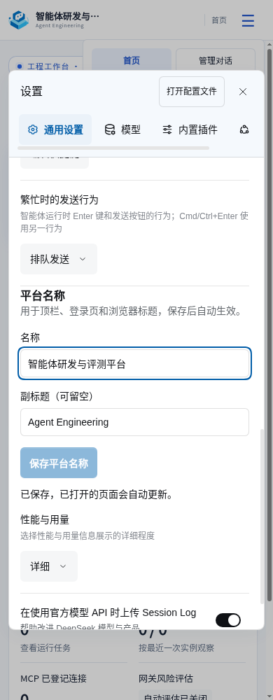
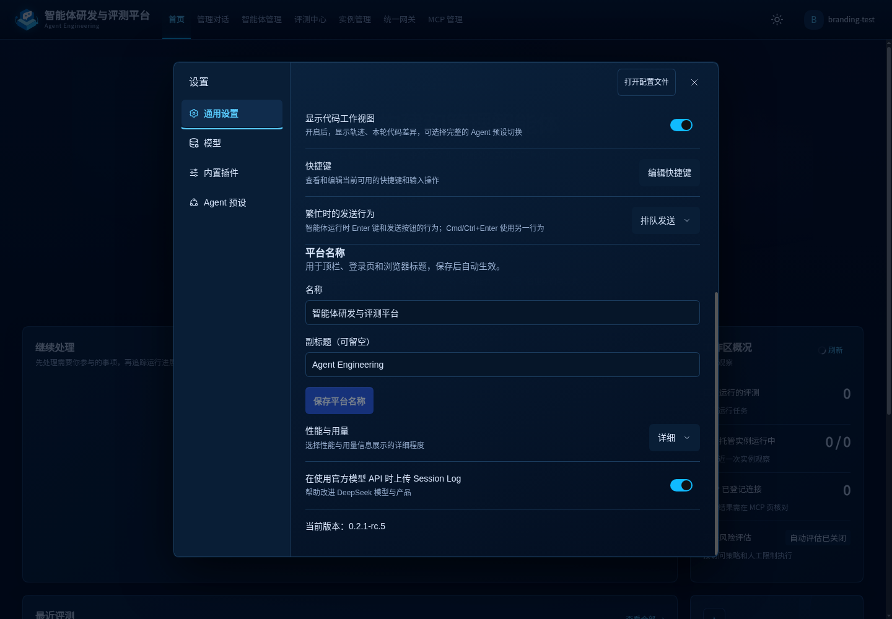
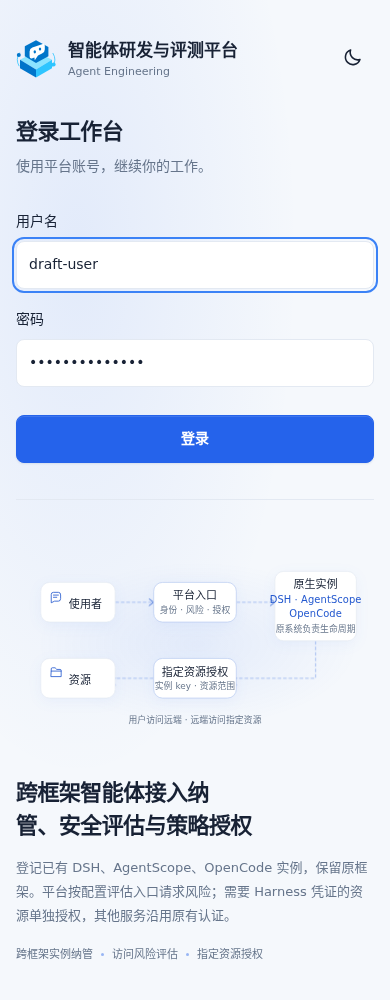

# 平台名称热更新与配置读取恢复核验

日期：2026-11-05。对应 `PA-12`，不提升整条路径、业务 Evaluation 或 Research Release 的结论。当前配置合同见[系统架构与部署设计](../../../../../docs/platform-design/02_系统架构与部署设计.md)。

平台名称通过原生设置保存。最初复用被替换的 `web-runtime` 注册配置，原生配置编辑器会定位到被覆盖的原条目；已改为独立的 `platform-branding` 配置归属，继续复用原生 Patch、通知及版本校验。首次 describe 请求失败时，原生表单仍可能维持 loading；页面现同时读取原生共享 describe 状态，明确显示失败、未装载或上次结果，首次失败可点击“重新读取配置”。未成功读取前禁止编辑和保存。

## 已完成检查

| 范围 | 结果及边界 |
| --- | --- |
| 类型及隔离构建 | `pnpm --dir platform/plugin run check`、插件隔离构建通过；不将构建作为实际装载证据。 |
| 配置、登录页、导航和客户端装配 | 33/33 通过，包括首次读取失败、重试、缺失命名空间、公开名称接口和 CSP。 |
| 工作区引导 | 7/7 通过；引导阶段尚无用户配置，使用共享默认名称。 |
| 启动器 | 45/45 通过。测试临时替换 HOME；本机 PyYAML 位于用户 site-packages，最后一次通过显式 PYTHONPATH 让隔离 HOME 访问既有依赖。先前未设置该环境的失败不作为程序回归结论。 |
| 原生认证集成附加检查 | 未通过：现有测试默认启动 53105，与本机运行中网关冲突。未停止既有网关或改写该测试的网关行为；登录页 HTTP 定向检查及实际密码登录已覆盖本次相关路径。 |
| 原生 DSH 浏览器交互 | 隔离 HOME、数据根和真实 DSH，15 项通过，见 [browser.json](browser.json)。两处认证页面和登录页同步更新，文档时间原点不变、PID 不变，证明保存无需页面刷新或重启；覆盖空名称、空副标题、HTML 按文本显示、长名称、并行编辑冲突、断网保留草稿及明确重试。 |
| 读取失败恢复 | 在真实浏览器拦截首次 settings/describe 请求；失败后不再无限加载，编辑禁用；解除拦截并点击重试后恢复持久配置，未刷新文档。3 项通过，见 [loading-recovery.json](loading-recovery.json)。其失败快照的 buttonDisabled 指首个“重新读取配置”按钮，不是保存按钮。 |
| 视觉与可达性 | 实际浏览器 1440、768、390 宽度无横向溢出；原生设置滚动后输入与保存可达、焦点可见；浅深色及窄屏登录页人工查看通过。设置项不要求全部位于初始可视区，见 [responsive.json](responsive.json) 及截图。 |

## 当前开发环境装载

本机先前的受管更新已装载独立配置插件。新建浏览器标签页完成真实登录，通用设置中的名称与副标题正常读取，见 [current-platform.json](current-platform.json)。旧标签页需刷新一次载入新客户端。

补充错误提示与重试的最后一版客户端已在隔离原生 DSH 验证。随后再次调用 `platform/dsh-deploy update` 时，有其他真实管理会话正在执行，工具返回 busy、activation=none；[activation.json](activation.json) 保留该回执摘要。这部分尚未在当前运行平台装载，不中断或取消他人的任务。未同步远端部署环境或修改业务智能体资产。

## 管理助手参与

真实只读管理会话 `session-5df83cc6-8a67-4786-a1e7-7b13098aad07` 已结束：通过原生文件读取核对共享默认值、设置入口与登录实现，工具回执均无错误。最终回复明确限于源码核对，未声称浏览器业务验证通过；本节不替代上述浏览器证据。未向助手发送凭据或授权其修改资产、部署及 Git。

