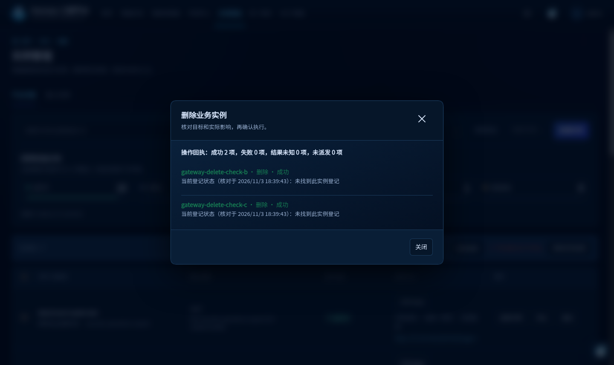
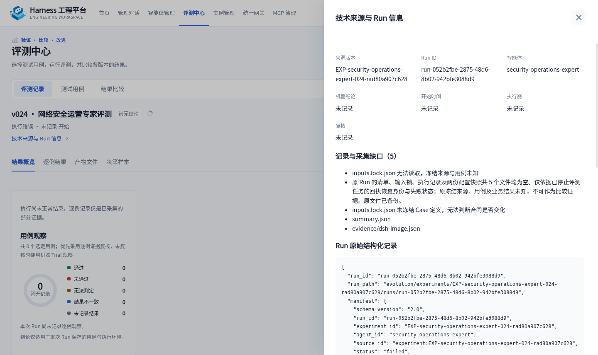
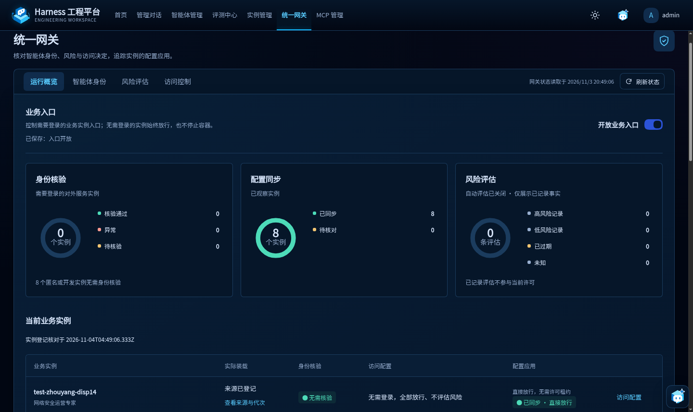
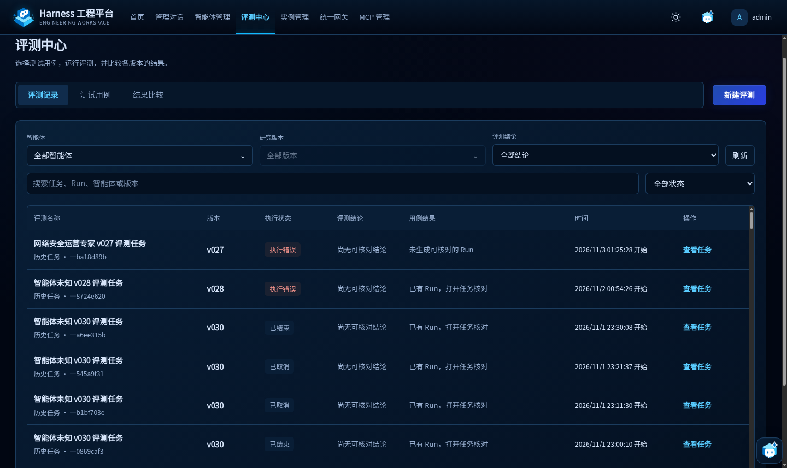

# 评测、实例与删除一致性恢复核验

2026-11-03 在当前开发环境完成，对应 `PA-06/10/12`。观测时间统一使用 UTC，见[脱敏回执](receipts.json)；本地日期为 11 月 3 日。本记录描述本地核验阶段，不提升业务 Evaluation、Research Release 或整体路径状态。后续指定会话的巡检拒绝见[根因排查](inspection-guard-diagnosis.md)。

## 实例删除

实例页面同时派发多项删除，而原实现先调用 DSH 删除容器及实例登记，再尝试独占公共网关配置锁；锁冲突被立即拒绝，产生“实例已由 DSH 删除，但业务网关登记清理未完成”。实例各自的锁无法保护这份共享配置。

共用网关写入现在有界等待锁，仅将 `EEXIST` 视为占用。受控删除先取得锁、重新读取并校验实际来源、准备临时配置，再调用 DSH，最后原子提交网关配置；取消或前置失败不派发删除。DSH 拒绝删除时不提交配置；DSH 已删除而配置提交失败时，恢复原实例登记，保留 HOME 并明确提示重试。创建和重启沿用同一份网关写入实现。

实际新建、停止了三个隔离验收实例，随后全部通过平台删除：一项 RPC 和两项页面批量删除均在人为持锁期间等待，实例登记仍在；释放锁后成功，实例和网关登记均移除，HOME 保留。页面两请求间隔约 0.55 ms，回执为成功 2、失败 0、未知 0，刷新核对通过，无新增浏览器错误。另核对并清理本轮失败留下的五项网关登记，逐项匹配原来源、确认无容器且 HOME 保留；其他配置保持，原配置已作私有备份。八项未能从本轮起始实例清单确定来源的旧登记保留。

## 评测与 Run 读取

原浏览器错误为 `Cannot read properties of undefined (reading 'slice')`，继而出现 `slot entry crashed in 'shell.overlay'`。空 `run.yaml` 被当作有效记录，缺失 `run_id` 进入页面并触发异常，随后显示管理对话。共享 Run 读取已校验目录身份、`run_id` 和状态，坏记录按读取失败反馈，不混入有效列表；共用清单写入改为临时文件加原子替换。

用户指定 EXP024 Run 的清单、输入锁、执行记录及两份配置快照共五个文件为零字节，原件已私有备份。只按已停止评测任务的真实回执恢复 Run 身份和失败状态，并记录恢复说明；未补造冻结来源、Case 或结果。只读详情允许展示输入锁缺失并标明未知，比较仍拒绝缺少冻结合同的 Run。恢复后清单概览读取 105 项、错误 0；实际页面核对记录、用例、比较、正常结果详情、恢复 Run 缺口及与实例页面的往返。该数量为当时快照，其他会话仍在创建记录。

## 异常实例与目标 Session

起始 13 个异常实例的退出时间与 Docker 服务重启相符，未观察到 OOM；原容器没有自动重启策略。已恢复这 13 项，初次恢复和策略更新保留容器、HOME、端口、镜像；主 Web Runtime 的共享 Compose 模板使用 `unless-stopped`，一次性初始化服务保持原行为。没有为验证策略重启 Docker 服务。Docker 服务先前为何重启，当前证据不足。

EXP027 目标 Preset 引用了缺失的 `diagnosis-runtime.mjs`。已通过现有资产构建入口从同 Candidate 的 TypeScript 源码生成制品，定向重启相关业务实例，核对原生 Preset 装载。第一阶段曾复用同 Agent、同 Candidate 的现存确认配置，不生成新凭据；原始 403 与该缺失的因果关系未查实。该配置恢复不表示匿名实例需要签名或确认；后续按下述直接放行原则整改。目标新 Session 实际完成模型回复“实例会话恢复正常”，刷新后回复仍在，连续 30 秒确认接口轮询均为 200，无新增错误；删除修复后的最后只读复核也通过。未将此回复视为完整安全运营业务验收。

后续用户删除旧实例、其他会话创建评测实例，最终清单与起始恢复快照分别记录，未重建已被用户删除的实例，也未接管并行评测实例。

## 第一阶段代码验证与实际生效

六组受影响测试共 419 项通过，其中实例及直接调用方 133 项；覆盖五路并发、锁内来源变化、取消、真实文件错误、DSH 拒绝、配置提交失败后的恢复与重试，以及 Run 缺口和原子写入失败。TypeScript 检查、隔离构建及实际构建通过，具体分组与代码摘要在回执中。

第一阶段通过锁定 DSH 的原生插件热更新装载服务端修复，实际持锁删除验证了新执行顺序；临时增加的热更新监听已移除。平台 PID `838769` 保持，两个原在途管理会话仍显示运行且 Agent 可用。该阶段未改 DSH 源码、重建业务镜像或重启平台；业务实例仅按装载需要定向重启。原始零字节文件为何产生尚未查实，完整业务用例未重跑，以上证据限定为当前平台与工具链恢复。

## 无需登录实例的原则整改与实际重载

是否需要登录决定访问控制是否适用，发布状态不改变匿名共享访问。网关、控制服务、实例 Runtime、MCP 分组调用、实例启动与重启、业务 Guard 及管理页面统一按此条件处理。无需登录的开发和发布实例均跳过身份认证、发布验签、风险评估、访问授权、工具限制、Guard 拦截及额外确认；控制同步不可用、Agent 发布配置未启用或旧人工限制不再阻断匿名请求。实例路由、Session 归属、业务接口参数与上游返回值合同继续用于保证功能正确。

根级协作说明已要求修改上述入口时执行 `test:business-access`，行为测试同时覆盖匿名开发、匿名发布及切回需要登录后恢复控制。此检查在开发交付时执行，不向业务请求增加校验门禁。管理页面只允许选择需要登录的发布实例设置临时限制或辅助重评，匿名实例明确显示直接放行。

经用户明确授权，平台从 PID `838769` 重启为 `1355770`。重启前实际有 4 个运行中的管理会话（提问时为 2 个）；重启前后列表均为 423 项，原在途任务已中断，未自动重放。最后按 Session ID 复核，重启前 423 项均保留，期间另增 2 项。平台 HOME、配置与业务容器保留。目标实例按资产装载需要定向重启；最后一次重启前无运行会话，前后 48 个 Session 均在，包含用户原会话，原 HOME、端口 `18561` 与标准镜像保留，网关和 Session 列表均返回 200。

实际浏览器核对统一网关、临时限制区、目标实例详情与评测中心。8 个当前实例均为匿名开发实例，页面显示直接放行；临时限制区无可选实例，动作按钮禁用。评测列表载入 129 行（含表头），往返页面没有再次跳到管理对话，观察窗口内新增控制台错误为 0。浏览器启用日志时重放的两条更早错误单独保留，不计为本轮新增错误。截图为实际页面，不是 Mock。

初始远端基线上的隔离完整平台回归 1600/1600、Python 实例适配器 152/152 通过；最后一处临时限制界面调整后，再次执行强制入口，平台相关 195 项及 TypeScript 适配器 21 项均通过，类型检查和实际客户端构建通过。数据发布工作树的 Guard 与目录合同 12/12 通过；实际开发 Candidate 的巡检合同 9/9、巡检与诊断目录返回值合同 2/2 通过。各次重叠测试不相加为新的总数。

发布前合入程序远端最新 `main`（`7cbb73cda4eb82506f4de5291928f1efb82f3abf`），最终完整回归为 1615 项、通过 1610 项、失败 5 项，类型检查和构建通过。5 项失败位于 SDK 实例操作和组合执行界面；在不含本次修复的该远端提交独立复跑这两组测试，24 项中同样通过 19 项、失败相同 5 项，确认失败已存在于合入基线。这些文件未被本次修改，未扩展修复其业务逻辑；本次不声称最终全量回归通过。最终合并版本的 `test:business-access` 再次通过平台 195 项和 TypeScript 适配器 21 项。失败用例、基线提交及观测摘要见回执。

用户原始巡检提示已通过实际新 Session 验证：旧 Guard 拒绝消失，巡检目录可读取。过程中发现目录包装器将上游字符串 `code` 改为数字，却保留上游字符串输出 Schema，已修正为原样返回；诊断目录存在同根因，一并整改并通过现有资产编译入口生成制品。另一次模型把 `deviceSelector` 传成字符串，按对象 Schema 被本地参数检查拒绝，不归因为上游或 DSH 故障。随后使用有效 `taskId` 的调用已到达真实上游，但资产范围查询返回 HTTP 500、`INSPECTION_SCOPE_UNAVAILABLE`，受理结果为 `BLOCKED`、`runId: null`，未创建巡检 Run。未修改外部服务，也未将此轮记为全资产巡检通过。

实际开发目录含其他会话尚未发布的巡检实现调整；本次隔离发布不夹带这份整体重写。远端基线中的巡检目录原已保留上游回执，本次增加的同类测试同时约束它和诊断目录；诊断 Runtime 缺失制品、匿名 Guard 与平台原则修复纳入本次发布。各阶段来源摘要、重载及测试边界见[脱敏回执](receipts.json)。完整安全运营 Evaluation、Research Release 与上游服务整改不在本轮完成范围。
